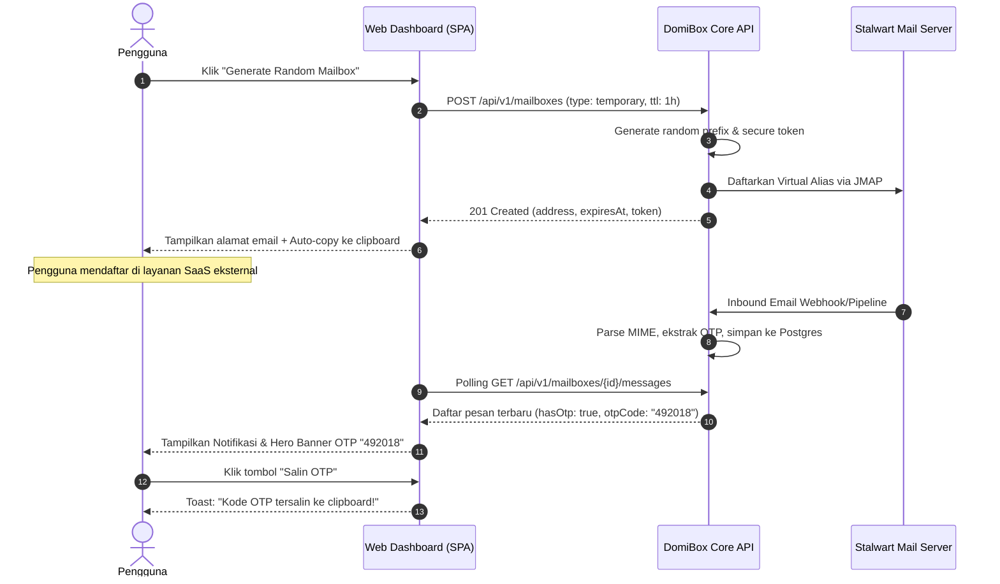

# Spesifikasi Arsitektur Informasi & Interaksi (IA & Interaction Spec) — DomiBox

| Status | Versi | Tanggal | Penulis | Dokumen Terkait |
| --- | --- | --- | --- | --- |
| PROPOSED | 1.0 | 2026-11-15 | omp-orchestrator/UXCore | `docs/00-governance/project-charter.md`<br>`docs/01-product/prd/product-requirements-document.md`<br>`docs/01-product/ux-principles.md`<br>`docs/09-research/ux-pattern-research.md` |

---

## 1. Arsitektur Informasi Web Dashboard (Information Architecture)

Struktur hierarki navigasi Web Dashboard DomiBox mengadopsi model sidebar dua kolom:

```
[DomiBox Dashboard]
│
├── 1. Mailbox Workspace (Tampilan Utama / Inbox)
│   ├── Quick Mailbox Generator (Random / Custom Prefix, Domain Selector, TTL Switch)
│   ├── Active Mailboxes List (Badge TTL, Unread Counter, Action Menu)
│   └── Message Viewer Panel
│       ├── Hero OTP Banner (Ekstraksi 1-klik)
│       ├── Header Metadata (From, To, Date, Subject, SPF/DKIM Badges)
│       └── Safe HTML / Plaintext Tab (Iframe Sandbox, Toggle Gambar)
│
├── 2. Domain Management (Pengaturan Domain)
│   ├── Domain Table (Status Active/Pending/Conflict, Catch-All toggle)
│   ├── Add Domain Modal (DNS Guide: MX & TXT records)
│   └── DNS Verification Trigger & Health Diagnostics
│
├── 3. Permanent Aliases (Alias Tetap)
│   ├── Permanent Mailbox List (Service Label / Notes, Status Toggle)
│   └── Create / Convert to Permanent Form
│
└── 4. System Settings (Pengaturan Platform)
    ├── Telegram Bot Pairing Status (Chat ID allowlist, Re-pair Token)
    ├── Purge Schedule Stats (Jumlah pesan & mailbox terhapus)
    └── Security & Admin Secret Token Management
```

---

## 2. Diagram Alur Interaksi Pengguna (User Interaction Flows)

### 2.1 Alur Pembuatan Alamat & Pengambilan OTP Instan (Web Dashboard)



---

## 3. Matriks State Komponen & Umpan Balik Antarmuka

| Komponen UI | Status Normal / Idle | Status Memuat (Loading) | Status Sukses (Success) | Status Error / Peringatan |
| --- | --- | --- | --- | --- |
| **Quick Generator** | Tombol aktif "Buat Alamat Acak" | Spinner animasi, input dinonaktifkan | Alamat terpilih, ikon centang "Copied!" | Alert merah: "Domain belum aktif / kuota penuh" |
| **Daftar Mailbox** | Kartu mailbox dengan countdown waktu hijau | Skeleton loader abu-abu berdenyut | Badge "Active" berubah sesuai sisa TTL | Badge merah "Expired" atau kuning "Expiring Soon (<5m)" |
| **Hero OTP Banner** | Tersembunyi jika tidak ada kode verifikasi | Skeleton loader saat mengurai pesan | Kotak berlatar hijau terang, font mono tebal, tombol salin | Kotak kuning: "Kode terdeteksi ambigu — verifikasi isi email" |
| **Pratinjau HTML** | Iframe terisolasi, gambar luar diblokir | Spinner "Memproses MIME aman..." | Email ter-render aman tanpa skrip | Banner peringatan: "Pengirim gagal verifikasi SPF/DKIM" |

---

## 4. Spesifikasi Responsif & Batas Resolusi
- **Desktop Layar Lebar ($\ge 1280$ px):** Tiga panel berdampingan (Sidebar navigasi, daftar mailbox & pesan, penampil detail pesan).
- **Tablet ($768 - 1279$ px):** Sidebar dapat dilipat (*collapsible*), tampilan dua panel (daftar dan penampil email).
- **Layar Seluler ($< 768$ px):** Tampilan bertingkat (*stack view*): Pengguna melihat daftar mailbox; mengklik mailbox membuka daftar pesan; mengklik pesan membuka tampilan penuh detail email dengan tombol kembali.
