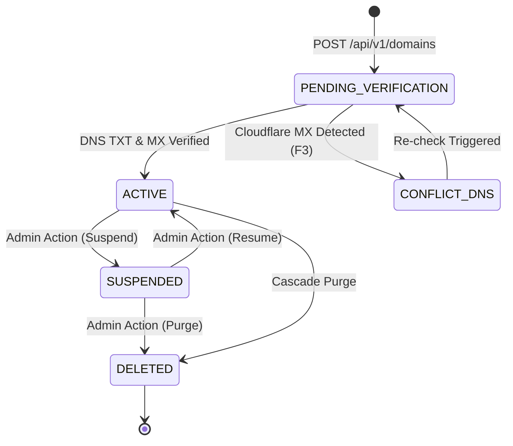

# Spesifikasi Fungsional: Manajemen Domain (Domain Management) — DomiBox

| Status | Versi | Tanggal | Penulis | Dokumen Terkait |
| --- | --- | --- | --- | --- |
| PROPOSED | 1.0 | 2026-11-15 | omp-orchestrator/ReqCore | `docs/00-governance/project-charter.md` `docs/01-product/prd/product-requirements-document.md` `docs/02-requirements/srs.md` `docs/03-architecture/adr/ADR-010.md` |

---

## 1. Ringkasan Modul
Modul Manajemen Domain (`DOM-###`) bertanggung jawab atas siklus hidup pendaftaran domain kustom, pembuatan token verifikasi kepemilikan DNS, validasi record MX dan TXT, pemantauan kesehatan routing DNS, serta penanganan konflik layanan DNS eksternal (termasuk Cloudflare Email Routing `F3`).

---

## 2. Rincian Kebutuhan Fungsional Domain

| ID Kebutuhan | Nama Kebutuhan | Deskripsi Fungsional & Aturan Bisnis | Kriteria Penerimaan (Acceptance Criteria) | Prioritas | Status Bukti |
| :---: | --- | --- | --- | :---: | :---: |
| **DOM-001** | Pendaftaran Domain Kustom | Sistem menyediakan antarmuka bagi admin untuk mendaftarkan domain baru (pilot: `sintaksis.biz.id`). Domain berstatus awal `PENDING_VERIFICATION`. | Format domain divalidasi sesuai RFC 1035. Token verifikasi TXT acak 32 karakter dihasilkan. | **Wajib** | `VERIFIED` |
| **DOM-002** | Verifikasi Rekaman DNS | Sistem melakukan kueri DNS internal untuk memvalidasi keberadaan rekaman TXT kepemilikan dan rekaman MX yang mengarah ke host DomiBox (`mail.sintaksis.biz.id` / IP VPS). | Domain berubah status menjadi `ACTIVE` hanya jika rekaman TXT cocok dan MX mengarah ke host server. | **Wajib** | `VERIFIED` |
| **DOM-003** | Deteksi Konflik Cloudflare Email Routing | Sistem mendeteksi jika rekaman MX domain diarahkan ke `route*.mx.cloudflare.net` (`F3`). | Sistem menandai status `CONFLICT_CLOUDFLARE_ROUTING` dan memberi panduan visual untuk menggunakan subdomain khusus. | **Penting** | `VERIFIED` (`F3`) |
| **DOM-004** | Penonaktifan Domain (*Suspend*) | Administrator dapat mengubah status domain menjadi `SUSPENDED` untuk menolak email masuk sementara tanpa menghapus konfigurasi. | Percobaan koneksi SMTP inbound untuk domain suspended ditolak dengan kode respon SMTP 550. | **Penting** | `PROPOSED` |
| **DOM-005** | Penghapusan Domain (*Safe Delete*) | Penghapusan domain dari sistem hanya diizinkan jika seluruh mailbox aktif pada domain tersebut telah kedaluwarsa atau dihapus. | Sistem menolak penghapusan domain jika masih terdapat mailbox aktif, kecuali admin menyertakan opsi konfirmasi paksa (*cascade force delete*). | **Penting** | `PROPOSED` |

---

## 3. Diagram Alur Status Domain (Domain Lifecycle State Machine)

