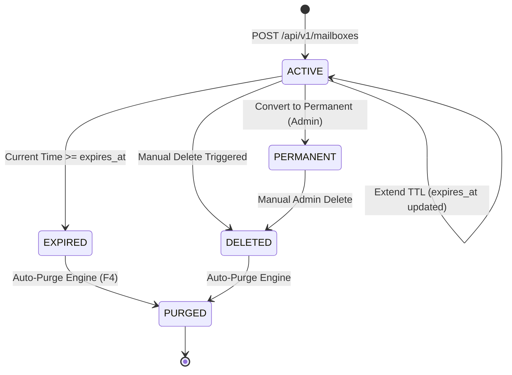

# Spesifikasi Fungsional: Siklus Hidup Mailbox (Mailbox Lifecycle) — DomiBox

| Status | Versi | Tanggal | Penulis | Dokumen Terkait |
| --- | --- | --- | --- | --- |
| PROPOSED | 1.0 | 2026-11-15 | omp-orchestrator/ReqCore | `docs/00-governance/project-charter.md` `docs/01-product/prd/product-requirements-document.md` `docs/02-requirements/srs.md` `docs/03-architecture/adr/ADR-003.md` `docs/03-architecture/adr/ADR-011.md` |

---

## 1. Ringkasan Modul
Modul Siklus Hidup Mailbox (`MBX-###`) mengelola pembuatan alamat email instan (kustom atau acak), pengaturan durasi masa aktif (TTL), perpanjangan waktu, konversi ke alias permanen, isolasi token akses sesi, serta pembersihan data kedaluwarsa secara deterministik tanpa bergantung pada fitur berbayar Stalwart Enterprise (`F2`, `F4`).

---

## 2. Rincian Kebutuhan Fungsional Mailbox

| ID Kebutuhan | Nama Kebutuhan | Deskripsi Fungsional & Aturan Bisnis | Kriteria Penerimaan (Acceptance Criteria) | Prioritas | Status Bukti |
| :---: | --- | --- | --- | :---: | :---: |
| **MBX-001** | Pembuatan Mailbox Sementara | Pengguna dapat membuat alamat email sementara dengan pilihan TTL: 10 menit, 1 jam, 24 jam, atau 7 hari. Sistem menghasilkan token akses rahasia 32 karakter URL-safe. | Alamat email terdaftar di database DomiBox dan terpetakan sebagai virtual alias aktif di Stalwart via JMAP. | **Wajib** | `VERIFIED` |
| **MBX-002** | Perpanjangan Durasi Mailbox | Pengguna dapat menambah masa aktif mailbox sementara sebelum kedaluwarsa (+10m, +1h, +24h) dengan batas akumulasi maksimal 30 hari. | Kolom `expires_at` pada database diperbarui; status tetap `ACTIVE`. | **Wajib** | `PROPOSED` |
| **MBX-003** | Konversi Mailbox Permanen | Administrator dapat mengonversi mailbox sementara menjadi alias permanen (`type: permanent`) dengan menyematkan label catatan layanan. | Kolom `expires_at` disetel menjadi `NULL`; mailbox dikecualikan dari jadwal pembersihan auto-purge. | **Penting** | `PROPOSED` |
| **MBX-004** | Penghapusan Manual Seketika | Pengguna atau admin dapat menghapus mailbox sementara sebelum masa TTL habis. | Status berubah menjadi `DELETED`; alias JMAP di Stalwart dihapus; email baru ditolak dengan SMTP 550. | **Wajib** | `VERIFIED` |
| **MBX-005** | Eksekusi Auto-Purge Otomatis | Scheduler internal memeriksa berkala (setiap 60 detik) dan membersihkan data pesan serta alias dari mailbox yang telah melampaui `expires_at` + grace period (`F4`). | Rekaman JMAP dihapus; baris database ditandai `PURGED`; berkas blob dihapus dari disk. | **Wajib** | `VERIFIED` (`F4`) |

---

## 3. Diagram Status Siklus Hidup Mailbox

