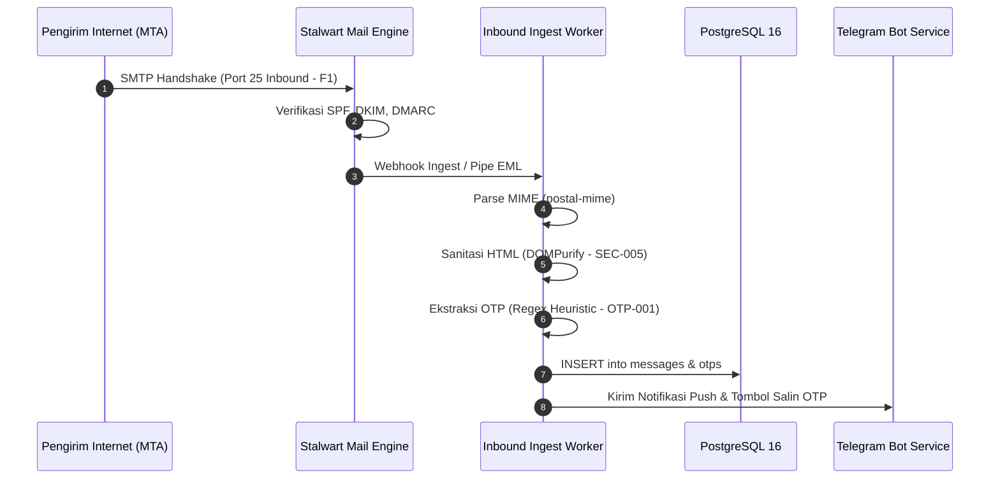

# Spesifikasi Fungsional: Manajemen Pesan & Kotak Masuk (Inbox Management) — DomiBox

| Status | Versi | Tanggal | Penulis | Dokumen Terkait |
| --- | --- | --- | --- | --- |
| PROPOSED | 1.0 | 2026-11-15 | omp-orchestrator/ReqCore | `docs/00-governance/project-charter.md` `docs/01-product/prd/product-requirements-document.md` `docs/02-requirements/srs.md` `docs/03-architecture/adr/ADR-004.md` `docs/05-security/threat-model.md` |

---

## 1. Ringkasan Modul
Modul Manajemen Kotak Masuk (`INB-###`) menangani penerimaan pesan email masuk (*inbound SMTP*), penguraian struktur MIME RFC 5322, pemisahan header/plaintext/HTML, sanitasi keamanan muatan XSS (`SEC-005`), isolasi lampiran berkas (`SEC-012`), serta penyajian daftar pesan secara terurut kronologis terbalik.

---

## 2. Rincian Kebutuhan Fungsional Kotak Masuk

| ID Kebutuhan | Nama Kebutuhan | Deskripsi Fungsional & Aturan Bisnis | Kriteria Penerimaan (Acceptance Criteria) | Prioritas | Status Bukti |
| :---: | --- | --- | --- | :---: | :---: |
| **INB-001** | Penerimaan & Parsing Pesan Masuk | Sistem menerima webhook/pipeline email dari Stalwart, mengurai MIME via `postal-mime`, dan mengekstrak From, To, Subject, Date, Plaintext, dan HTML. | Pesan tersimpan di database dalam waktu $\le 3$ detik sejak koneksi SMTP selesai (`NFR-004`). | **Wajib** | `VERIFIED` |
| **INB-002** | Sanitasi HTML & Isolasi XSS | Seluruh badan HTML dibersihkan menggunakan DOMPurify (menghilangkan tag skrip dan handler event berbahaya) sebelum disimpan atau ditampilkan. | Muatan uji coba XSS (seperti ``) dinetralisir 100% (`SEC-005`). | **Wajib** | `VERIFIED` |
| **INB-003** | Penonaktifan Pelacak Gambar Bawaan | Gambar eksternal diblokir secara default; disajikan tombol pengguna untuk memuat gambar manual jika disetujui. | Permintaan HTTP ke server pihak ketiga dicegah saat pesan pertama kali dibuka. | **Wajib** | `VERIFIED` |
| **INB-004** | Pengambilan Daftar Pesan | Pengguna dapat mengambil daftar pesan untuk mailbox tertentu dengan otentikasi token akses `X-Mailbox-Token`. | Kueri mengembalikan metadata ringkas (id, from, subject, receivedAt, hasOtp, isRead) terurut dari yang terbaru. | **Wajib** | `VERIFIED` |
| **INB-005** | Penanganan Lampiran Aman | Lampiran email disimpan secara terpisah dan hanya dapat diunduh dengan header HTTP `Content-Disposition: attachment`. Ekstensi berbahaya (`.exe`, `.bat`) diblokir. | Berkas lampiran tidak dapat dieksekusi langsung di peramban web (`SEC-012`). | **Penting** | `PROPOSED` |

---

## 3. Diagram Alur Pemrosesan Email Masuk (Inbound Ingestion Pipeline)

