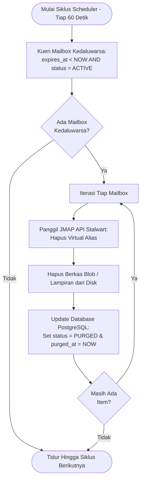

# Spesifikasi Fungsional: Administrasi & Operasional Sistem (Admin & Ops) — DomiBox

| Status | Versi | Tanggal | Penulis | Dokumen Terkait |
| --- | --- | --- | --- | --- |
| PROPOSED | 1.0 | 2026-11-15 | omp-orchestrator/ReqCore | `docs/00-governance/project-charter.md` `docs/01-product/prd/product-requirements-document.md` `docs/02-requirements/srs.md` `docs/03-architecture/adr/ADR-001.md` `docs/03-architecture/adr/ADR-011.md` |

---

## 1. Ringkasan Modul
Modul Administrasi & Operasional Sistem (`OPS-###`) mengatur kebijakan keamanan administratif pemilik tunggal, manajemen konfigurasi lingkungan (*environment configuration*), daemon scheduler pembersihan otomatis (*auto-purge worker* `F4`), metrik pemantauan kesehatan layanan (*health check*), dan mitigasi penyalahgunaan sumber daya VPS.

---

## 2. Rincian Kebutuhan Fungsional Administrasi & Operasional

| ID Kebutuhan | Nama Kebutuhan | Deskripsi Fungsional & Aturan Bisnis | Kriteria Penerimaan (Acceptance Criteria) | Prioritas | Status Bukti |
| :---: | --- | --- | --- | :---: | :---: |
| **OPS-001** | Autentikasi Master Admin | Akses ke rute administratif (manajemen domain, konversi permanen, pengaturan bot) wajib menyertakan Master Admin Secret Token melalui header `Authorization: Bearer <TOKEN>`. | Percobaan tanpa token ditolak dengan status HTTP 401 Unauthorized (`SEC-002`). | **Wajib** | `VERIFIED` |
| **OPS-002** | Scheduler Pembersihan Otomatis (*Auto-Purge*) | Engine scheduler internal berjalan setiap 60 detik untuk memeriksa mailbox kedaluwarsa (`expires_at < NOW()`) dan menghapus data pesan serta alias JMAP terkait (`F4`). | Pembersihan selesai dalam waktu $\le 2$ detik per siklus tanpa mengunci tabel database (`NFR-008`). | **Wajib** | `VERIFIED` (`F4`) |
| **OPS-003** | Pemeriksaan Kesehatan Layanan (*Health Checks*) | Endpoint `GET /health` dan `GET /health/ready` menyajikan status operasional koneksi database PostgreSQL, mail engine Stalwart, dan penggunaan disk host. | Mengembalikan status HTTP 200 dengan payload JSON diagnostik jika semua komponen sehat. | **Wajib** | `VERIFIED` |
| **OPS-004** | Pembatasan Laju Permintaan (*API Rate Limiting*) | Sistem menerapkan pembatasan laju panggilan REST API publik maksimal 100 permintaan per menit per alamat IP (`SEC-009`). | Permintaan yang melebihi batas menerima respon HTTP 429 Too Many Requests beserta header `Retry-After`. | **Penting** | `PROPOSED` |
| **OPS-005** | Audit Trail Pencatatan Aktivitas | Setiap aksi administratif (penambahan/penghapusan domain, penonaktifan mailbox, konversi permanen) dicatat dalam tabel `audit_logs`. | Log mencakup timestamp ISO-8601, tipe entitas, ID aksi, alamat IP pemanggil, dan status keberhasilan. | **Penting** | `VERIFIED` |

---

## 3. Diagram Alur Scheduler Pembersihan Otomatis (Purge Worker Cycle)

