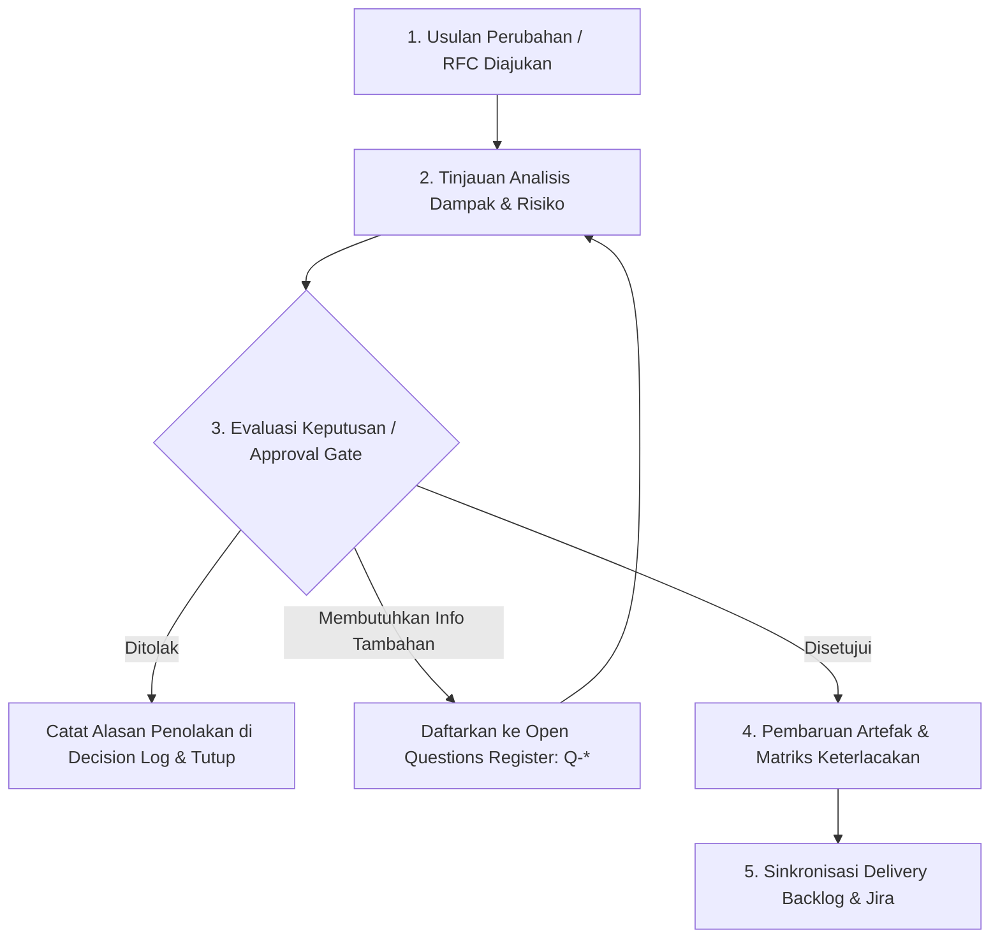

# Scope & Change Control Procedure - DomiBox Platform

| Status | Versi | Tanggal | Penulis | Dokumen Terkait |
| --- | --- | --- | --- | --- |
| PROPOSED | 0.1 | 2026-11-15 | omp-orchestrator/ReqCore | `docs/00-governance/project-charter.md` `docs/00-governance/documentation-standards.md` `docs/00-governance/revision-and-approval-policy.md` `docs/00-governance/decision-log.md` `docs/00-governance/open-questions.md` `docs/01-product/mvp-scope.md` `docs/01-product/prd/product-requirements-document.md` `docs/02-requirements/traceability/traceability-matrix.md` |

---

## 1. Pendahuluan & Prinsip Pengendalian Perubahan (Introduction & Principles)

### 1.1 Tujuan Prosedur (Purpose)
Dokumen ini menetapkan mekanisme formal tata kelola batas cakupan (*Scope Baseline*) dan prosedur pengendalian perubahan (*Change Control Procedure*) untuk platform **DomiBox**. Prosedur ini dirancang untuk mencegah pergeseran cakupan yang tidak terkendali (*scope creep*), menjaga konsistensi keterlacakan seluruh artefak dari sasaran piagam hingga kode pengujian, serta menghubungkan proses rekayasa kebutuhan dengan kebijakan revisi proyek (`docs/00-governance/revision-and-approval-policy.md`).

### 1.2 Prinsip Inti Tata Kelola Perubahan
1. **Integritas Garis Dasar (Baseline Integrity):** Garis dasar cakupan MVP yang telah disepakati tidak boleh diubah secara sepihak tanpa evaluasi dampak formal.
2. **Keterlacakan Penuh (End-to-End Traceability):** Setiap perubahan kebutuhan wajib memperbarui rantai keterlacakan kanonikal pada `docs/02-requirements/traceability/traceability-matrix.md`.
3. **Larangan Penggunaan Ulang ID (No ID Reuse):** Jika sebuah kebutuhan, kasus uji, atau keputusan dihapus atau dibatalkan, nomor ID kanonikalnya dipensiunkan (*deprecated/superseded*) dan tidak boleh digunakan ulang untuk konsep lain.
4. **Kejujuran Bukti (Truthfulness in Evidence):** Status kebutuhan hanya dapat ditingkatkan menjadi `VERIFIED` atau `APPROVED` jika bukti nyata (hasil uji coba, URL referensi terverifikasi, atau keputusan owner formal) telah terbukti.

---

## 2. Garis Dasar Cakupan Proyek (Project Scope Baseline)

Berdasarkan Piagam Proyek (`docs/00-governance/project-charter.md`), PRD (`docs/01-product/prd/product-requirements-document.md`), dan Batasan MVP (`docs/01-product/mvp-scope.md`), cakupan sistem dibagi menjadi dua domain tegas:

### 2.1 Cakupan Dalam Garis Dasar MVP (*In-Scope MVP Baseline*)
| Modul / Domain | Fitur & Kapabilitas Inti | ID Kebutuhan Terkait | Status Garis Dasar |
| --- | --- | --- | :---: |
| **Domain Management** | Pendaftaran domain kustom pribadi, verifikasi kepemilikan via DNS TXT, pemantauan rekaman MX, deteksi konflik Cloudflare Email Routing. | `FR-001` (`DOM-001`, `DOM-002`, `DOM-003`) | **TERKUNCI (BASELINE)** |
| **Mailbox Lifecycle** | Pembuatan alamat sementara berbasis durasi TTL (10m, 1j, 24j), perpanjangan waktu, token otentikasi privat acak, mailbox permanen admin single-owner terbatas, penghapusan instan. | `FR-002` (`MBX-001`, `MBX-002`, `MBX-004`), `FR-003` (`MBX-003`) | **TERKUNCI (BASELINE)** |
| **Inbound Processing** | Penerimaan koneksi SMTP masuk Port 25, validasi penerima pada fase RCPT TO, pembedahan MIME, evaluasi otentikasi SPF/DKIM/DMARC. | `FR-004` (`INB-001`, `INB-002`, `INB-003`) | **TERKUNCI (BASELINE)** |
| **OTP & Content Extraction** | Ekstraksi heuristik kode verifikasi numerik/alfanumerik, deteksi magic activation link, penyajian tombol salin cepat. | `FR-005` (`OTP-001`, `OTP-002`) | **TERKUNCI (BASELINE)** |
| **Telegram Bot Channel** | Penautan akun admin via kode pairing sekali pakai, penerimaan notifikasi pesan masuk instan, tombol aksi inline salin OTP, perintah buat mailbox kilat. | `FR-006` (`BOT-001`, `BOT-002`, `BOT-003`) | **TERKUNCI (BASELINE)** |
| **Web Dashboard** | Antarmuka inbox responsif (SPA), live countdown timer, penampil pesan HTML terisolasi dalam sandboxed iframe, panel admin domain dan kuota. | `FR-007` (`WEB-001`, `WEB-002`, `WEB-003`) | **TERKUNCI (BASELINE)** |
| **Operations & Purge** | Scheduler pembersihan otomatis data kedaluwarsa setiap 60 detik, pencatatan log audit mutasi sistem append-only. | `FR-008` (`OPS-001`, `OPS-002`) | **TERKUNCI (BASELINE)** |

### 2.2 Di Luar Cakupan MVP (*Explicit Out-of-Scope / Fase 2*)
1. **Pengiriman Email Keluar (Outbound SMTP):** Penyerahan email keluar ke MTA eksternal ditunda ke Fase 2 karena pemblokiran bawaan port 25 keluar oleh penyedia hosting (`F1` / `RISK-007`).
2. **Sistem Multi-Penyewa Publik (Public Multi-Tenancy):** Pendaftaran akun publik bebas, isolasi tenant komersial, dan manajemen tim organisasi.
3. **Monetisasi & Billing:** Gateway pembayaran, integrasi langganan (Stripe, Midtrans), penagihan otomatis, dan kuota berbayar.
4. **Aplikasi Seluler Native:** Pembangunan aplikasi iOS / Android native (antarmuka mobile diakomodasi via Web Responsif dan Telegram Bot).

---

## 3. Alur Kerja Permintaan Perubahan (Change Request Workflow)

Setiap usulan penambahan, modifikasi, atau penghapusan kebutuhan terhadap garis dasar yang telah ditetapkan wajib mengikuti siklus 5 tahap berikut:

### Tahap 1: Pengajuan Usulan Perubahan (*Change Request Submission*)
Inisiator menyusun dokumen ringkas Permintaan Perubahan (*Request for Change* / RFC) yang memuat:
- Deskripsi perubahan yang diusulkan.
- Alasan bisnis / pemicu teknis perubahan.
- Dokumen dan ID kebutuhan yang berpotensi terdampak.

### Tahap 2: Analisis Dampak (*Impact Assessment*)
Tim rekayasa (Lead Requirements, Arsitek, QA, dan DevOps) melakukan evaluasi komprehensif terhadap:
- **Dampak Arsitektur & Performa:** Apakah perubahan membutuhkan modifikasi skema database atau menambah beban memori/CPU VPS yang melebihi batas toleransi (`NFR-009` $\le 600$ MB).
- **Dampak Keamanan:** Apakah perubahan membuka celah permukaan serangan baru (menambah ancaman pada `SEC-*`).
- **Dampak Jadwal & Delivery:** Berapa estimasi *story points* tambahan dan apakah mempengaruhi jadwal rilis MVP.

### Tahap 3: Keputusan Tata Kelola (*Governance Approval Gate*)
Keputusan diambil oleh Project Sponsor / Lead Orchestrator:
- **`APPROVED`:** Usulan diterima; dicatat dalam `docs/00-governance/decision-log.md` (`DEC-*`).
- **`REJECTED`:** Usulan ditolak; alasan penolakan dicatat dalam log keputusan tanpa mengubah baseline.
- **`DEFERRED`:** Ditunda ke rilis Fase 2 / Pasca-MVP.
- **`NEEDS OWNER DECISION`:** Masih terdapat ketidakpastian tinggi; dicatat dalam `docs/00-governance/open-questions.md` (`Q-*`).

### Tahap 4: Pembaruan Artefak Rekayasa (*Artifact Mutation & RTM Update*)
Sesuai `docs/00-governance/revision-and-approval-policy.md`:
1. Dokumen spesifikasi terdampak (PRD, SRS, NFR, SEC) dimutakhirkan dengan menaikkan nomor revisi dokumen (misal: v0.1 $\rightarrow$ v0.2).
2. RTM kanonikal (`docs/02-requirements/traceability/traceability-matrix.md`) wajib diselaraskan:
   - Kebutuhan baru ditambahkan dengan ID kanonikal berikutnya.
   - Kebutuhan yang dibatalkan ditandai statusnya menjadi `DEPRECATED` atau `SUPERSEDED` (tidak dihapus dari riwayat baris).

### Tahap 5: Sinkronisasi Backlog Delivery (*Delivery Alignment*)
Perubahan yang disetujui diteruskan ke tim pengiriman (*Phase 8 Delivery*) untuk memperbarui daftar *Epic*, *User Stories*, atau *Spike Tasks* di Jira (`DBX-*`) dan file `docs/08-delivery/jira-sync-map.json`.

---

## 4. Matriks Wewenang Persetujuan Perubahan (Change Authority Matrix)

| Tingkat Dampak Perubahan | Kriteria Klasifikasi | Pihak Peninjau (Reviewer) | Pihak Pengesah (Approver) | Mekanisme Pencatatan |
| --- | --- | --- | --- | --- |
| **Mayor (Tier 1)** | Perubahan visi produk, penambahan modul di luar MVP, perubahan arsitektur fundamental (misal: ganti mail engine Stalwart, pembukaan pendaftaran publik). | Requirements Lead, Architecture Lead, Security Lead | Project Sponsor / Owner (`STK-001`) | Wajib entri `DEC-*` baru di `decision-log.md` + Update PRD/Scope Baseline. |
| **Moderat (Tier 2)** | Penambahan endpoint API baru, penyesuaian parameter NFR/SLA, perubahan skema database minor tanpa mengubah arsitektur inti. | Requirements Lead, Tech Lead | Lead Orchestrator | Entri `DEC-*` atau catatan rilis revisi dokumen (v0.x). |
| **Minor (Tier 3)** | Klarifikasi redaksional dokumen, perbaikan tautan relatif rusak, koreksi tipografi, penambahan detail acceptance criteria. | Penulis Dokumen / Reviewer Sesi | Reviewer Sesi | Update riwayat revisi (*Document Revision History*) pada header dokumen terkait. |

---

## 5. Hubungan dengan Kebijakan Tata Kelola Proyek (Governance Linkage)

Prosedur pengendalian perubahan ini secara ketat terhubung dengan:
- `docs/00-governance/revision-and-approval-policy.md`: Menentukan aturan transisi status (`PROPOSED` $\rightarrow$ `APPROVED` $\rightarrow$ `SUPERSEDED`).
- `docs/00-governance/decision-log.md`: Tempat pencatatan resmi seluruh keputusan persetujuan/penolakan Tier 1 dan Tier 2 (`DEC-*`).
- `docs/00-governance/open-questions.md`: Tempat pencatatan pertanyaan terbuka yang timbul selama evaluasi perubahan (`Q-*`).
- `docs/00-governance/documentation-standards.md`: Memastikan konvensi format metadata dan penandaan status bukti tetap dipatuhi saat perubahan dilakukan.
