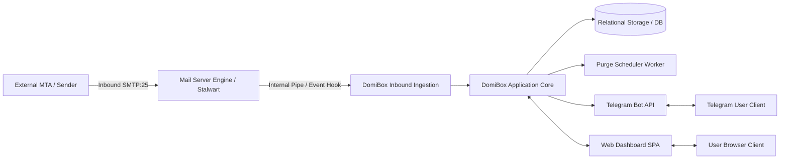

# Software Requirements Specification (SRS) - DomiBox Platform

| Status | Versi | Tanggal | Penulis | Dokumen Terkait |
| --- | --- | --- | --- | --- |
| PROPOSED | 0.1 | 2026-11-15 | omp-orchestrator/ReqCore | `docs/00-governance/project-charter.md` `docs/00-governance/documentation-standards.md` `docs/00-governance/open-questions.md` `docs/01-product/prd/product-requirements-document.md` `docs/01-product/mvp-scope.md` `docs/02-requirements/brd.md` `docs/02-requirements/traceability/traceability-matrix.md` |

---

## 1. Pendahuluan (Introduction)

### 1.1 Tujuan Dokumen (Purpose)
Dokumen Spesifikasi Kebutuhan Perangkat Lunak (*Software Requirements Specification* / SRS) ini merinci persyaratan fungsional, karakteristik antarmuka, model perilaku sistem, dan aturan bisnis perangkat lunak untuk platform **DomiBox**. Spesifikasi ini menjadi acuan utama bagi tim arsitektur teknis (*Phase 4 Architecture & ADR*), pengembang spesifikasi teknis (*Phase 5 Technical*), tim keamanan (*Phase 6 Security*), dan tim jaminan kualitas (*Phase 6 Quality*).

### 1.2 Cakupan Perangkat Lunak (Product Scope)
DomiBox adalah sistem manajemen email multi-domain mandiri (*self-hosted*) yang berjalan dalam kontainer Docker pada VPS Linux (pilot: `vps-tencent3b`, Ubuntu 24.04.5 LTS, 2 vCPU, 3.6 GiB RAM). Perangkat lunak mencakup:
- Sub-sistem manajemen domain dan validasi rekaman DNS (MX/TXT).
- Sub-sistem siklus hidup mailbox sementara (*temporary disposable mailbox*) dan permanen (*persistent mailbox/alias*).
- Sub-sistem pemrosesan email masuk (*inbound SMTP processing* dan MIME parser).
- Sub-sistem analisis konten dan ekstraksi instan kode OTP / tautan verifikasi.
- Antarmuka pengguna multi-kanal: Web Application Dashboard (SPA) dan Bot Telegram.
- Sub-sistem penjadwal latar belakang (*background scheduler*) untuk pembersihan data otomatis (*auto-purge*).

Sesuai resolusi usulan `Q-003` dan `mvp-scope.md`, fungsi pengiriman email keluar (*outbound SMTP submission*), sistem pembayaran (*billing*), dan pendaftaran multi-penyewa publik (*public multi-tenancy*) secara tegas dinyatakan di luar cakupan (*Out-of-Scope*) versi ini.

---

## 2. Deskripsi Keseluruhan Sistem (Overall System Description)

### 2.1 Perspektif Produk & Konteks Antarmuka
Sistem DomiBox beroperasi sebagai satu kesatuan arsitektur monolit modular (*modular monolith*) berbasis kontainer yang berinteraksi dengan:
1. **Server Email Pengirim Eksternal:** Mengirimkan email ke DomiBox melalui protokol SMTP (Port 25) terpandu rekaman DNS MX domain kustom.
2. **DNS Server Penyedia Domain (Cloudflare / Authoritative DNS):** Menyediakan rekaman DNS MX, TXT, dan A untuk domain pengguna (contoh pilot: `sintaksis.biz.id`).
3. **Telegram Bot API:** Menyediakan saluran notifikasi push instan dan perintah operasional cepat pengguna.
4. **Peramban Web Pengguna:** Antarmuka SPA untuk pengelolaan domain, mailbox, dan peninjauan pesan email.

### 2.2 Karakteristik & Peran Pengguna (User Characteristics)
- **Single Owner / Administrator (`USR-ADMIN`):** Memiliki hak penuh mengelola domain, membuat mailbox sementara & permanen, melihat audit log, dan mengonfigurasi integrasi bot.
- **Session Guest / Temporary User (`USR-TEMP`):** Mengakses mailbox sementara tertentu menggunakan token sesi unik tanpa hak administratif domain atau mailbox lain.
- **Telegram Chat User (`USR-TG`):** Pengguna terautentikasi melalui alur *pairing* satu kali dengan token admin untuk menerima notifikasi pesan masuk dan melakukan aksi cepat.

---

## 3. Kebutuhan Fungsional Rinci (Functional Requirements — `FR-*`)

Sesuai konvensi penomoran kanonikal proyek, kebutuhan dikelompokkan ke dalam modul: `DOM-` (Domain), `MBX-` (Mailbox), `INB-` (Inbound), `OTP-` (OTP/Extraction), `BOT-` (Telegram Bot), `WEB-` (Web UI), dan `OPS-` (Operations/Scheduler).

### 3.1 Modul Manajemen Domain (`DOM-`)

| ID Kebutuhan | Kebutuhan Fungsional & Spesifikasi Perilaku | Prioritas | Induk BR | Kriteria Penerimaan Ringkas (Acceptance Criteria) | Status Bukti |
| --- | --- | :---: | :---: | --- | :---: |
| **FR-001** / `DOM-001` | **Pendaftaran Domain Kustom:** Admin mendaftarkan domain baru (pilot `sintaksis.biz.id`); status awal `PENDING_VERIFICATION`; token verifikasi TXT 32 karakter dihasilkan. | **Wajib** | `BR-001` | Format domain valid RFC 1035; token TXT 32 karakter terbit. | `VERIFIED` |
| **FR-001.1** / `DOM-002` | **Verifikasi Rekaman DNS:** Kueri DNS internal validasi TXT kepemilikan + MX ke host DomiBox; status menjadi `ACTIVE` hanya jika keduanya cocok. | **Wajib** | `BR-001` | Domain `ACTIVE` iff TXT cocok & MX mengarah ke host server. | `VERIFIED` |
| **FR-001.2** / `DOM-003` | **Deteksi Konflik Cloudflare Email Routing (`F3`):** Deteksi MX mengarah ke `route*.mx.cloudflare.net`; tandai `CONFLICT_CLOUDFLARE_ROUTING` dan pandu subdomain. | **Penting** | `BR-001` | Kueri mendeteksi host `mx.cloudflare.net`; aktivasi langsung ditahan. | `VERIFIED` (`F3`) |
| `DOM-004` | **Penonaktifan Domain (*Suspend*):** Admin mengubah status domain menjadi `SUSPENDED`; email masuk baru ditolak. | **Penting** | `BR-001` | Koneksi SMTP inbound untuk domain suspended ditolak dengan kode 550. | `PROPOSED` |
| `DOM-005` | **Penghapusan Domain (*Safe Delete*):** Hapus domain hanya jika seluruh mailbox aktif telah kedaluwarsa/dihapus (cascade force delete opsional). | **Penting** | `BR-001` | Sistem menolak penghapusan jika masih ada mailbox aktif. | `PROPOSED` |

### 3.2 Modul Siklus Hidup Mailbox (`MBX-`)

| ID Kebutuhan | Kebutuhan Fungsional & Spesifikasi Perilaku | Prioritas | Induk BR | Kriteria Penerimaan Ringkas (Acceptance Criteria) | Status Bukti |
| --- | --- | :---: | :---: | --- | :---: |
| **FR-002** / `MBX-001` | **Pembuatan Mailbox Sementara:** Alamat email sementara dengan TTL 10m/1h/24h/7d; token akses rahasia 32 karakter URL-safe. | **Wajib** | `BR-001` | Alamat terdaftar di DB dan terpetakan sebagai virtual alias aktif di Stalwart via JMAP. | `VERIFIED` |
| **FR-002.1** / `MBX-002` | **Perpanjangan Durasi Mailbox:** Tambah masa aktif sebelum kedaluwarsa (+10m/+1h/+24h), akumulasi maks 30 hari. | **Wajib** | `BR-001` | Kolom `expires_at` diperbarui; status tetap `ACTIVE`. | `PROPOSED` |
| **FR-003** / `MBX-003` | **Konversi Mailbox Permanen:** Admin mengonversi mailbox sementara menjadi alias permanen (`type: permanent`) dengan label catatan. | **Penting** | `BR-001` | `expires_at` = `NULL`; mailbox dikecualikan dari auto-purge. | `PROPOSED` |
| `MBX-004` | **Penghapusan Manual Seketika:** Hapus mailbox sementara sebelum TTL habis. | **Wajib** | `BR-001` | Status `DELETED`; alias JMAP dihapus; email baru ditolak dengan SMTP 550. | `VERIFIED` |
| `MBX-005` | **Eksekusi Auto-Purge Otomatis (`F4`):** Scheduler tiap 60 detik membersihkan mailbox kedaluwarsa + grace period. | **Wajib** | `BR-004` | Rekaman JMAP dihapus; baris DB `PURGED`; blob dihapus dari disk. | `VERIFIED` (`F4`) |

### 3.3 Modul Pemrosesan Email Masuk (`INB-`)

| ID Kebutuhan | Kebutuhan Fungsional & Spesifikasi Perilaku | Prioritas | Induk BR | Kriteria Penerimaan Ringkas (Acceptance Criteria) | Status Bukti |
| --- | --- | :---: | :---: | --- | :---: |
| **FR-004** / `INB-001` | **Penerimaan & Parsing Pesan Masuk:** Webhook/pipeline dari Stalwart; parse MIME via `postal-mime`; ekstrak From, To, Subject, Date, Plaintext, HTML. | **Wajib** | `BR-002` | Pesan tersimpan di DB dalam waktu ≤ 3 detik sejak koneksi SMTP selesai (`NFR-004`). | `VERIFIED` |
| `INB-002` | **Sanitasi HTML & Isolasi XSS (`SEC-005`):** Badan HTML dibersihkan via DOMPurify sebelum disimpan/ditampilkan. | **Wajib** | `BR-004` | Muatan XSS dinetralisir 100%. | `VERIFIED` |
| `INB-003` | **Penonaktifan Pelacak Gambar Bawaan:** Gambar eksternal diblokir default; tombol muat manual. | **Wajib** | `BR-004` | Permintaan HTTP ke server pihak ketiga dicegah saat pesan pertama kali dibuka. | `VERIFIED` |
| `INB-004` | **Pengambilan Daftar Pesan:** Daftar pesan per mailbox dengan otentikasi `X-Mailbox-Token`. | **Wajib** | `BR-001` | Kueri mengembalikan metadata ringkas terurut dari yang terbaru. | `VERIFIED` |
| `INB-005` | **Penanganan Lampiran Aman (`SEC-012`):** Lampiran disimpan terpisah; hanya unduh via `Content-Disposition: attachment`; ekstensi berbahaya diblokir. | **Penting** | `BR-004` | Berkas lampiran tidak dapat dieksekusi langsung di peramban. | `PROPOSED` |

### 3.4 Modul Pusat Ekstraksi OTP (`OTP-`)

| ID Kebutuhan | Kebutuhan Fungsional & Spesifikasi Perilaku | Prioritas | Induk BR | Kriteria Penerimaan Ringkas (Acceptance Criteria) | Status Bukti |
| --- | --- | :---: | :---: | --- | :---: |
| **FR-005** / `OTP-001` | **Deteksi & Ekstraksi Kode OTP Numerik:** Pola angka 4–8 digit berdekatan kata kunci verifikasi. | **Wajib** | `BR-002` | Kode numerik diekstraksi dan disimpan pada kolom `otp_code`. | `VERIFIED` |
| `OTP-002` | **Deteksi Kode Alfanumerik:** Ekstrak kode alfanumerik (mis. `AB-1234`) terikat kata kunci otentikasi. | **Penting** | `BR-002` | Format alfanumerik dikenali tanpa salah deteksi hash/ID transaksi. | `PROPOSED` |
| `OTP-003` | **Identifikasi Tautan Verifikasi (*Magic Link*):** Ekstrak URL konfirmasi aktivasi akun. | **Penting** | `BR-002` | URL tersimpan pada kolom `magic_link` dan disajikan sebagai tombol navigasi. | `PROPOSED` |
| `OTP-004` | **Penanganan Ambiguitas & Kode Ganda:** Skor pembobotan berbasis kedekatan kata kunci; kandidat tertinggi disajikan utama. | **Penting** | `BR-002` | Kandidat dengan skor heuristik tertinggi disajikan sebagai kode utama. | `PROPOSED` |
| `OTP-005` | **Penyajian Responsif & Tombol Salin 1-Klik:** Kode OTP disajikan pada banner atas penampil pesan (Web) dan tombol inline Telegram. | **Wajib** | `BR-003` | Mengklik tombol langsung menyalin kode ke clipboard. | `VERIFIED` |

### 3.5 Modul Bot Telegram (`BOT-`)

| ID Kebutuhan | Kebutuhan Fungsional & Spesifikasi Perilaku | Prioritas | Induk BR | Kriteria Penerimaan Ringkas (Acceptance Criteria) | Status Bukti |
| --- | --- | :---: | :---: | --- | :---: |
| **FR-006** / `BOT-001` | **Autentikasi & Allowlist Chat ID:** Bot hanya merespons perintah dari Chat ID yang telah dipasangkan via token rahasia admin sekali pakai. | **Wajib** | `BR-003` | Perintah dari akun tak dikenal diabaikan/penolakan aman (`SEC-006`). | `VERIFIED` |
| `BOT-002` | **Perintah Pembuatan Cepat (`/new`):** Membuat mailbox sementara acak; respon alamat email + tombol inline. | **Wajib** | `BR-003` | Respon bot ≤ 2 detik (`NFR-002`). | `VERIFIED` |
| `BOT-003` | **Notifikasi Push Pesan Masuk:** Ringkasan pengirim, subjek, mailbox tujuan, kode OTP (jika ada). | **Wajib** | `BR-003` | Notifikasi diterima ≤ 2 detik sejak email diproses. | `VERIFIED` |
| `BOT-004` | **Tombol Interaktif Salin OTP:** Tombol inline `Salin OTP: [KODE]`. | **Wajib** | `BR-003` | Memudahkan verifikasi akun di ponsel dalam 1 ketukan. | `VERIFIED` |
| `BOT-005` | **Perintah Pemantauan & Status (`/list`, `/status`):** Daftar mailbox aktif, sisa TTL, jumlah pesan belum dibaca. | **Penting** | `BR-003` | Daftar tersaji rapi dengan tombol aksi cepat. | `PROPOSED` |

### 3.6 Modul Antarmuka Web Dashboard (`WEB-`)

| ID Kebutuhan | Kebutuhan Fungsional & Spesifikasi Perilaku | Prioritas | Induk BR | Kriteria Penerimaan Ringkas (Acceptance Criteria) | Status Bukti |
| --- | --- | :---: | :---: | --- | :---: |
| **FR-007** / `WEB-001` | **Antarmuka Workspace & Inbox:** Panel generator alamat, daftar mailbox aktif, penampil pesan email. | **Wajib** | `BR-003` | FCP ≤ 1.2 detik pada koneksi standar (`NFR-004`). | `VERIFIED` |
| `WEB-002` | **Widget Generator Cepat (*Quick Generator*):** Formulir ringkas pilih domain, prefix, TTL, tombol instan. | **Wajib** | `BR-001` | Alamat terbuat dan tersalin ≤ 100 ms pasca respon API. | `VERIFIED` |
| `WEB-003` | **Penampil Pesan HTML Aman (*Safe Viewer*):** Isolasi HTML dalam `<iframe sandbox="allow-same-origin">`; blokir pelacak gambar default. | **Wajib** | `BR-004` | Muatan JavaScript dinonaktifkan total. | `VERIFIED` |
| `WEB-004` | **Komponen Banner Hero OTP:** Kotak penonjolan kode verifikasi besar + tombol salin 1-klik. | **Wajib** | `BR-002` | Banner muncul otomatis jika `has_otp = true`. | `VERIFIED` |
| `WEB-005` | **Responsivitas & Mode Gelap (*Dark Mode*):** Tema terang/gelap otomatis + adaptasi seluler–desktop. | **Wajib** | `BR-003` | Kontras rasio WCAG Level AA pada kedua tema (`NFR-006`). | `VERIFIED` |

### 3.7 Modul Administrasi & Operasional (`OPS-`)

| ID Kebutuhan | Kebutuhan Fungsional & Spesifikasi Perilaku | Prioritas | Induk BR | Kriteria Penerimaan Ringkas (Acceptance Criteria) | Status Bukti |
| --- | --- | :---: | :---: | --- | :---: |
| `OPS-001` | **Autentikasi Master Admin:** Rute admin wajib Master Admin Secret Token via header `Authorization: Bearer <TOKEN>`. | **Wajib** | `BR-004` | Tanpa token ditolak HTTP 401 (`SEC-002`). | `VERIFIED` |
| **FR-008** / `OPS-002` | **Scheduler Pembersihan Otomatis (*Auto-Purge*):** Engine scheduler tiap 60 detik; hapus data pesan + alias JMAP. | **Wajib** | `BR-004` | Pembersihan ≤ 2 detik per siklus tanpa mengunci tabel DB (`NFR-008`). | `VERIFIED` (`F4`) |
| `OPS-003` | **Pemeriksaan Kesehatan Layanan (*Health Checks*):** `GET /health` & `GET /health/ready` status DB, Stalwart, disk. | **Wajib** | `BR-004` | HTTP 200 dengan payload JSON diagnostik jika sehat. | `VERIFIED` |
| `OPS-004` | **Pembatasan Laju Permintaan (*Rate Limiting*):** Maks 100 req/menit per IP (`SEC-009`). | **Penting** | `BR-004` | Kelebihan batas menerima HTTP 429 + header `Retry-After`. | `PROPOSED` |
| `OPS-005` | **Audit Trail Pencatatan Aktivitas:** Setiap aksi admin dicatat dalam tabel `audit_logs`. | **Penting** | `BR-004` | Log mencakup timestamp ISO-8601, tipe entitas, ID aksi, IP pemanggil, status. | `VERIFIED`

---

## 4. Spesifikasi Data & Antarmuka Tingkat Dokumentasi (Data & Interfaces)

### 4.1 Entitas Data Utama (Data Entities Overview)
1. **`Domain`:** `id`, `domain_name`, `verification_token`, `mx_status`, `txt_status`, `status` (PENDING/ACTIVE/SUSPENDED), `created_at`, `updated_at`.
2. **`Mailbox`:** `id`, `domain_id`, `address` (full email), `local_part`, `access_token_hash`, `is_permanent` (boolean), `expires_at` (nullable), `status` (ACTIVE/EXPIRED/PURGED), `created_at`.
3. **`Message`:** `id`, `mailbox_id`, `sender_address`, `subject`, `text_body`, `html_body_sanitized`, `extracted_otp`, `extracted_link`, `spf_status`, `dkim_status`, `dmarc_status`, `received_at`.
4. **`TelegramPairing`:** `id`, `chat_id`, `pairing_token`, `status` (PENDING/ACTIVE), `paired_at`.

### 4.2 Desain Antarmuka Eksternal (API Overview)
Sistem mengekspos REST API privat/publik terkendali:
- `POST /api/v1/domains` (Admin: daftar domain baru)
- `POST /api/v1/domains/{id}/verify` (Admin: verifikasi status DNS)
- `POST /api/v1/mailboxes/temporary` (Publik/Admin: buat mailbox sementara baru)
- `GET /api/v1/mailboxes/{id}/messages` (Dengan Header `X-Mailbox-Token`: ambil daftar email)
- `GET /api/v1/messages/{id}` (Dengan Header `X-Mailbox-Token`: baca detail pesan)
- `DELETE /api/v1/mailboxes/{id}` (Dengan Header `X-Mailbox-Token`: hapus mailbox mandiri)
- `POST /api/v1/telegram/webhook` (Internal/Telegram: penerimaan perintah bot)

---

## 5. Ringkasan Keterlacakan ke Kebutuhan Bisnis (Traceability Summary)

> **Catatan kanonikal (DEC-001):** Modul `DOM-*`/`MBX-*`/`INB-*`/`OTP-*`/`BOT-*`/`WEB-*`/`OPS-*` didefinisikan secara rinci di `docs/02-requirements/functional-specs/01..07-*.md` (sumber primer perilaku modul). `FR-*` dipertahankan sebagai alias pengelompokan tingkat SRS.

| Kebutuhan Fungsional (`FR-*`) | Modul Teknis (Kanonikal) | Induk Kebutuhan Bisnis (`BR-*`) | Modul Terkait |
| --- | --- | --- | --- |
| `FR-001` / `DOM-001..003` (+`DOM-004,005`) | Manajemen Domain | `BR-001`, `BR-004` | DNS Engine, Cloudflare Detector (`functional-specs/01-domain-management.md`) |
| `FR-002` / `MBX-001,002,004,005` | Mailbox Sementara & Lifecycle | `BR-001`, `BR-004` | TTL Engine, Token Security, Purge (`functional-specs/02-mailbox-lifecycle.md`) |
| `FR-003` / `MBX-003` | Mailbox Permanen | `BR-001`, `BR-004` | Storage Manager, Quota Manager (`functional-specs/02-mailbox-lifecycle.md`) |
| `FR-004` / `INB-001..005` | Penerimaan & Inbox | `BR-002`, `BR-004` | SMTP/Worker, MIME Parser, SPF/DKIM, Sanitizer (`functional-specs/03-inbox-management.md`) |
| `FR-005` / `OTP-001..005` | Ekstraksi OTP | `BR-002`, `BR-003` | Regex Heuristik, URL Sanitizer (`functional-specs/04-otp-center.md`) |
| `FR-006` / `BOT-001..005` | Bot Telegram | `BR-003` | Telegram API Client, Token Pairing (`functional-specs/05-telegram-bot.md`) |
| `FR-007` / `WEB-001..005` | Web Dashboard | `BR-001`, `BR-002`, `BR-003`, `BR-004` | SPA Client, Sandboxed Iframe Viewer (`functional-specs/06-web-dashboard.md`) |
| `FR-008` / `OPS-001..005` | Operasional & Purge | `BR-004` | Master Auth, Scheduler, Health, Rate Limit, Audit (`functional-specs/07-admin-operations.md`) |

