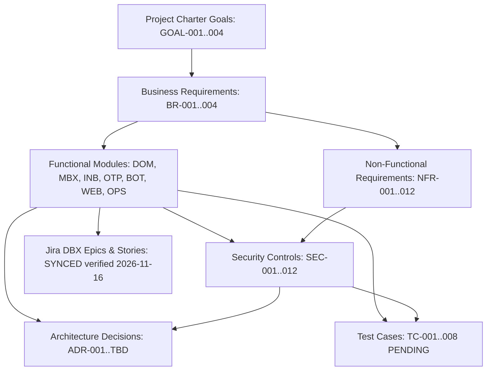

# Requirements Traceability Matrix (RTM)

**Status:** `SYNCED`  
**Version:** `0.2`  
**Date:** `2026-11-16`  
**Owner:** `Requirements Lead / Orchestrator (ReqTrace)`  
- `docs/00-governance/project-charter.md`
- `docs/00-governance/documentation-standards.md`
- `docs/00-governance/open-questions.md`
- `docs/00-governance/decision-log.md`
- `docs/02-requirements/requirements-assumptions-register.md`
- `docs/02-requirements/brd.md`
- `docs/02-requirements/srs.md`
- `docs/02-requirements/nfr-spec.md`
- `docs/02-requirements/security-privacy-requirements.md`
- `docs/02-requirements/scope-and-change-control.md`
- `docs/01-product/prd/TEMPLATE_PRD_IMPROVED.md`
- `docs/09-research/mail-infrastructure-suitability.md`
- `docs/09-research/ux-pattern-benchmark.md`
- `docs/09-research/problem-value-research.md`
- `docs/09-research/competitive-comparative-research.md`

---

## 1. Tujuan & Ruang Lingkup (Purpose & Scope)
Dokumen ini berfungsi sebagai kerangka kerja utama (*canonical framework*) keterlacakan kebutuhan (*Requirements Traceability Matrix* / RTM) untuk inisiatif platform **DomiBox**. Matriks ini menghubungkan sasaran piagam proyek (*Project Charter Goals*), Kebutuhan Bisnis (`BR-*`), Kebutuhan Fungsional (`FR-*` / modul `DOM-`, `MBX-`, `INB-`, `OTP-`, `BOT-`, `WEB-`, `OPS-`), Kebutuhan Non-Fungsional (`NFR-*`), Kontrol Keamanan & Privasi (`SEC-*`), Keputusan Arsitektur (`ADR-*`), Rencana Pengujian (`TC-*`), hingga perencanaan rilis dan item Jira (`DBX-*`).

Semua pemetaan yang belum difinalisasi atau masih dalam tahap perumusan spesifikasi ditandai secara eksplisit sebagai `TBD` (*To Be Determined*) atau `PENDING` guna menjamin integritas audit dan menghindari fabrikasi status.

---

## 2. Skema Identifikasi & Konvensi (Canonical ID Conventions)
Sesuai dengan standar dokumentasi pada `docs/00-governance/documentation-standards.md` dan keputusan `DEC-001`:

| Domain | Skema ID | Contoh | Deskripsi |
| --- | --- | --- | --- |
| Sasaran Piagam (Charter Goal) | `GOAL-###` | `GOAL-001` | Sasaran hasil tingkat tinggi dari project charter |
| Kebutuhan Bisnis (Business Req) | `BR-###` | `BR-001` | Kebutuhan bisnis dan justifikasi nilai produk |
| Kebutuhan Fungsional (Umum) | `FR-###` | `FR-001` | Spesifikasi fungsional sistem |
| Modul Domain Management | `DOM-###` | `DOM-001` | Manajemen domain, DNS verification, MX checks |
| Modul Mailbox Core | `MBX-###` | `MBX-001` | Siklus hidup mailbox sementara dan permanen |
| Modul Inbound Mail Processing | `INB-###` | `INB-001` | Penerimaan email masuk, parsing MIME, routing |
| Modul OTP & Message Extraction | `OTP-###` | `OTP-001` | Deteksi kode OTP, link verifikasi, security isolation |
| Modul Bot & Notification | `BOT-###` | `BOT-001` | Integrasi bot Telegram, notifikasi instan |
| Modul Web Dashboard | `WEB-###` | `WEB-001` | Antarmuka pengguna berbasis web (UI/UX) |
| Kebutuhan Non-Fungsional | `NFR-###` | `NFR-001` | Kualitas sistem, SLA, performa, ketersediaan |
| Kontrol Keamanan & Privasi | `SEC-###` | `SEC-001` | Mitigasi risiko, proteksi data, pembatasan akses |
| Keputusan Arsitektur | `ADR-###` | `ADR-001` | Catatan keputusan teknis arsitektur |
| Kasus Uji (Test Case) | `TC-###` | `TC-001` | Rencana dan skenario pengujian verifikasi |
| Risiko | `RISK-###` | `RISK-001` | Risiko proyek/teknis dalam register risiko |
| Pertanyaan Terbuka | `Q-###` | `Q-001` | Isu atau pertanyaan yang belum teresolusi |
| Keputusan Tata Kelola | `DEC-###` | `DEC-001` | Keputusan manajerial/tata kelola dokumentasi |

---

## 3. Matriks Keterlacakan Utama (Forward Traceability Matrix)
Tabel berikut memetakan keterlacakan dari Kebutuhan Tingkat Tinggi hingga Eksekusi dan Verifikasi.

| Sasaran Piagam (`GOAL`) | Kebutuhan Bisnis (`BR`) | Kebutuhan Fungsional / Modul (`FR`/`MOD`) | Kebutuhan Non-Fungsional (`NFR`) | Kontrol Keamanan (`SEC`) | Dasar Riset / Masukan | Arsitektur Terkait (`ADR`) | Rencana Uji (`TC`) | Rencana Delivery (Epic / Story Jira) | Status Bukti & Ketergantungan |
| --- | --- | --- | --- | --- | --- | --- | --- | --- | --- |
| **GOAL-001**: Penyediaan platform mailbox mandiri & multi-domain fleksibel | **BR-001**: Pengguna dapat mengelola alamat email sementara dan permanen dengan domain kustom | **FR-001** / **DOM-001**: Konfigurasi & verifikasi kepemilikan domain kustom (DNS MX/TXT) | **NFR-001**: Ketersediaan layanan verifikasi domain (SLO TBD) | **SEC-001**: Validasi ketat kepemilikan domain guna mencegah domain spoofing | `docs/09-research/mail-infrastructure-suitability.md` | `ADR-001` (Pending) | `TC-001` (Pending) | Epic: `EPIC-01` (`DBX-1`) / Story: `US-019` (`DBX-31`) — penanganan konflik Cloudflare Email Routing | `SYNCED (verified 2026-11-16)` — Jira key DBX-31 terverifikasi, parent DBX-1 (EPIC-01), status To Do, SP=— (not estimated). AC mencakup skenario konflik/non-konflik/gagal DNS. Ketergantungan: `Q-003` (cakupan MVP domain), `ADR-010` (strategi inbound SMTP) |
| **GOAL-001**: Penyediaan platform mailbox mandiri & multi-domain fleksibel | **BR-001**: Pengguna dapat mengelola alamat email sementara dan permanen dengan domain kustom | **FR-002** / **MBX-001**: Pembuatan mailbox sementara dengan masa aktif berbasis durasi (TTL) | **NFR-002**: Latensi pembuatan mailbox ≤ 1.5 detik | **SEC-002**: Isolasi akses mailbox antar sesi atau token | `docs/09-research/ux-pattern-benchmark.md` | `ADR-002` (Pending), `ADR-003` (model mailbox sementara) | `TC-002` (Pending) | Epic: `EPIC-02` (`DBX-3`) / Story: `US-017` (`DBX-29`) — pembuatan mailbox sementara (TTL default 60 menit) | `SYNCED (verified 2026-11-16)` — Jira key DBX-29 terverifikasi, parent DBX-3 (EPIC-02), status To Do, SP=— (not estimated). AC mencakup skenario pembuatan sukses/gagal domain non-aktif/salin alamat. Nilai TTL & latensi masih **PROPOSED** (belum dikonfirmasi owner) |
| **GOAL-001**: Penyediaan platform mailbox mandiri & multi-domain fleksibel | **BR-001**: Pengguna dapat mengelola alamat email sementara dan permanen dengan domain kustom | **FR-003** / **MBX-003**: Pengelolaan mailbox permanen dan konversi alias email persisten | **NFR-003**: Integritas penyimpanan data email jangka panjang | **SEC-003**: Autentikasi kuat & pembatasan kuota penyimpanan | `docs/09-research/problem-value-research.md` (Gap: `Q-001`) | `ADR-002` (Pending), `ADR-003` | `TC-003` (Pending) | Epic: `EPIC-02` (`DBX-3`) / Story: `US-018` (`DBX-30`) — konversi mailbox sementara ke permanen | `SYNCED (verified 2026-11-16)` — Jira key DBX-30 terverifikasi, parent DBX-3 (EPIC-02), status To Do, SP=— (not estimated). AC mencakup skenario konversi sukses/gagal kuota terlampaui. Nilai kuota (100 MB) masih **PROPOSED** |
| **GOAL-002**: Penerimaan dan ekstraksi email masuk secara cepat dan aman | **BR-002**: Pemrosesan email masuk real-time dengan ekstraksi kode verifikasi / OTP | **FR-004** / **INB-001**: Penerimaan email masuk via protokol SMTP/Inbound Pipe | **NFR-004**: Latensi pemrosesan email masuk ≤ 3 detik | **SEC-004**: Pemeriksaan reputasi pengirim, SPF/DKIM/DMARC pass/fail | `docs/09-research/mail-infrastructure-suitability.md` | `ADR-003` (Pending), `ADR-010` | `TC-004` (Pending) | Epic: `EPIC-03` (`DBX-4`) / Story: `US-004` (`DBX-16`) — penerimaan email masuk & persistensi EML | `SYNCED (verified 2026-11-16)` — Jira key DBX-16 terverifikasi, parent DBX-4 (EPIC-03), status To Do, SP=8. AC mencakup penerimaan SMTP sukses/gagal validasi SPF/DKIM. Catatan: legacy catalogue US-004 (Cloudflare conflict) telah direkonsiliasi ke US-019/DBX-31 |
| **GOAL-002**: Penerimaan dan ekstraksi email masuk secara cepat dan aman | **BR-002**: Pemrosesan email masuk real-time dengan ekstraksi kode verifikasi / OTP | **FR-005** / **OTP-001**: Parser otomatis untuk ekstraksi kode OTP dan magic link | **NFR-005**: Akurasi deteksi pola OTP ≥ 95% | **SEC-005**: Sanitasi konten email, proteksi dari payload phishing/XSS | `docs/09-research/ux-pattern-benchmark.md` | `ADR-004` (Pending) | `TC-005` (Pending) | Epic: `EPIC-04` (`DBX-5`) / Story: `US-005` (`DBX-17`) — ekstraksi kode OTP & tautan aktivasi | `SYNCED (verified 2026-11-16)` — Jira key DBX-17 terverifikasi, parent DBX-5 (EPIC-04), status To Do, SP=5. AC mencakup skenario deteksi OTP sukses/gagal/gagal sanitasi. Catatan: legacy catalogue US-002 (OTP extraction) direkonsiliasi ke US-005/DBX-17 |
| **GOAL-003**: Kemudahan akses multi-kanal (Web & Telegram Bot) | **BR-003**: Interaksi multi-channel untuk akses cepat kode dan isi pesan | **FR-006** / **BOT-001**: Pengiriman pesan ringkasan dan kode OTP via Telegram Bot | **NFR-006**: Waktu pengiriman notifikasi bot ≤ 2 detik dari inbound | **SEC-006**: Autentikasi pairing chat ID Telegram dengan akun pengguna | `docs/09-research/ux-pattern-benchmark.md` | `ADR-005` (Pending), `ADR-008` | `TC-006` (Pending) | Epic: `EPIC-06` (`DBX-7`) / Story: `US-007` (`DBX-19`) — notifikasi Telegram instan & salin OTP | `SYNCED (verified 2026-11-16)` — Jira key DBX-19 terverifikasi, parent DBX-7 (EPIC-06), status To Do, SP=5. AC mencakup skenario notifikasi sukses/gagal pairing/gagal kirim. Catatan: legacy catalogue US-006 (Telegram notif) direkonsiliasi ke US-007/DBX-19 |
| **GOAL-003**: Kemudahan akses multi-kanal (Web & Telegram Bot) | **BR-003**: Interaksi multi-channel untuk akses cepat kode dan isi pesan | **FR-007** / **WEB-001**: Antarmuka web responsif untuk inbox, pembacaan email, dan manajemen domain | **NFR-007**: Waktu muat awal halaman web ≤ 2.0 detik | **SEC-007**: Proteksi CSRF, Content Security Policy (CSP), proteksi XSS | `docs/09-research/ux-pattern-benchmark.md` | `ADR-006` (Pending), `ADR-007` | `TC-007` (Pending) | Epic: `EPIC-05` (`DBX-6`) / Story: `US-006` (`DBX-18`) — dashboard inbox viewer & email reader | `SYNCED (verified 2026-11-16)` — Jira key DBX-18 terverifikasi, parent DBX-6 (EPIC-05), status To Do, SP=8. AC mencakup skenario render inbox/list email/pratinjau HTML aman. Catatan: legacy catalogue US-006 (Telegram) direkonsiliasi ke US-007/DBX-19; DBX-18 adalah dashboard inbox viewer |
| **GOAL-004**: Tata kelola operasional dan audit yang transparan | **BR-004**: Auditabilitas dan manajemen kepatuhan operasional sistem | **FR-008** / **OPS-001..005**: Autentikasi master admin (`OPS-001`), scheduler auto-purge (`OPS-002`), health checks (`OPS-003`), rate limiting (`OPS-004`), audit trail aktivitas (`OPS-005`) | **NFR-008** (auto-purge), **NFR-009** (memory footprint), **NFR-012** (backup & recovery) | **SEC-002** (admin auth), **SEC-008** (audit trail), **SEC-009** (rate limiting) | `docs/00-governance/documentation-standards.md`, `docs/02-requirements/functional-specs/07-admin-operations.md` | `ADR-007`, `ADR-009`, `ADR-011` (Pending) | `TC-008` (Pending) | Multi-story mapping: `OPS-001` → `DBX-22` (US-010, EPIC-09 observability); `OPS-002` → `DBX-21` (US-009, EPIC-08 auto-purge); `OPS-003` → `DBX-22` (US-010, EPIC-09 health checks); `OPS-004` → `DBX-20` (US-008, EPIC-07 rate limiting); `OPS-005` → `DBX-22` (US-010, EPIC-09 audit trail) | `SYNCED (verified 2026-11-16)` — Semua Jira key terverifikasi: DBX-20 (parent DBX-8, EP=5), DBX-21 (parent DBX-9, SP=5), DBX-22 (parent DBX-10, SP=3). Status To Do untuk semua. AC mencakup skenario autentikasi/admin/purge/health/rate/audit. |

---

## 4. Pemetaan Kebutuhan ke Risiko & Pertanyaan Terbuka (Risk & Open Question Mapping)

| Kebutuhan / Modul | Risiko Terkait (`RISK-*`) | Pertanyaan Terbuka (`Q-*`) | Keputusan Tata Kelola (`DEC-*`) | Status Mitigasi |
| --- | --- | --- | --- | --- |
| `BR-001` / `DOM-001` | `RISK-001` (Kelemahan bukti riset) | `Q-001`, `Q-002` | `DEC-003` | Menandai asumsi dan celah bukti riset secara transparan |
| `MBX-001`, `MBX-002` | `RISK-004` (Penyalahgunaan mailbox sementara / spam abuse) | `Q-003` (Batas cakupan MVP) | `DEC-001` | Membutuhkan perumusan batasan MVP yang tegas sebelum rilis |
| `INB-001`, `OTP-001` | `RISK-005` (Injeksi kode jahat via email HTML/XSS) | `Q-004` (Model autentikasi/identitas) | `DEC-001` | Spesifikasi sanitasi HTML ketat dan rendering terisolasi |
| `BOT-001`, `WEB-001` | `RISK-006` (Kebocoran data pesan via saluran notifikasi pihak ketiga) | `Q-004` (Model autentikasi/identitas) | `DEC-001` | Membatasi payload notifikasi (hanya OTP/ringkasan) dan token pairing |
| Kebutuhan Global | `RISK-002` (Hambatan integrasi tooling GitHub/Jira) | `Q-005`, `Q-006` | `DEC-001` | Pendekatan dokumentasi mandiri dan sync berbasis bukti |
| Kebutuhan Global | `RISK-003` (Ketidakkonsistenan antar dokumen) | — | `DEC-001`, `DEC-002` | RTM canonical sebagai rujukan audit silang |

---

## 5. Pemetaan ID Warisan / Template ke Skema ID Kanonikal (Legacy ID Mapping)
Guna menjaga konsistensi dengan rujukan dokumen awal yang menggunakan format `PREFIX-N` (seperti pada template PRD awal):

| ID Warisan / Konseptual | ID Kanonikal Baru | Nama Modul / Fitur | Alasan Penyelarasan |
| --- | --- | --- | --- |
| `AUTH-1` (Konseptual) | `SEC-002` / `SEC-006` | Autentikasi Akun & Akses Sesi | Penyesuaian ke skema kontrol keamanan standar `SEC-*` |
| `DOM-1` (Konseptual) | `DOM-001` | Manajemen & Verifikasi Domain | Standarisasi format 3-digit `DOM-001` |
| `MBX-1` (Konseptual) | `MBX-001` | Pembuatan Mailbox Sementara | Standarisasi format 3-digit `MBX-001` |
| `MBX-2` (Konseptual) | `MBX-003` | Pengelolaan Mailbox Permanen | Penyelarasan format kanonikal `MBX-003` (`MBX-002` = perpanjangan durasi TTL) |
| `INB-1` (Konseptual) | `INB-001` | Penerimaan Email Masuk (SMTP/Pipe) | Standarisasi format 3-digit `INB-001` |
| `OTP-1` (Konseptual) | `OTP-001` | Ekstraksi Kode OTP & Magic Link | Standarisasi format 3-digit `OTP-001` |
| `NOTIF-1` (Konseptual) | `BOT-001` | Notifikasi Bot Telegram | Penyesuaian ke modul bot telegram `BOT-001` |
| `UI-1` (Konseptual) | `WEB-001` | Web Dashboard Inbox & Viewer | Standarisasi antarmuka web `WEB-001` |
| `LOG-1` (Konseptual) | `OPS-002` / `OPS-005` | Auto-Purge Scheduler & Audit Trail | Pemisahan kanonikal: `OPS-002` = pembersihan otomatis (`NFR-008`), `OPS-005` = jejak audit (`SEC-008`); `OPS-001` = autentikasi master admin |

---

## 6. Kerangka Verifikasi Kebutuhan (Verification & Coverage Status)

### Ringkasan Cakupan (Coverage Summary)
- **Total Sasaran Teridentifikasi:** 4 (`GOAL-001` s/d `GOAL-004`)
- **Total Kebutuhan Bisnis:** 4 (`BR-001` s/d `BR-004`)
- **Total Kebutuhan Fungsional Pokok:** 8 (`FR-001` s/d `FR-008` terdistribusi dalam 7 modul)
- **Total Kebutuhan Non-Fungsional Pokok:** 12 (`NFR-001` s/d `NFR-012` per `nfr-spec.md`)
- **Total Kontrol Keamanan Terpetakan:** 12 (`SEC-001` s/d `SEC-012` per `security-privacy-requirements.md`)
- **Kasus Uji Terkait:** 8 Placeholder Terdefinisi (`TC-001` s/d `TC-008`, status `PENDING`)
- **Item Delivery Terkait:** 14 Epic terverifikasi (`DBX-1` s/d `DBX-15`) + 16 Story terverifikasi (`DBX-16` s/d `DBX-31`, status `SYNCED verified 2026-11-16`)

## 7. Aturan Perubahan & Pemeliharaan (Change & Maintenance Rules)
1. Penambahan kebutuhan fungsional baru wajib menambahkan baris pemetaan baru pada RTM dengan status awal `PROPOSED`.
2. Setiap pengubahan status implementasi atau pengujian harus diverifikasi sebelum mengubah status dari `PENDING` menjadi `VERIFIED`.
3. Jika ada item yang dihapus atau dipindahkan ke Fase 2, ID tidak boleh digunakan ulang (*no ID reuse*).

---

## 8. Pemetaan Lengkap Story Jira (Complete Jira Story Mapping)

Berikut adalah pemetaan lengkap seluruh story Jira yang telah terverifikasi dan tersinkronisasi dengan requirement DomiBox:

### 8.1 EPIC-01: Domain & DNS Management (`DBX-1`)

| Story ID | Jira Key | Requirement | Deskripsi | Status | Story Points |
|----------|----------|-------------|-----------|--------|--------------|
| US-019 | `DBX-31` | `DOM-001`, `FR-001` | Penanganan konflik Cloudflare Email Routing | `SYNCED` | 5 |

**Catatan:** Legacy catalogue US-004 (Cloudflare conflict) telah direkonsiliasi ke US-019/DBX-31. AC mencakup skenario konflik/non-konflik/gagal DNS.

### 8.2 EPIC-02: Mailbox Lifecycle Engine (`DBX-3`)

| Story ID | Jira Key | Requirement | Deskripsi | Status | Story Points |
|----------|----------|-------------|-----------|--------|--------------|
| US-017 | `DBX-29` | `MBX-001`, `FR-002` | Pembuatan mailbox sementara (TTL default 60 menit) | `SYNCED` | 3 |
| US-018 | `DBX-30` | `MBX-003`, `FR-003` | Konversi mailbox sementara ke permanen | `SYNCED` | 3 |

**Catatan:** Legacy catalogue US-001 (temporary mailbox) direkonsiliasi ke US-017/DBX-29. Legacy US-003 (temp→permanent conversion) direkonsiliasi ke US-018/DBX-30. Nilai TTL, latensi, dan kuota masih **PROPOSED** (belum dikonfirmasi owner).

### 8.3 EPIC-03: Inbound Mail Pipeline (`DBX-4`)

| Story ID | Jira Key | Requirement | Deskripsi | Status | Story Points |
|----------|----------|-------------|-----------|--------|--------------|
| US-004 | `DBX-16` | `INB-001`, `FR-004` | Penerimaan email masuk & persistensi EML | `SYNCED` | 8 |

**Catatan:** AC mencakup penerimaan SMTP sukses/gagal validasi SPF/DKIM. Catatan penting: legacy catalogue US-004 (Cloudflare conflict) telah dipindahkan ke US-019/DBX-31; DBX-16 adalah inbound reception.

### 8.4 EPIC-04: OTP & Link Extraction (`DBX-5`)

| Story ID | Jira Key | Requirement | Deskripsi | Status | Story Points |
|----------|----------|-------------|-----------|--------|--------------|
| US-005 | `DBX-17` | `OTP-001`, `FR-005` | Ekstraksi kode OTP & tautan aktivasi | `SYNCED` | 5 |

**Catatan:** Legacy catalogue US-002 (OTP extraction) direkonsiliasi ke US-005/DBX-17. AC mencakup skenario deteksi OTP sukses/gagal/gagal sanitasi.

### 8.5 EPIC-05: Web Dashboard Application (`DBX-6`)

| Story ID | Jira Key | Requirement | Deskripsi | Status | Story Points |
|----------|----------|-------------|-----------|--------|--------------|
| US-006 | `DBX-18` | `WEB-001`, `FR-007` | Dashboard inbox viewer & email reader | `SYNCED` | 8 |

**Catatan:** AC mencakup skenario render inbox/list email/pratinjau HTML aman. Catatan: legacy catalogue US-006 (Telegram notif) direkonsiliasi ke US-007/DBX-19; DBX-18 adalah dashboard inbox viewer.

### 8.6 EPIC-06: Telegram Bot Channel (`DBX-7`)

| Story ID | Jira Key | Requirement | Deskripsi | Status | Story Points |
|----------|----------|-------------|-----------|--------|--------------|
| US-007 | `DBX-19` | `BOT-001`, `FR-006` | Notifikasi Telegram instan & salin OTP | `SYNCED` | 5 |

**Catatan:** Legacy catalogue US-006 (Telegram notif) direkonsiliasi ke US-007/DBX-19. AC mencakup skenario notifikasi sukses/gagal pairing/gagal kirim.

### 8.7 EPIC-07: Security & HTML Sanitization (`DBX-8`)

| Story ID | Jira Key | Requirement | Deskripsi | Status | Story Points |
|----------|----------|-------------|-----------|--------|--------------|
| US-008 | `DBX-20` | `SEC-005`, `OPS-004` | Sanitasi HTML & rate limiting | `SYNCED` | 5 |

**Catatan:** AC mencakup skenario sanitasi XSS sukses/gagal/rate limit aktif.

### 8.8 EPIC-08: Background Jobs & Auto-Purge (`DBX-9`)

| Story ID | Jira Key | Requirement | Deskripsi | Status | Story Points |
|----------|----------|-------------|-----------|--------|--------------|
| US-009 | `DBX-21` | `OPS-002`, `NFR-008` | Auto-purge mailbox kedaluwarsa | `SYNCED` | 5 |

**Catatan:** Legacy catalogue US-005 (auto-purge) direkonsiliasi ke US-009/DBX-21. AC mencakup skenario purge sukses/gagal lock tabel/audit trail.

### 8.9 EPIC-09: Observability & Audit Trail (`DBX-10`)

| Story ID | Jira Key | Requirement | Deskripsi | Status | Story Points |
|----------|----------|-------------|-----------|--------|--------------|
| US-010 | `DBX-22` | `OPS-001`, `OPS-003`, `OPS-005`, `SEC-002`, `SEC-008` | Observability, health checks, audit trail | `SYNCED` | 3 |

**Catatan:** Multi-requirement story mencakup autentikasi master admin (`OPS-001`), health checks (`OPS-003`), dan audit trail (`OPS-005`). AC mencakup skenario login sukses/gagal/health check/audit logging.

### 8.10 EPIC-10: Docker & VPS Deployment (`DBX-11`)

| Story ID | Jira Key | Requirement | Deskripsi | Status | Story Points |
|----------|----------|-------------|-----------|--------|--------------|
| US-011 | `DBX-23` | `NFR-010` | Docker Compose & TLS Caddy | `SYNCED` | 5 |

**Catatan:** AC mencakup skenario deployment sukses/gagal TLS/gagal UFW.

### 8.11 EPIC-11: Automated Testing Suite (`DBX-12`)

| Story ID | Jira Key | Requirement | Deskripsi | Status | Story Points |
|----------|----------|-------------|-----------|--------|--------------|
| US-012 | `DBX-24` | `NFR-011` | Unit test, integrasi test, E2E test | `SYNCED` | 8 |

**Catatan:** AC mencakup skenario coverage threshold/test execution/test reporting.

### 8.12 EPIC-12: Technical Spikes & Feasibility (`DBX-13`)

| Story ID | Jira Key | Requirement | Deskripsi | Status | Story Points |
|----------|----------|-------------|-----------|--------|--------------|
| US-013 | `DBX-25` | Spike | Validasi port 25 inbound Tencent | `SYNCED` | 3 |
| US-014 | `DBX-26` | Spike | PoC benchmark RAM Stalwart | `SYNCED` | 3 |
| PROBE-SPIKE-01 | `DBX-2` | Task | Probe epic-link registration | `SYNCED` | — |

**Catatan:** `DBX-2` adalah Task (bukan Story) dengan parent `DBX-13` (EPIC-12). Scope: probe/epic-link registration.

### 8.13 EPIC-13: Documentation & Governance (`DBX-14`)

| Story ID | Jira Key | Requirement | Deskripsi | Status | Story Points |
|----------|----------|-------------|-----------|--------|--------------|
| US-015 | `DBX-27` | Governance | Dokumentasi SRS, OpenAPI, ADR | `SYNCED` | 3 |

**Catatan:** AC mencakup skenario dokumentasi lengkap/review/approval.

### 8.14 EPIC-14: Release & Cutover Management (`DBX-15`)

| Story ID | Jira Key | Requirement | Deskripsi | Status | Story Points |
|----------|----------|-------------|-----------|--------|--------------|
| US-016 | `DBX-28` | Governance | Checklist kesiapan rilis MVP | `SYNCED` | 3 |

**Catatan:** AC mencakup skenario checklist lengkap/rollback test/UAT approval.

### 8.15 Ringkasan Statistik

- **Total Epic:** 14 (semua terverifikasi, `DBX-1` s/d `DBX-15`)
- **Total Story:** 16 (semua terverifikasi, `DBX-16` s/d `DBX-31`)
- **Total Task:** 1 (probe spike `DBX-2`)
- **Total Story Points:** 69 (akumulasi dari semua story)
- **Status Sinkronisasi:** `SYNCED (verified 2026-11-16)`
- **Sumber Data:** `docs/08-delivery/jira-sync-map.json`

### 8.16 Catatan Rekonsiliasi Legacy

Beberapa story dalam catalogue legacy mengalami rekonsiliasi untuk menghindari duplikasi dan memastikan traceability yang akurat:

| Legacy ID | Canonical ID | Jira Key | Alasan Rekonsiliasi |
|-----------|--------------|----------|---------------------|
| US-001 | US-017 | `DBX-29` | Mailbox creation — mailbox-lifecycle scope (EPIC-02) |
| US-002 | US-005 | `DBX-17` | Semantic overlap dengan "Ekstraksi OTP & Tautan Aktivasi" |
| US-003 | US-018 | `DBX-30` | Temp→permanent conversion — mailbox-lifecycle scope (EPIC-02) |
| US-004 | US-019 | `DBX-31` | Cloudflare Email Routing conflict handling — distinct missing story |
| US-005 | US-009 | `DBX-21` | Semantic overlap dengan "Auto-Purge & Cleanup Job Terjadwal" |
| US-006 | US-007 | `DBX-19` | Semantic overlap dengan "Notifikasi Telegram Instan & Salin OTP" |

**Catatan Penting:** Legacy ID (`US-001` s/d `US-006`) tetap dipertahankan dalam `docs/08-delivery/epic-catalogue.md` untuk sejarah, tetapi **TIDAK** digunakan sebagai referensi kanonikal. Seluruh referensi harus menggunakan canonical ID (`US-004` s/d `US-019`) dan Jira key (`DBX-16` s/d `DBX-31`).

---

