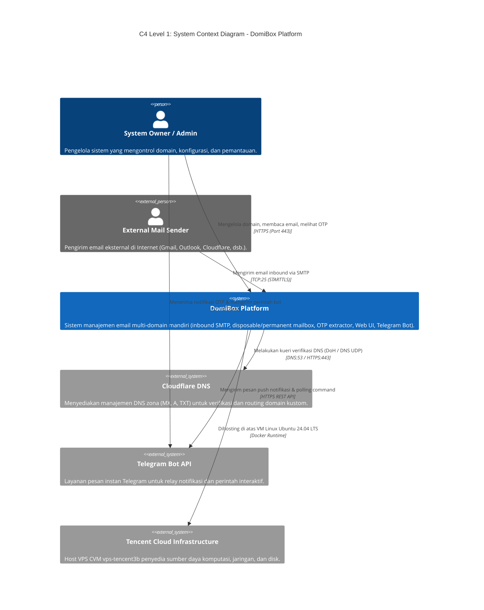
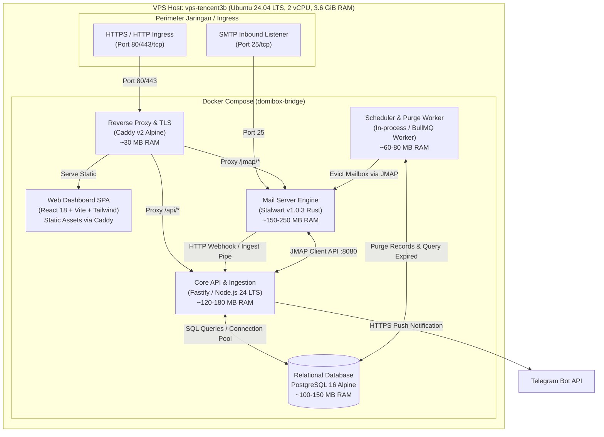

# Architecture Overview — DomiBox Platform

| Status | Versi | Tanggal | Penulis | Dokumen Terkait |
| --- | --- | --- | --- | --- |
| PROPOSED | 0.1 | 2026-11-15 | omp-orchestrator/ArchCore | `docs/00-governance/project-charter.md` `docs/01-product/prd/product-requirements-document.md` `docs/02-requirements/srs.md` `docs/02-requirements/nfr-spec.md` `docs/03-architecture/tech-evaluation-matrix.md` `docs/03-architecture/capacity-planning.md` `docs/03-architecture/failure-mode-analysis.md` `docs/03-architecture/diagrams/c4-system-context.md` `docs/03-architecture/diagrams/c4-container.md` `docs/03-architecture/diagrams/component-diagram.md` `docs/03-architecture/diagrams/deployment-diagram.md` `docs/03-architecture/adr/ADR-001.md` |

---

## 1. Eksekutif & Tujuan Dokumen

Dokumen **Architecture Overview** ini menjabarkan fondasi arsitektur perangkat lunak dan infrastruktur teknis untuk platform **DomiBox** (*Self-Hosted Multi-Domain Email Management Platform*). Dokumen ini mengintegrasikan seluruh persyaratan produk (`PRD`), persyaratan fungsional (`SRS`), atribut kualitas non-fungsional (`NFR-Spec`), dan hasil riset kelayakan infrastruktur (`MailInfraResearch`).

Tujuan utama arsitektur DomiBox adalah mewujudkan sistem email multi-domain yang tangguh, aman, dan berkinerja tinggi yang dioperasikan secara mandiri (*self-hosted single-owner*) pada infrastruktur komputasi berbiaya hemat (pilot node: 1 unit VPS Tencent Cloud, 2 vCPU AMD EPYC 7K62, 3.6 GiB RAM).

---

## 2. Pendorong Arsitektur (Architectural Drivers)

Desain arsitektur DomiBox dikendalikan oleh empat pilar pendorong utama:

### 2.1 Kebutuhan Bisnis & Produk (Business & Product Drivers)
1. **Multi-Domain Kustom (`DOM-001` s/d `DOM-005`):** Mendukung hingga 10 domain kustom aktif dengan validasi DNS (MX dan TXT verifikasi kepemilikan), deteksi konflik Cloudflare Email Routing (`F3`), penonaktifan darurat, dan penghapusan domain aman per `docs/02-requirements/functional-specs/01-domain-management.md`.
2. **Siklus Hidup Mailbox Lengkap (`MBX-001` s/d `MBX-005`):**
   - *Temporary Disposable Mailbox (`MBX-001`, `MBX-002`):* Alamat acak/kustom dengan durasi aktif berbasis TTL (10m, 1h, 24h, kustom) yang dapat diperpanjang, dilindungi *access token* unik 32-karakter (`SEC-002`).
   - *Konversi ke Permanen (`MBX-003`):* Alamat persisten tanpa batas waktu dengan pembatasan kuota ketat (maks 100 MB).
   - *Penghapusan Cepat & Pembersihan Terjadwal (`MBX-004`, `MBX-005`):* Penghapusan manual seketika dan auto-purge latar belakang yang terikat siklus hidup engine email.
3. **Pusat Ekstraksi OTP & Verifikasi (`OTP-001` s/d `OTP-005`):** Deteksi dan ekstraksi otomatis kode OTP numerik/alfanumerik, tautan aktivasi instan, penanganan ambiguitas kode, serta penyalinan satu-klik (*one-click copy*).
4. **Pemrosesan Email Masuk Terisolasi (`INB-001` s/d `INB-005`):** Penerimaan via SMTP/Worker, sanitasi HTML DOMPurify (`SEC-005`), pemblokiran tracking pixel, serta penanganan lampiran aman.
5. **Multi-Kanal Akses Terintegrasi (`WEB-001`..`005`, `BOT-001`..`005`):** Web Dashboard responsif bersandbox iframe dan bot Telegram (notifikasi push < 2 detik pasca-inbound, pembuatan mailbox instan, perintah inline).
6. **Tata Kelola & Keamanan Operasional (`OPS-001` s/d `OPS-005`):** Master auth secret (`SEC-001`), pembersihan otomatis berbasis batas aman disk (`F4`), health check diagnostik, pembatasan laju (*rate limiting* `SEC-009`), dan pencatatan audit komprehensif.

### 2.2 Batasan Lingkungan & Infrastruktur (Environmental Constraints - Terverifikasi 2026-11-14)
- **Node VPS:** 1 unit Tencent Cloud CVM (`vps-tencent3b`), Ubuntu 24.04.5 LTS, 2 vCPU AMD EPYC 7K62, total RAM 3.6 GiB (3.0 GiB available), swap 1.9 GiB, ruang disk 59 GB (50 GB free).
- **Alokasi Sumber Daya DomiBox:** Maksimal RAM 1.2 GiB (kondisi puncak) dan kuota disk maksimum 10 GB dari 50 GB ruang bebas host.
- **Port Jaringan VPS:** Port 22/tcp, 127.0.0.1:9000-9001 (container terisolasi `rustfs`), dan 127.0.0.53:53 sedang berjalan. Port 25, 80, 443, 993, 465, 587 berstatus **BEBAS**.
- **Jaringan Tencent Cloud:** Port 25 *outbound* diblokir secara default oleh Tencent Cloud. Port 25 *inbound* **TERBUKA** melalui konfigurasi Security Group dan UFW. Konsekuensinya, pengiriman email keluar (*outbound SMTP*) secara eksplisit dinyatakan **Out-of-Scope (Fase 2 / `Q-003`)**, dan DomiBox beroperasi sebagai sistem penerima email masuk (*inbound-only*).
- **DNS Pilot Domain (`sintaksis.biz.id`):** Dikelola di Cloudflare Nameserver (`dylan.ns.cloudflare.com`). Tidak memiliki MX record eksisting saat preflight (Status 0 DoH, no answer). *Cloudflare Email Routing* tidak boleh diaktifkan pada domain utama bersamaan dengan MX VPS karena saling menimpa (`F3`).

### 2.3 Persyaratan Kualitas Utama (Key Quality Attributes / NFRs)
- **Ketersediaan (`NFR-001`):** Uptime $\ge 99.5\%$ per bulan kalender.
- **Latensi Pembuatan Mailbox (`NFR-002`):** Respon P95 $\le 1.5$ detik.
- **Integritas Pesan (`NFR-003`):** Zero data loss pada mailbox permanen.
- **Latensi Pemrosesan Inbound (`NFR-004`):** Respon P95 $\le 3.0$ detik untuk email $\le 500$ KB.
- **Akurasi Ekstraksi OTP (`NFR-005`):** Presisi deteksi $\ge 95.0\%$.
- **Latensi Notifikasi Telegram (`NFR-006`):** Respon P95 $\le 2.0$ detik.
- **Batas Jejak Memori (`NFR-009`):** Total alokasi RAM kontainer DomiBox $\le 600$ MB dalam kondisi normal/idle, batas keras cgroups $\le 1.2$ GiB saat burst.
- **Batas Ukuran Pesan (`NFR-010`):** Maksimal 15 MB per transaksi SMTP inbound.

### 2.4 Batasan Lisensi Perangkat Lunak
- **Stalwart v1.0.3:** Berlisensi AGPL-3.0. Fitur *Masked Email* merupakan fitur Enterprise berbayar (`F2`). Untuk versi Community, mailbox sementara diimplementasikan menggunakan pemetaan *virtual alias* dan *JMAP API account provisioning* yang dikendalikan oleh scheduler DomiBox (`ADR-003`). Stalwart diisolasi sebagai service jaringan independen melalui API HTTP/JMAP tanpa pertautan kode sumber (*no code linking*).

---

## 3. Ringkasan Model C4 (C4 Model Summary)

Arsitektur DomiBox dirancang menggunakan metodologi C4 (*Context, Container, Component, Code*):

### 3.1 C4 Level 1: System Context
Sistem DomiBox berada di tengah ekosistem email. Sistem menerima lalu lintas SMTP inbound pada port 25 dari External Mail Transfer Agent (Gmail, Microsoft 365, Yahoo, dsb.) berdasarkan resolusi rekaman DNS MX di Cloudflare. Pengguna Pemilik/Admin mengakses sistem melalui Web Browser (HTTPS) atau Telegram Client (Bot API).

### 3.2 C4 Level 2: Container Diagram
Sistem DomiBox didekomposisi menjadi kontainer-kontainer terisolasi yang diorkestrasi oleh Docker Compose:
1. **Reverse Proxy (Caddy):** Mengelola terminasi TLS otomatis (Let's Encrypt / ZeroSSL), menyajikan static asset Web SPA, dan memproksikan lalu lintas API ke Backend serta antarmuka JMAP/WebAdmin Stalwart.
2. **Web Dashboard SPA (React + Vite + shadcn/ui):** Antarmuka pengguna modern berbasis browser.
3. **Core Backend & Inbound Worker (Fastify / Node.js 24 LTS):** Layanan monolit modular yang menangani REST API, webhook/pipe ingestion dari Stalwart, pembedah MIME, ekstraksi OTP heuristik, dan dispatcher notifikasi.
4. **Background Scheduler & Purge Engine:** Pekerja periodik internal untuk pembersihan data kedaluwarsa (`expires_at`), sinkronisasi status JMAP, dan rotasi log.
5. **Mail Engine (Stalwart Mail Server v1.0.3):** Server SMTP, JMAP, dan IMAP berperforma tinggi berbasis Rust yang menerima koneksi port 25 dan memvalidasi keaslian pengirim (SPF, DKIM, DMARC).
6. **Relational Database (PostgreSQL 16 Alpine):** Penyimpanan persisten utama untuk metadata domain, definisi mailbox, token akses, relasi pesan, data audit log, dan tabel antrean internal.

### 3.3 C4 Level 3: Component Diagram (Core Application)
Di dalam kontainer Core Application Backend, modularitas dijaga melalui komponen-komponen terpisah dengan batas tanggung jawab tunggal (*Single Responsibility Principle*):
- **AuthGuard:** Mengamankan endpoint REST API menggunakan validasi Admin Session Token (JWT/Cookie) dan Mailbox Guest Access Token.
- **DomainManager:** Mengelola status domain kustom, memvalidasi konfigurasi rekaman DNS (MX & TXT) melalui Cloudflare DoH, serta mendeteksi konflik routing eksternal.
- **JMAPClient:** Berkomunikasi dengan Stalwart Management API untuk sinkronisasi akun, pembuatan alias virtual, dan penyesuaian kuota.
- **InboundParser & MIME Demuxer:** Membedah raw RFC 5322 MIME stream dari Stalwart, memisahkan teks polos, HTML tersanitasi, serta metadata lampiran.
- **OTPExtractor:** Mesin heuristik ekspresi reguler yang mengekstrak kode verifikasi (angka 4–8 digit, alfanumerik) dan tautan aktivasi akun.
- **NotificationDispatcher:** Pengirim pesan asinkron yang memformat ringkasan email dan kode OTP ke saluran Telegram Bot API.
- **MailboxService:** Mengatur logika siklus hidup mailbox (sementara dan permanen), penghitungan TTL, dan perpanjangan masa aktif.
- **PurgeWorker:** Eksekutor latar belakang yang membersihkan baris basis data kedaluwarsa dan berkas email terkait secara atomik.

---

## 4. Ringkasan Tumpukan Teknologi (Technology Stack Summary)

Pilihan teknologi dirancang untuk efisiensi komputasi ekstrem pada lingkungan 2 vCPU / 3.6 GiB RAM. Rincian perbandingan dan justifikasi terdokumentasi dalam `docs/03-architecture/tech-evaluation-matrix.md`.

| Komponen Arsitektur | Teknologi Terpilih | Versi Target | Rationale & Justifikasi Teknis |
| --- | --- | --- | --- |
| **Mail Server Engine** | Stalwart Mail Server | v1.0.3 (Community) | Berbasis Rust murni dengan jejak memori sangat rendah (~150 MB vs Mailu >1.5 GB), mendukung protokol modern SMTP, JMAP, dan IMAP dalam satu binari tunggal, serta memiliki parser SPF/DKIM bawaan (`ADR-002`). |
| **Edge & Reverse Proxy** | Caddy Server | v2.8+ Alpine | Otomasi sertifikat TLS (Let's Encrypt) tanpa dependensi eksternal, konfigurasi deklaratif ringkas, performa tinggi dengan konsumsi RAM < 30 MB. |
| **Backend Core Runtime** | Fastify (Node.js) | v24 LTS / Fastify v4 | Framework web Node.js tercepat dengan *overhead* memori rendah (~120 MB), ekosistem async I/O matang, schema validation bawaan via Ajv/TypeBox, dan dukungan native TypeScript (`ADR-006`). |
| **Database Persisten** | PostgreSQL | v16 Alpine | Database relasional tangguh yang mendukung ACID komprehensif, tipe data JSONB fleksibel untuk metadata email, dan konsumsi memori terukur (~120 MB setelah penyesuaian buffer) (`ADR-005`). |
| **Frontend Framework** | React + Vite + shadcn/ui | React 18, Vite 5, Tailwind CSS | Standar industri untuk Single Page Application berkinerja tinggi, menghasilkan bundel statis murni yang di-*cache* oleh Caddy tanpa membutuhkan runtime Node.js di sisi frontend (`ADR-007`). |
| **Telegram Bot Client** | grammY | v1.20+ | Framework bot Telegram TypeScript modern yang ringan, berbasis middleware fleksibel, mendukung alur conversation plugin, dan efisien untuk mode long-polling/webhook (`ADR-008`). |
| **MIME Parsing Engine** | postal-mime / mailparser | Versi stabil terbaru | Parser email RFC 5322 berbasis stream yang cepat dan andal dalam mendekomposisi pesan multipart tanpa lonjakan memori (*OOM spike*). |
| **HTML Sanitizer** | DOMPurify / sanitize-html | Versi stabil terbaru | Mencegah eksploitasi Cross-Site Scripting (XSS) dan pelacakan piksel tersembunyi pada saat rendering badan pesan HTML email (`SEC-004`). |

---

## 5. Pertimbangan Lintas-Sektor (Cross-Cutting Concerns)

### 5.1 Keamanan & Isolasi (Security & Privacy Controls - `SEC-*`)
1. **Sanitasi Konten Email (`SEC-004`):** Seluruh konten HTML email wajib melalui pipeline sanitasi ketat (`DOMPurify`) untuk menghapus tag `<script>`, `<iframe>`, atribut `onerror`, serta memblokir eksekusi objek berbahaya sebelum disajikan pada Web Dashboard.
2. **Perlindungan Data Sensitif & OTP (`SEC-003`):** Kode OTP dan isi email sementara memiliki kebijakan retensi pendek. Token akses mailbox sementara dibuat dengan generator kriptografis aman (`crypto.randomBytes(32)`).
3. **Autentikasi & Otorisasi (`SEC-001`, `ADR-009`):** Autentikasi administrator menggunakan kombinasi Session Cookie aman (*HttpOnly, Secure, SameSite=Strict*) dengan proteksi brute-force (rate limiter 5 percobaan/menit). Akses mailbox sementara dilindungi token otorisasi terikat mailbox yang dapat dikirim sebagai query parameter `token` (tautan inbox yang dapat dibagikan) atau header `X-Mailbox-Token` (panggilan API), sesuai ADR-009 dan kontrak OpenAPI.
4. **Isolasi Kontainer & Non-Root Execution:** Seluruh kontainer Docker Compose berjalan menggunakan user non-root dengan kapabilitas Linux yang diminimalisasi (`cap_drop: ALL`).

### 5.2 Observabilitas & Audit Logging (`OPS-001`)
- **Pencatatan Terstruktur:** Seluruh log aplikasi dicatat dalam format JSON terstruktur ke `stdout` melalui logger performa tinggi (`pino`).
- **Audit Trail:** Aksi administratif kritis (pendaftaran domain, penghapusan mailbox, perubahan token) disimpan dalam tabel `audit_logs` dengan informasi pelaku, timestamp, alamat IP, dan payload aksi.
- **Health Check Endpoints:** Endpoint `/health/live` (status proses dasar) dan `/health/ready` (konektivitas PostgreSQL, Stalwart JMAP, dan ketersediaan kuota disk) diimplementasikan untuk pemantauan otomatis probe eksternal.

### 5.3 Idempotensi & Toleransi Kegagalan (Fault Tolerance & Idempotency)
- **Idempotensi Inbound Processing:** Setiap pesan masuk diekstraksi nilai `Message-ID` dari header RFC 5322. Pasangan `(domain_id, message_id)` memiliki indeks unik di basis data untuk mencegah duplikasi pemrosesan dan spam notifikasi ke Telegram apabila pengirim mengirim ulang email yang sama.
- **Penjadwal Pembersihan Mandiri (*Self-Healing Purge*):** Jika proses scheduler sempat terhenti, saat *startup* scheduler akan langsung memindai dan menghapus seluruh record mailbox dengan kondisi `expires_at <= NOW()`.

---

## 6. Analisis Trade-Off Arsitektur

| Keputusan Arsitektur | Opsi Dipilih | Alternatif Ditolak | Alasan & Trade-Off |
| --- | --- | --- | --- |
| **Gaya Arsitektur Sistem** | Modular Monolith (Docker Compose) | Microservices Terdistribusi | **Keuntungan:** Overhead memori minimal (< 500 MB), latensi pemanggilan in-process mendekati nol, kesederhanaan deployment pada 1 VPS. **Kerugian:** Skalabilitas horizontal terbatas pada kapasitas single node (namun sangat memadai untuk beban target). |
| **Strategi Inbound SMTP** | Native Port 25 Inbound pada Host | Cloudflare Email Routing Webhook | **Keuntungan:** Kontrol penuh atas seluruh domain tanpa keterikatan batasan kuota pihak ketiga, mendukung autentikasi native SPF/DKIM. **Kerugian:** Memerlukan pembukaan port 25 pada Security Group Tencent dan pemeliharaan reputasi IP. |
| **Model Mailbox Sementara** | Pemetaan Virtual Alias & Routing Internal | Akun Mailbox Fisik Terpisah di Stalwart | **Keuntungan:** Tidak membebani engine Stalwart dengan pembuatan ribuan akun pengguna terisolasi; penghapusan data instan cukup via kueri DB lokal. **Kerugian:** Diperlukan modul perutean internal cerdas di sisi DomiBox Core. |
| **Penyimpanan Pesan Email** | PostgreSQL (Metadata + Body Teks/HTML) & Volume Mount untuk Attachment Besar | Object Storage Eksternal (S3 / MinIO) | **Keuntungan:** Tidak menambah biaya langganan cloud eksternal dan tidak memakan RAM untuk menjalankan server MinIO mandiri. **Kerugian:** Membutuhkan kebijakan kuota disk ketat (10 GB) dan pembersihan periodik disiplin. |

---

## 7. Indeks Keputusan Arsitektur (ADR Index)

Rincian spesifikasi keputusan formal didokumentasikan dalam sub-folder `docs/03-architecture/adr/`:

| Nomor ADR | Judul Keputusan Arsitektur | Status |
| --- | --- | :---: |
| `ADR-001` | Pemilihan Gaya Arsitektur Modular Monolith Berbasis Docker Compose | `PROPOSED` |
| `ADR-002` | Pemilihan Stalwart v1.0.3 Community sebagai Mail Server Engine Utama | `PROPOSED` |
| `ADR-003` | Model Implementasi Mailbox Sementara Berbasis Virtual Alias & Scheduler | `PROPOSED` |
| `ADR-004` | Pemilihan Protokol JMAP untuk Integrasi Aplikasi dengan Mail Server | `PROPOSED` |
| `ADR-005` | Pemilihan PostgreSQL 16 sebagai Penyimpanan Data Relasional Utama | `PROPOSED` |
| `ADR-006` | Pemilihan Fastify (Node.js LTS) untuk Backend Core Service | `PROPOSED` |
| `ADR-007` | Pemilihan React, Vite, dan shadcn/ui untuk Antarmuka Web Dashboard | `PROPOSED` |
| `ADR-008` | Pemilihan Framework grammY untuk Layanan Bot Telegram | `PROPOSED` |
| `ADR-009` | Model Autentikasi Administrator dan Guest Access Token Mailbox | `PROPOSED` |
| `ADR-010` | Strategi Inbound SMTP Native Port 25 dan Delegasi DNS Cloudflare | `PROPOSED` |
| `ADR-011` | Strategi Background Scheduler dan Engine Pembersihan Data Otomatis | `PROPOSED` |
| `ADR-012` | Penentuan Toolchain Pengujian Otomatis dan Jaminan Kualitas | `PROPOSED` |
