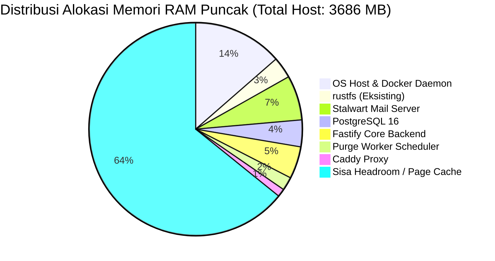
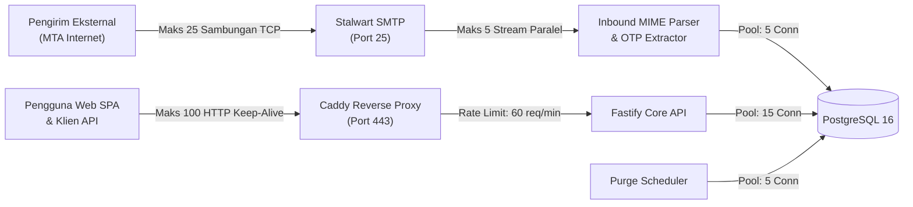

# Perencanaan Kapasitas & Anggaran Sumber Daya (Capacity Planning) — DomiBox

| Status | Versi | Tanggal | Penulis | Dokumen Terkait |
| --- | --- | --- | --- | --- |
| PROPOSED | 0.1 | 2026-11-15 | omp-orchestrator/ArchCore | `docs/00-governance/project-charter.md` `docs/02-requirements/srs.md` `docs/02-requirements/nfr-spec.md` `docs/03-architecture/architecture-overview.md` `docs/03-architecture/tech-evaluation-matrix.md` `docs/03-architecture/failure-mode-analysis.md` `docs/03-architecture/adr/ADR-005.md` `docs/03-architecture/adr/ADR-011.md` |

---

## 1. Pendahuluan & Sasaran Perencanaan

Dokumen **Capacity Planning** ini menetapkan batas operasional, anggaran sumber daya komputasi (*resource budget*), dan pemodelan pertumbuhan penyimpanan data untuk platform **DomiBox**. Seluruh kalkulasi diturunkan secara langsung dari batasan perangkat keras nyata yang terverifikasi pada host target:

### 1.1 Spesifikasi Host Terverifikasi (`vps-tencent3b`, 2026-11-14)
- **Komputasi:** 2 vCPU AMD EPYC 7K62 @ 2.60GHz
- **Memori Fisik:** Total 3.6 GiB (~3686 MB), Tersedia (*Available*) ~3.0 GiB (3072 MB)
- **Ruang Swap:** 1.9 GiB (2048 MB) terkonfigurasi di swapfile
- **Penyimpanan Disk:** Total 59 GB, Ruang Bebas (*Free*) 50 GB pada partisi root `/`
- **Layanan Lain pada Host:** Terdapat 1 kontainer terisolasi `rustfs/rustfs:1.0.4` pada `127.0.0.1:9000-9001` (konsumsi memori terukur ~80 MB). Port mail dan HTTP berstatus bersih.

---

## 2. Anggaran Alokasi Memori (Memory Budget Breakdown)

Batas keras total memori yang dialokasikan untuk seluruh tumpukan kontainer DomiBox ditetapkan maksimal **1.2 GiB** pada kondisi puncak (*peak load*), dan **< 600 MB** pada kondisi normal/idle (`NFR-009`). Kebijakan ini menyisakan cadangan aman $\ge 1.8$ GiB RAM untuk sistem operasi Linux host, buffer cache I/O disk, dan kontainer `rustfs`.

### 2.1 Rincian Alokasi Memori per Komponen

| Komponen / Kontainer | Peran & Runtime | Estimasi Idle | Estimasi Puncak (Peak) | cgroup Memory Limit | Catatan Tuning & Optimasi |
| --- | --- | :---: | :---: | :---: | --- |
| **Sistem Operasi Host** | Linux Kernel, systemd, sshd, Docker daemon | ~350 MB | ~500 MB | N/A (Host) | Buffer/cache disk dinamis Linux |
| **Layanan rustfs (Eksisting)**| Storage engine internal (127.0.0.1) | ~80 MB | ~120 MB | N/A (Eksisting) | Independen, jangan diinterferensi |
| **Caddy Reverse Proxy** | Edge TLS & Static Web Server (Go/Alpine) | ~20 MB | ~45 MB | `64M` | Melayani aset web statis murni & reverse proxy |
| **Stalwart Mail Server** | Mail Engine: SMTP, JMAP, SPF/DKIM (Rust) | ~140 MB | ~250 MB | `384M` | Konfigurasi worker threads = 2, internal cache disesuaikan |
| **PostgreSQL 16 Alpine** | Database Relasional Utama | ~90 MB | ~150 MB | `256M` | `shared_buffers = 64MB`, `work_mem = 4MB`, `max_connections = 30` |
| **Fastify Core Backend** | REST API, Ingestion, MIME parser (Node 24 LTS) | ~110 MB | ~180 MB | `256M` | Node flag: `--max-old-space-size=192`, parsing berbasis stream |
| **Purge Worker / Scheduler** | Background worker pembersih data kedaluwarsa | ~40 MB | ~75 MB | `128M` | Eksekusi in-process atau lightweight process berkala |
| **Total Beban DomiBox** | — | **~400 MB** | **~700 MB** | **~1088 MB (~1.1 GiB)** | **Sangat aman (< 30% total RAM 3.6 GiB)** |
| **Sisa RAM Bebas (Headroom)** | — | **~2850 MB** | **~2450 MB** | — | Buffer tangguh untuk lonjakan I/O dan OS page cache |

---

## 3. Pemodelan Pertumbuhan Penyimpanan Disk (Disk Growth & Auto-Purge Modeling)

Kuota disk maksimum yang dialokasikan untuk data DomiBox adalah **10 GB** dari total 50 GB ruang disk bebas pada host (`NFR-004`).

### 3.1 Karakteristik Data & Asumsi Pemodelan
1. **Mailbox Sementara (Temporary Disposable Mailbox):**
   - Batas aktif bersamaan: 500 mailbox aktif bersamaan.
   - Durasi retensi rata-rata (TTL): 1 jam (dengan opsi 10 menit s/d 24 jam).
   - Rata-rata email per mailbox sementara: 3 pesan email masuk (registrasi, konfirmasi akun, kode OTP).
   - Ukuran rata-rata per email masuk: 80 KB (teks polos + HTML berformat + header). Email lampiran dibatasi maks 15 MB (`NFR-010`).
   - Laju pembuatan pesan sementara: 1.500 email / hari.
2. **Mailbox Permanen:**
   - Batas jumlah mailbox permanen: 20 mailbox.
   - Kuota penyimpanan maksimal per mailbox permanen: 100 MB.
   - Total batas keras mailbox permanen: $20 \times 100\text{ MB} = 2.0\text{ GB}$.
3. **Database Relasional (PostgreSQL):**
   - Ukuran per record metadata email (header, subjek, relasi): ~1.5 KB.
   - Index overhead (B-Tree + GIN untuk pencarian): ~40% dari ukuran data mentah.

### 3.2 Analisis Kebutuhan Kapasitas Disk (Kondisi Stabil / Steady-State)

| Kategori Data | Volume / Jumlah Entitas | Ukuran Rata-rata | Total Ukuran Disk | Strategi Pengendalian / Retensi |
| --- | :---: | :---: | :---: | --- |
| **Mailbox Permanen (Data)** | 20 mailbox | Max 100 MB / box | **2.0 GB** | Kuota ketat per-mailbox, tolak pesan jika kuota 100% |
| **Mailbox Sementara (Aktif)** | 500 mailbox bersamaan | 3 pesan @ 80 KB | **~120 MB** | Dihapus otomatis saat `expires_at` tercapai |
| **PostgreSQL DB (Metadata & Log)**| 500.000 log & history transaksi | ~2 KB / baris | **~1.0 GB** | Rotasi log audit > 30 hari, vacuum berkala |
| **Temporary Raw Spool / Attachments**| Antrean inbound burst | Buffer 50 pesan | **~250 MB** | File spool langsung dibersihkan pasca-parse |
| **Cadangan Lokal (Local Backup Dump)**| 7 hari snapshot rotasi | ~100 MB / dump | **~700 MB** | Rotasi snapshot harian, simpan 7 revisi terakhir |
| **Total Kapasitas Terpakai** | — | — | **~4.07 GB** | **Di bawah batas alokasi 10 GB (Margin Aman ~59%)** |

### 3.3 Pemodelan Laju Akumulasi Tanpa Purge vs Dengan Auto-Purge
Jika pembersihan otomatis gagal berfungsi:
$$\text{Laju Pertumbuhan} = 1.500\text{ email/hari} \times 80\text{ KB} = 120\text{ MB/hari} \approx 3.6\text{ GB/bulan}$$
Dalam waktu kurang dari 3 bulan, kuota 10 GB akan terlampaui.

**Mekanisme Pembersihan Presisi (`NFR-008`):**
- Scheduler dijalankan setiap **60 detik**.
- Menghapus record email dan mailbox yang melewati batas waktu (`expires_at < NOW()`).
- Menjalankan unlinking berkas lampiran dari disk dalam batch berukuran $\le 200$ berkas per siklus untuk mencegah lonjakan I/O disk.
- *Emergency Trigger:* Jika sisa ruang disk host $< 2$ GB, penerimaan pesan sementara ditolak dengan respon SMTP `452 Insufficient system storage`, dan proses pembersihan darurat diaktifkan seketika.

---

## 4. Batasan Konkurensi & Ambang Sambungan (Connection Limits & Sizing)

Untuk mencegah kehabisan sumber daya sistem (*resource starvation*) pada arsitektur 2 vCPU, diterapkan batasan konkurensi terukur pada setiap lapisan:

### 4.1 Matriks Batasan Konkurensi Jaringan & Aplikasi

| Parameter Konfigurasi | Nilai Batas (Limit) | Komponen Terkait | Rationale & Justifikasi Teknis |
| --- | :---: | :---: | --- |
| **Maksimal Koneksi SMTP Masuk** | 25 koneksi bersamaan | Stalwart (Port 25) | Mencegah eksploitasi DoS/slowloris pada port 25 |
| **Batas Laju SMTP per IP Sumber** | 10 koneksi / menit | Stalwart / Caddy / UFW | Menangkal spammer terdistribusi tanpa mengorbankan MTA sah |
| **Ukuran Maksimum Pesan Email** | 15 MB | Stalwart SMTP Server | Mengamankan RAM dan disk dari lampiran raksasa (`NFR-010`) |
| **PostgreSQL Connection Pool** | 30 sambungan (`max_connections`) | PostgreSQL Config | Alokasi: Fastify API (15), Worker/Scheduler (5), Admin/Spare (10) |
| **Fastify Keep-Alive Connections** | 100 sambungan | Fastify HTTP Server | Efisiensi penanganan klien Web SPA dan polling Telegram |
| **Rate Limit REST API Publik** | 60 request / menit per IP | Fastify (`@fastify/rate-limit`) | Mencegah scraping dan brute force pembuatan token mailbox |
| **Batas Konkurensi Inbound Worker** | 5 pesan diproses paralel | Core Ingestion Engine | Menghindari spike CPU 100% pada proses komputasi regex OTP |

---

## 5. Strategi Degradasi Terkendali (Graceful Degradation Triggers)

Sistem mengadopsi mekanisme pertahanan otomatis berbasis ambang batas (*threshold alerts*):
1. **Level Waspada Memori (Memory > 80% / > 960 MB alokasi DomiBox):**
   - Sistem menonaktifkan sementara pembacaan lampiran biner non-teks.
   - Prioritas pemrosesan diberikan secara eksklusif kepada ekstraksi kode OTP dan ringkasan teks email masuk.
2. **Level Kritis Disk (Ruang Bebas Host < 2 GB):**
   - Mail server Stalwart secara otomatis merespons status `452 4.3.1 Insufficient system storage` pada transaksi SMTP baru.
   - Scheduler menjalankan prosedur pembersihan darurat (*emergency purge*) dengan menghapus mailbox sementara yang masa aktifnya telah habis tanpa menunggu jendela interval normal.
3. **Level Beban CPU Tinggi (Load Average > 2.5 selama > 3 menit):**
   - Eksekusi polling sinkronisasi DNS Domain dan tugas audit non-kritis ditunda secara otomatis hingga beban komputasi normal kembali.
