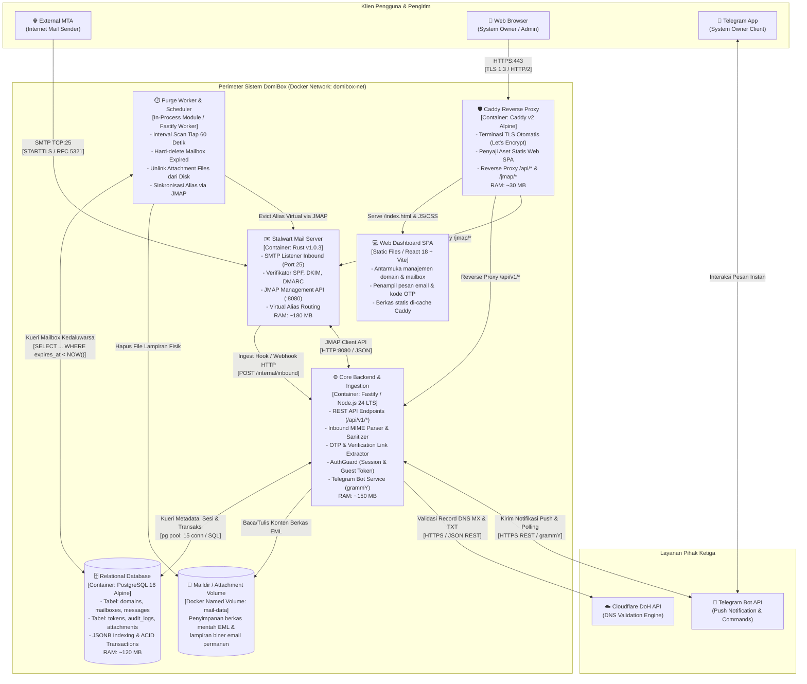

# C4 Level 2: Container Diagram — DomiBox Platform

| Status | Versi | Tanggal | Penulis | Dokumen Terkait |
| --- | --- | --- | --- | --- |
| PROPOSED | 0.1 | 2026-11-15 | omp-orchestrator/ArchCore | `docs/00-governance/project-charter.md` `docs/02-requirements/srs.md` `docs/03-architecture/architecture-overview.md` `docs/03-architecture/diagrams/c4-system-context.md` `docs/03-architecture/diagrams/component-diagram.md` `docs/03-architecture/diagrams/deployment-diagram.md` |

---

## 1. Deskripsi Tingkat Kontainer Sistem

Diagram Kontainer (C4 Level 2) membedah batasan internal sistem **DomiBox** menjadi modul-modul kontainer perangkat lunak terisolasi yang dapat dideploy secara independen namun beroperasi secara terkoordinasi di bawah satu orkestrator Docker Compose pada VPS host.

### Daftar Kontainer dalam Ekosistem DomiBox:
1. **Edge Reverse Proxy (Caddy v2 Alpine):** Gerbang tunggal lalu lintas web masuk (HTTP/HTTPS) yang menangani terminasi TLS otomatis via Let's Encrypt dan menyajikan aset statis.
2. **Web Dashboard SPA (React 18 + Vite + shadcn/ui):** Antarmuka pengguna browser berbasis Single Page Application murni.
3. **Core Backend & Ingestion Service (Fastify / Node.js 24 LTS):** Monolit modular yang menangani REST API, webhook/pipe ingestion dari server mail, MIME parsing, heuristik ekstraksi OTP, dan integrasi bot.
4. **Purge Worker / Scheduler (In-Process / BullMQ):** Pekerja latar belakang terjadwal untuk evaluasi kedaluwarsa mailbox (`expires_at`) dan pembersihan file disk.
5. **Mail Server Engine (Stalwart v1.0.3 Community - Rust):** Server mail performa tinggi penyedia listener SMTP port 25, pemverifikasi SPF/DKIM/DMARC, serta API manajemen JMAP.
6. **Relational Database (PostgreSQL 16 Alpine):** Basis data relasional persisten untuk metadata sistem, definisi domain, mailbox, token, dan indeks pencarian pesan.

---

## 2. Diagram Mermaid C4 Container

---

## 3. Tanggung Jawab & Batas Kontainer

| Nama Kontainer | Teknologi / Image | Port Internal / Terbuka | Batas Memori (cgroups) | Tanggung Jawab Utama |
| --- | --- | :---: | :---: | --- |
| **caddy** | `caddy:2.8-alpine` | `80:80`, `443:443` | `64 MB` | Manajemen sertifikat SSL otomatis, penyajian berkas statis frontend, mitigasi rate-limit awal HTTP. |
| **stalwart** | `stalwartlabs/mail-server:v1.0.3` | `25:25`, `8080:8080` (internal) | `384 MB` | Menerima koneksi SMTP inbound, validasi anti-spoofing (SPF/DKIM), manajemen akun/alias via JMAP. |
| **backend-core** | `node:24-alpine` | `3000:3000` (internal) | `256 MB` | Menjalankan Fastify server, orkestrasi bisnis domain/mailbox, ekstraksi OTP, pengirim notifikasi Telegram. |
| **postgres** | `postgres:16-alpine` | `5432:5432` (internal) | `256 MB` | Menjamin konsistensi ACID, isolasi konkurensi (MVCC), penyimpanan metadata pesan dan audit log. |
| **web-spa** | N/A (Multi-stage build) | N/A (Static files) | `0 MB` (Runtime) | Menghasilkan bundel HTML/JS/CSS yang dimount langsung ke root direktori web Caddy. |
