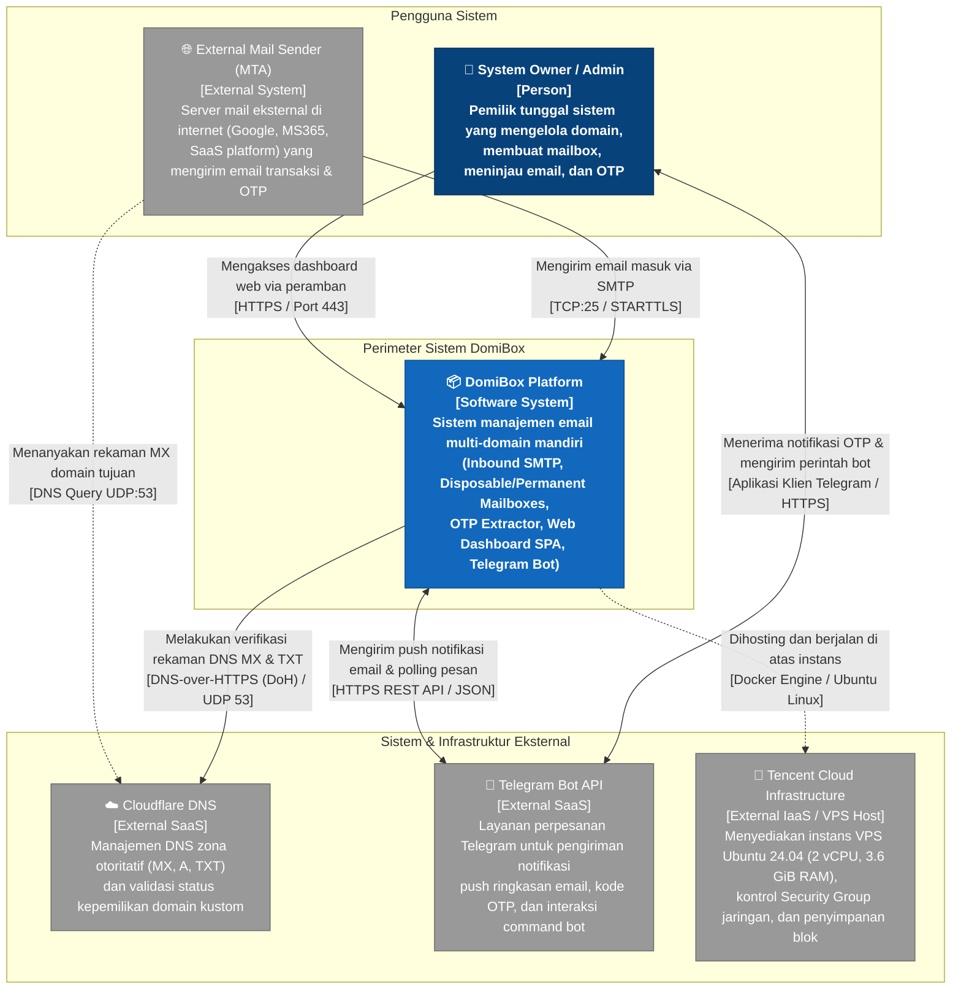

# C4 Level 1: System Context Diagram — DomiBox Platform

| Status | Versi | Tanggal | Penulis | Dokumen Terkait |
| --- | --- | --- | --- | --- |
| PROPOSED | 0.1 | 2026-11-15 | omp-orchestrator/ArchCore | `docs/00-governance/project-charter.md` `docs/01-product/prd/product-requirements-document.md` `docs/02-requirements/srs.md` `docs/03-architecture/architecture-overview.md` `docs/03-architecture/diagrams/c4-container.md` |

---

## 1. Deskripsi Tingkat Konteks Sistem

Diagram Konteks Sistem (C4 Level 1) ini menggambarkan batasan terluar (*system boundaries*) dari platform **DomiBox**, pengguna manusia yang berinteraksi dengannya, serta sistem-sistem eksternal yang terhubung langsung melalui protokol jaringan.

### Entitas Utama dalam Konteks:
1. **System Owner / Administrator:** Pengguna tunggal pengelola sistem yang memiliki hak administratif penuh atas domain kustom, konfigurasi sistem, dan pemantauan mailbox.
2. **External Mail Sender (MTA Internet):** Server email pengirim di internet (seperti Google Gmail, Microsoft Outlook, penyedia SaaS/e-commerce) yang mengirimkan pesan email masuk ke domain yang dihosting di DomiBox.
3. **DomiBox Platform:** Sistem inti yang menangani penerimaan email SMTP, pemilahan mailbox, ekstraksi kode OTP, antarmuka web, serta integrasi bot Telegram.
4. **Cloudflare DNS Infrastructure:** Penyedia layanan DNS otoritatif untuk resolusi rekaman MX, A, dan validasi TXT kepemilikan domain kustom.
5. **Telegram Bot API:** Layanan cloud perpesanan Telegram yang menghubungkan bot DomiBox dengan aplikasi Telegram milik pemilik.
6. **Tencent Cloud Infrastructure:** Penyedia infrastruktur komputasi awan yang meng-host instans CVM `vps-tencent3b`, mengelola Security Group, dan menyediakan konektivitas jaringan publik.

---

## 2. Diagram Mermaid C4 Context

---

## 3. Matriks Aliran Data & Protokol Antar-Sistem

| Sumber | Tujuan | Protokol / Port | Payload & Karakteristik Data | Rujukan Kebutuhan |
| --- | --- | :---: | --- | :---: |
| **External Mail Sender** | **DomiBox** | SMTP / TCP:25 (STARTTLS) | Aliran data email mentah RFC 5322 (Header, MIME multipart, teks, HTML, lampiran $\le 15$ MB). | `INB-001`, `FR-004` |
| **System Owner** | **DomiBox** | HTTPS / TCP:443 (TLS 1.3) | Permintaan Web Dashboard SPA, autentikasi session cookie, kueri mailbox, dan inspeksi pesan. | `WEB-001`, `FR-007` |
| **DomiBox** | **Telegram Bot API** | HTTPS / TCP:443 (REST) | Pengiriman payload notifikasi JSON (subjek, pengirim, ringkasan teks, kode OTP yang diekstrak). | `BOT-001`, `FR-006` |
| **DomiBox** | **Cloudflare DNS** | DNS over HTTPS / TCP:443 | Kueri JSON REST ke endpoint Cloudflare DoH (`https://cloudflare-dns.com/dns-query`) untuk validasi MX dan TXT. | `DOM-001`, `FR-001` |
| **DomiBox** | **Tencent Cloud** | Kernel Syscalls & Cgroups | Eksekusi runtime Docker Compose, batasan memori RAM $\le 1.2$ GiB, partisi penyimpanan disk volume $\le 10$ GB. | `OPS-001`, `NFR-009` |
