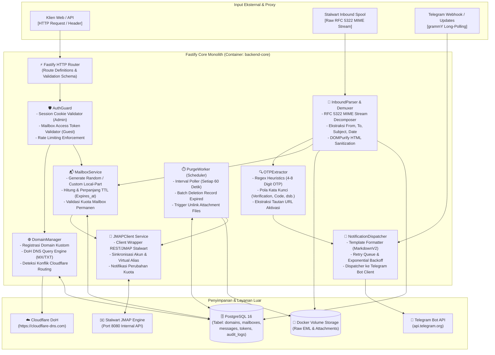

# C4 Level 3: Component Diagram (Backend Core) — DomiBox Platform

| Status | Versi | Tanggal | Penulis | Dokumen Terkait |
| --- | --- | --- | --- | --- |
| PROPOSED | 0.1 | 2026-11-15 | omp-orchestrator/ArchCore | `docs/00-governance/project-charter.md` `docs/02-requirements/srs.md` `docs/03-architecture/architecture-overview.md` `docs/03-architecture/diagrams/c4-container.md` `docs/03-architecture/adr/ADR-006.md` |

---

## 1. Deskripsi Tingkat Komponen (Backend Core Service)

Diagram Komponen (C4 Level 3) merinci struktur internal kontainer **Backend Core Application (Fastify / Node.js 24 LTS)**. Diagram ini memperlihatkan bagaimana logika bisnis dibagi menjadi modul-modul independen (*loosely coupled, highly cohesive*) yang bekerja sama untuk memproses email, mengekstrak kode OTP, mengelola domain dan mailbox, serta mengendalikan notifikasi.

### Daftar Komponen Utama:
1. **AuthGuard:** Modul otentikasi dan otorisasi yang memvalidasi Admin Session Cookie dan Guest Access Token (`X-Mailbox-Token`).
2. **DomainManager:** Komponen pengelola status domain kustom, generator token TXT verifikasi, dan validator rekaman DNS melalui kueri Cloudflare DoH.
3. **MailboxService:** Pengendali siklus hidup mailbox (sementara dan permanen), alokasi kuota, penghitungan TTL, dan perpanjangan masa aktif.
4. **InboundParser & MIME Demuxer:** Pembedah aliran MIME RFC 5322 mentah yang memisahkan teks polos, HTML tersanitasi, serta metadata lampiran.
5. **OTPExtractor:** Mesin heuristik yang memindai teks dan HTML pesan untuk menemukan kode verifikasi (angka 4–8 digit, alfanumerik) dan tautan aktivasi akun.
6. **NotificationDispatcher:** Komponen antrean internal yang memformat ringkasan pesan dan mengirimkannya secara asinkron ke Telegram Bot API.
7. **JMAPClient:** Klien HTTP internal terabstraksi yang berkomunikasi dengan Stalwart Management API untuk membuat alias virtual dan menyinkronkan kuota.
8. **PurgeWorker:** Eksekutor penjadwal latar belakang yang memindai dan menghapus data mailbox kedaluwarsa secara atomik dari basis data dan disk.

---

## 2. Diagram Mermaid C4 Component

---

## 3. Rincian Modul Komponen & Antarmuka Internal

| Komponen | Masukan (*Inputs*) | Keluaran (*Outputs*) | Dependensi Internal / Eksternal |
| --- | --- | --- | --- |
| **AuthGuard** | Header `Authorization`, `Cookie`, `X-Mailbox-Token` | Konteks `req.user` atau `req.mailbox` terverifikasi | Kueri session/token ke PostgreSQL, modul `@fastify/cookie` |
| **DomainManager** | Nama domain, request validasi TXT/MX | Status domain (`ACTIVE`, `PENDING`, `CONFLICT_ROUTING`) | Modul `node-fetch` ke Cloudflare DoH, tabel `domains` |
| **MailboxService** | Permintaan pembuatan mailbox, parameter TTL | Objek `Mailbox`, token akses unik 32-karakter | Modul `crypto`, JMAPClient, tabel `mailboxes` |
| **InboundParser** | Aliran biner MIME email masuk | Objek pesan terstruktur JSON, status SPF/DKIM | Pustaka `postal-mime`, `DOMPurify`, volume disk `mail-data` |
| **OTPExtractor** | Teks polos & teks HTML dari InboundParser | Array kode OTP terdeteksi, array URL aktivasi | Modul ekspresi reguler heuristik internal |
| **NotificationDispatcher** | Ringkasan email, metadata pesan, hasil OTP | Pengiriman pesan chat terformat ke Telegram | Framework `grammY`, Telegram Bot API eksternal |
| **JMAPClient** | Perintah pembuatan alias, update kuota | Respon status HTTP 200/204 dari Stalwart | Endpoint Stalwart JMAP (`http://stalwart:8080/jmap`) |
| **PurgeWorker** | Pemicu cron interval (60 detik) | Jumlah baris terhapus, berkas fisik yang di-unlink | Transaksi SQL PostgreSQL, syscall `fs.promises.unlink` |
