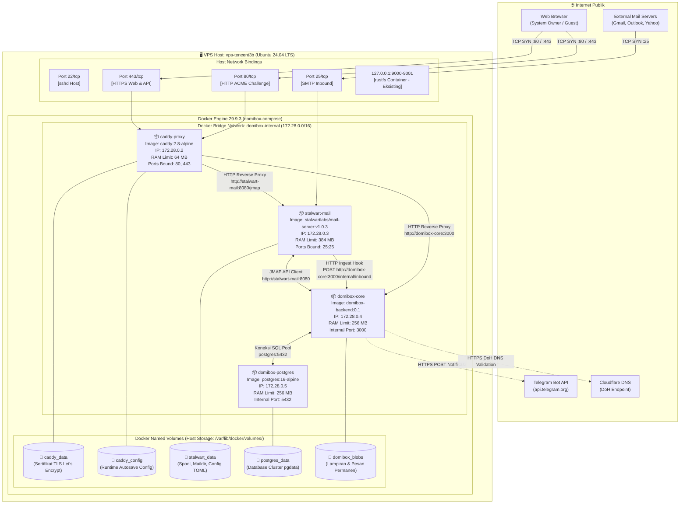

# Topologi Deployment & Kontainer Fisik — DomiBox Platform

| Status | Versi | Tanggal | Penulis | Dokumen Terkait |
| --- | --- | --- | --- | --- |
| PROPOSED | 0.1 | 2026-11-15 | omp-orchestrator/ArchCore | `docs/00-governance/project-charter.md` `docs/02-requirements/srs.md` `docs/02-requirements/nfr-spec.md` `docs/03-architecture/architecture-overview.md` `docs/03-architecture/capacity-planning.md` `docs/03-architecture/diagrams/c4-container.md` `docs/03-architecture/adr/ADR-001.md` `docs/03-architecture/adr/ADR-010.md` |

---

## 1. Pendahuluan & Lingkungan Infrastruktur Target

Dokumen ini mendefinisikan topologi penempatan fisik (*physical deployment topology*), konfigurasi jaringan virtual Docker, pemetaan port antarmuka publik, serta alokasi volume penyimpanan data persisten untuk platform **DomiBox**.

### Karakteristik Node Host Terverifikasi (`vps-tencent3b`, 2026-11-14):
- **Sistem Operasi:** Ubuntu 24.04.5 LTS (Linux kernel 6.8.0-x86_64)
- **Komputasi:** 2 vCPU AMD EPYC 7K62, 3.6 GiB Total RAM, 1.9 GiB Swap
- **Container Runtime:** Docker Engine 29.9.3, Docker Compose v5.7.0
- **Layanan Non-Terkait yang Berjalan:** `rustfs/rustfs:1.0.4` pada `127.0.0.1:9000-9001` (Terisolasi sempurna, tidak diakses atau diubah).
- **Perimeter Firewall Jaringan:**
  - *Tencent Cloud Security Group:* Port 22/tcp (SSH), Port 80/tcp (HTTP), Port 443/tcp (HTTPS), Port 25/tcp (Inbound SMTP diizinkan). Port 25 Outbound diblokir secara default oleh infrastruktur Tencent.
  - *Host UFW (Uncomplicated Firewall):* Mengikuti aturan Security Group host.

---

## 2. Diagram Topologi Deployment Fisik & Jaringan Docker

---

## 3. Matriks Pemetaan Port & Proteksi Jaringan

| Port Host | Protokol | Sumber Diizinkan | Layanan Tujuan Kontainer | Fungsi & Keterangan |
| :---: | :---: | :---: | :---: | --- |
| **22** | TCP | Alamat IP Admin / Terbatas | `Host sshd` | Akses terminal manajemen jarak jauh VPS. |
| **25** | TCP | `0.0.0.0/0` (Seluruh Dunia) | `stalwart-mail:25` | Menerima email masuk dari MTA internet (inbound SMTP). |
| **80** | TCP | `0.0.0.0/0` (Seluruh Dunia) | `caddy-proxy:80` | Pengalihan otomatis HTTP ke HTTPS & HTTP-01 challenge ACME. |
| **443** | TCP | `0.0.0.0/0` (Seluruh Dunia) | `caddy-proxy:443` | Antarmuka web utama Web SPA dan REST API. |
| **5432** | TCP | *Hanya Internal Docker Bridge* | `domibox-postgres:5432` | **TIDAK DI-EXPOSE KE HOST**. Hanya dapat diakses oleh `domibox-core`. |
| **3000** | TCP | *Hanya Internal Docker Bridge* | `domibox-core:3000` | **TIDAK DI-EXPOSE KE HOST**. Hanya dapat diakses oleh `caddy-proxy`. |
| **8080** | TCP | *Hanya Internal Docker Bridge* | `stalwart-mail:8080` | **TIDAK DI-EXPOSE KE HOST**. Endpoint JMAP dan WebAdmin Stalwart. |
| **9000-9001** | TCP | `127.0.0.1` (Loopback Host) | `rustfs-container` | Layanan eksisting independen host (Jangan diganggu). |

---

## 4. Rincian Volume Penyimpanan Persisten & Strategi Backup

Seluruh data persisten DomiBox disimpan dalam volume bernama (*Docker Named Volumes*) pada partisi `/var/lib/docker/volumes/` host:

1. **`postgres_data`:**
   - Menyimpan seluruh tabel database (domain, mailbox, token sesi, audit trail, metadata email).
   - Di-*backup* setiap 24 jam sekali menggunakan script `pg_dump` otomatis yang dikompresi ke direktori `/opt/domibox/backups/`.
2. **`domibox_blobs` & `stalwart_data`:**
   - Menyimpan file mentah pesan email (format `.eml`) dan berkas lampiran yang diisolasi.
   - Dikelola oleh retensi otomatis Purge Worker (`NFR-008`).
3. **`caddy_data`:**
   - Menyimpan sertifikat SSL/TLS X.509 dan kunci privat yang diterbitkan Let's Encrypt / ZeroSSL.
   - Menghindari batas laju (*rate-limiting*) penerbitan sertifikat Let's Encrypt saat kontainer direstart.
