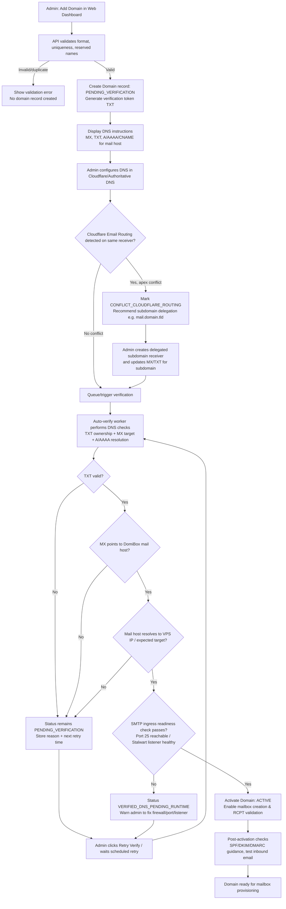

# Domain Onboarding Flow

**Status:** `PROPOSED`  
**Version:** `0.1`  
**Date:** `2026-11-15`  
**Owner:** `Architecture`  
**Dokumen Terkait:** `./network-port-matrix.md`, `../adr/ADR-001.md`, `../adr/ADR-002.md`, `../adr/ADR-003.md`, `../adr/ADR-010.md`, `../../02-requirements/srs.md` (`FR-001`, `DOM-001..DOM-003`), `../../02-requirements/brd.md` (`BR-001`, `BR-004`), `../../02-requirements/security-privacy-requirements.md` (`SEC-001`, `SEC-004`), `../../09-research/mail-infrastructure-suitability.md`

## 1. Tujuan
Mendefinisikan alur onboarding domain kustom ke DomiBox, mulai dari pendaftaran domain di dashboard, penerbitan token verifikasi, konfigurasi DNS (MX/TXT/A/CNAME) di Cloudflare/authoritative DNS, verifikasi otomatis/manual, aktivasi domain, hingga panduan delegasi subdomain untuk menghindari konflik dengan Cloudflare Email Routing.

## 2. Prasyarat & Prinsip
- Administrator memiliki akses ke zona DNS domain (Cloudflare atau DNS provider authoritative).
- VPS DomiBox memiliki IP publik stabil dan port 25/80/443 dikonfigurasi sesuai `network-port-matrix.md`.
- Domain onboarding tidak dianggap aktif sampai verifikasi kepemilikan (TXT) dan routing penerimaan (MX) tervalidasi (`DOM-001`, `SEC-001`).
- Satu hostname/domain penerima tidak boleh memiliki MX yang konflik (mis. MX DomiBox dan MX Cloudflare Email Routing pada penerima yang sama).

## 3. Flowchart (End-to-End Onboarding)

## 4. Langkah Operasional Rinci

### 4.1 Pendaftaran Domain (Dashboard/API)
| Langkah | Aktor | Aksi | Output Sistem | Status Domain |
| --- | --- | --- | --- | --- |
| 1 | Admin | Input domain/subdomain (mis. `sintaksis.biz.id` atau `mail.sintaksis.biz.id`) | Validasi format, normalisasi, cek duplikasi | - |
| 2 | Sistem | Buat record domain + token verifikasi TXT unik | Token verifikasi (mis. `_domibox-verification=<token>`), instruksi DNS, audit log | `PENDING_VERIFICATION` |
| 3 | Sistem | Tampilkan target konfigurasi | MX target, host A/AAAA, TTL rekomendasi, panduan konflik Cloudflare | `PENDING_VERIFICATION` |

### 4.2 Konfigurasi DNS (Cloudflare / Authoritative DNS)
Rekomendasi baseline (contoh untuk receiver `mail.sintaksis.biz.id`):

| Record | Host/Name | Type | Value/Target | TTL | Tujuan | Wajib |
| --- | --- | --- | --- | --- | --- | --- |
| Ownership verification | `_domibox-verification.mail` | TXT | `domibox-verify=<random-token>` | 300-600 | Bukti kepemilikan domain/subdomain | Ya |
| MX receiver | `mail` | MX | `10 mx.mail.sintaksis.biz.id.` (atau host mail DomiBox) | 300-3600 | Routing email inbound ke Stalwart | Ya |
| Mail host address | `mx.mail` (atau host MX) | A / AAAA | `<VPS_PUBLIC_IPv4/IPv6>` | 300-3600 | Resolusi host penerima SMTP | Ya |
| SPF (opsional, konteks identitas) | `mail` | TXT | `v=spf1 -all` (baseline no-send untuk receiver-only subdomain) | 3600 | Menyatakan domain/subdomain tidak mengirim mail (MVP inbound-only) | Direkomendasikan |
| DMARC (opsional) | `_dmarc.mail` | TXT | `v=DMARC1; p=reject; rua=mailto:<ops@example>` (sesuaikan kebijakan) | 3600 | Kebijakan anti-spoofing observability | Direkomendasikan |
| DKIM | `<selector>._domainkey.mail` | TXT | Public key (jika signing diaktifkan di masa depan) | 3600 | Validasi signature outbound/signing use case | Tidak untuk MVP inbound-only |

> Catatan: Nilai SPF/DMARC/DKIM di atas adalah panduan arsitektur; implementasi aktual harus mengikuti kebijakan domain dan kebutuhan operasional. MVP DomiBox berfokus inbound-only.

### 4.3 Verifikasi Otomatis (Worker) & Aktivasi
| Tahap Verifikasi | Pemeriksaan | Sumber Data | Hasil Lulus | Hasil Gagal |
| --- | --- | --- | --- | --- |
| V1 - Ownership TXT | TXT `_domibox-verification` cocok token aktif | DNS resolver authoritative/recursive | Lanjut ke V2 | Tetap `PENDING_VERIFICATION` + alasan `TXT_NOT_FOUND/TXT_MISMATCH` |
| V2 - MX Routing | MX record receiver menunjuk ke host mail yang diharapkan | DNS MX query | Lanjut ke V3 | `PENDING_VERIFICATION` + alasan `MX_MISSING/MX_MISMATCH` |
| V3 - Host Resolution | Host MX resolve ke IP VPS/target yang valid | DNS A/AAAA | Lanjut ke V4 | `PENDING_VERIFICATION` + alasan `HOST_UNRESOLVED/IP_MISMATCH` |
| V4 - Runtime Readiness (opsional gate aktivasi) | Listener SMTP/Stalwart sehat dan port 25 dapat menerima koneksi | Health check internal + probe terkontrol | Domain `ACTIVE` | `VERIFIED_DNS_PENDING_RUNTIME` + panduan perbaikan firewall/port/service |
| V5 - Conflict Detection | Deteksi MX Cloudflare Email Routing pada receiver yang sama | DNS MX pattern check | Lanjut/aktif sesuai konteks | `CONFLICT_CLOUDFLARE_ROUTING` + rekomendasi subdomain delegasi |

**Mekanisme auto-verify worker:**
- Trigger: event saat domain dibuat/update DNS hint, tombol "Retry Verify", dan jadwal periodik (mis. setiap 1-5 menit dengan backoff).
- Idempotent: verifikasi membaca state terkini DNS dan memperbarui status hanya jika berubah.
- Audit: setiap percobaan verifikasi menyimpan timestamp, resolver result summary, status akhir, dan error code.
- Keamanan: token verifikasi bersifat acak, dapat diputar ulang (rotate/regenerate), dan tidak dipakai sebagai kredensial akses mailbox.

## 5. Panduan Delegasi Subdomain (Cloudflare Email Routing & Konflik MX)

### 5.1 Kapan Delegasi Subdomain Diperlukan
- Domain apex (`example.com`) sudah menggunakan Cloudflare Email Routing atau penyedia MX lain yang harus tetap aktif.
- Administrator ingin DomiBox menerima mail tanpa memutus routing email eksisting pada apex.
- Diperlukan isolasi operasional/pengujian (mis. `mail.example.com` untuk DomiBox, apex tetap untuk provider lain).

### 5.2 Pola Delegasi yang Direkomendasikan
| Pola | Contoh | Kapan Digunakan | Kelebihan | Catatan |
| --- | --- | --- | --- | --- |
| Subdomain receiver khusus | `mail.sintaksis.biz.id` | Default rekomendasi pilot | Isolasi konflik MX, rollback mudah, tidak mengganggu apex | Mailbox menjadi `user@mail.sintaksis.biz.id` |
| Subdomain produk | `inbox.example.com` | Branding/UX tertentu | Nama lebih deskriptif | Tetap perlu MX/TXT terpisah |
| Apex receiver | `sintaksis.biz.id` | Tidak ada layanan MX lain pada apex | Alamat email lebih pendek | **Tidak kompatibel** jika Cloudflare Email Routing aktif pada apex |

### 5.3 Langkah Delegasi Subdomain (Praktis)
1. Pilih subdomain receiver (mis. `mail.sintaksis.biz.id`) dan daftarkan subdomain tersebut di DomiBox (bukan apex).
2. Buat/konfirmasi record MX pada host `mail` mengarah ke mail host DomiBox (bukan `route*.mx.cloudflare.net`).
3. Buat record A/AAAA untuk host MX yang ditunjuk agar resolve ke IP VPS DomiBox.
4. Tambahkan TXT verifikasi kepemilikan pada subdomain sesuai token yang diberikan DomiBox.
5. Jika zona DNS dikelola di Cloudflare, pastikan record mail host yang perlu bypass proxy di-set **DNS only** (bukan proxied) untuk resolusi mail yang benar; record dashboard/web dapat tetap proxied sesuai desain.
6. Jalankan verifikasi otomatis di DomiBox; perbaiki hingga status `ACTIVE`.

### 5.4 Guardrail Anti-Konflik
- Sistem menolak aktivasi jika MX receiver mengarah ke Cloudflare Email Routing pada hostname yang sama dengan target penerimaan DomiBox.
- Sistem memberi panduan eksplisit: "Gunakan subdomain delegasi" alih-alih menimpa MX apex secara diam-diam.
- Perubahan DNS yang memicu konflik setelah aktivasi harus mengubah status kesehatan domain (mis. `DEGRADED_DNS_CONFLICT`) dan memicu peringatan operasional.

## 6. State Domain (Onboarding Perspective)
| Status | Arti | Transisi Masuk | Transisi Keluar |
| --- | --- | --- | --- |
| `PENDING_VERIFICATION` | Domain terdaftar, menunggu DNS valid | Domain dibuat / verifikasi gagal | `ACTIVE`, `CONFLICT_CLOUDFLARE_ROUTING`, `VERIFIED_DNS_PENDING_RUNTIME` |
| `CONFLICT_CLOUDFLARE_ROUTING` | MX receiver bentrok dengan Cloudflare Email Routing | Deteksi konflik MX | `PENDING_VERIFICATION` (setelah DNS diperbaiki) |
| `VERIFIED_DNS_PENDING_RUNTIME` | DNS valid tetapi runtime SMTP belum siap | V1-V3 lulus, V4 gagal | `ACTIVE`, `PENDING_VERIFICATION` |
| `ACTIVE` | Domain siap menerima mail dan digunakan untuk mailbox | V1-V4 lulus, tanpa konflik | `SUSPENDED` (operasional), `DEGRADED_DNS_CONFLICT` (monitoring lanjutan) |

## 7. Kriteria Keberhasilan Onboarding
- Token verifikasi TXT tervalidasi untuk receiver yang didaftarkan.
- MX receiver mengarah ke host mail DomiBox dan host resolve ke target infrastruktur yang benar.
- Tidak ada konflik Cloudflare Email Routing pada receiver yang sama.
- Port 25/Stalwart listener siap menerima SMTP inbound (sesuai gate operasional).
- Uji inbound sederhana (email percobaan) diterima dan diproses ke mailbox aktif.

## 8. Traceability
| Kebutuhan | Cakupan |
| --- | --- |
| `BR-001` | Pendaftaran domain kustom, verifikasi DNS, aktivasi domain |
| `BR-004` | Audit status verifikasi dan deteksi konflik konfigurasi |
| `FR-001` / `DOM-001` | Token verifikasi TXT, validasi MX/TXT, aktivasi `ACTIVE` |
| `FR-001.1` / `DOM-002` | Deteksi konflik Cloudflare Email Routing dan rekomendasi subdomain delegasi |
| `FR-001.2` / `DOM-003` | Status operasional domain (aktif/suspend) dan dampaknya pada penerimaan |
| `SEC-001` | Validasi kepemilikan domain sebelum aktivasi |
| `SEC-004` | Keamanan jalur penerimaan email melalui konfigurasi DNS/MX yang benar |
| `ADR-001`, `ADR-002`, `ADR-010` | Batas sistem, integrasi mail engine, strategi DNS/Port 25/delegasi subdomain |

## 9. Referensi Teknis & Standar
- RFC 1035 — Domain Names: Implementation and Specification (DNS records): https://www.rfc-editor.org/rfc/rfc1035
- RFC 5321 — Simple Mail Transfer Protocol (MX-based mail routing): https://www.rfc-editor.org/rfc/rfc5321
- RFC 7208 — Sender Policy Framework (SPF): https://www.rfc-editor.org/rfc/rfc7208
- RFC 6376 — DomainKeys Identified Mail (DKIM): https://www.rfc-editor.org/rfc/rfc6376
- RFC 7489 — Domain-based Message Authentication, Reporting, and Conformance (DMARC): https://www.rfc-editor.org/rfc/rfc7489
- Cloudflare DNS Documentation: https://developers.cloudflare.com/dns/
- Cloudflare Email Routing Documentation (MX takeover behavior): https://developers.cloudflare.com/email-routing/
- Stalwart Mail Server Documentation (domain/account configuration context): https://stalw.art/docs/
- Riset internal: `../../09-research/mail-infrastructure-suitability.md`
