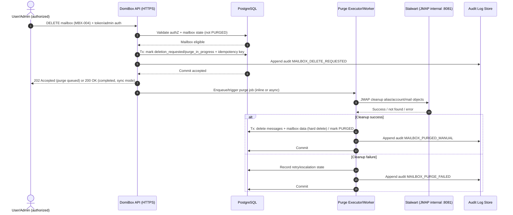

# Expiration & Deletion Flow

**Status:** `PROPOSED`  
**Version:** `0.1`  
**Date:** `2026-11-15`  
**Owner:** `Architecture`  
**Dokumen Terkait:** `./mailbox-lifecycle-state-machine.md`, `./email-flow-sequence.md`, `./network-port-matrix.md`, `../adr/ADR-003.md`, `../adr/ADR-004.md`, `../adr/ADR-005.md`, `../adr/ADR-011.md`, `../../02-requirements/srs.md` (`MBX-002`, `MBX-004`, `OPS-001`, `OPS-002`), `../../02-requirements/brd.md` (`BR-001`, `BR-004`), `../../02-requirements/nfr-spec.md` (`NFR-003`, `NFR-008`), `../../02-requirements/security-privacy-requirements.md` (`SEC-002`, `SEC-003`, `SEC-008`)

## 1. Tujuan
Mendefinisikan alur teknis kedaluwarsa (expiration), pembersihan otomatis (auto-purge), dan penghapusan manual (immediate deletion) untuk mailbox sementara pada DomiBox, termasuk sinkronisasi penghapusan alias/account/mail objects di Stalwart via JMAP, penghapusan/pelunakan data di PostgreSQL, serta pencatatan audit log yang dapat ditelusuri.

## 2. Ruang Lingkup
- **Termasuk:** mailbox sementara (`is_permanent=false`) yang melewati `expires_at`, permintaan hapus segera (`MBX-004`), retry/idempotensi job, konsistensi DomiBox DB ↔ Stalwart, dan audit.
- **Tidak termasuk:** penghapusan mailbox permanen (diatur oleh alur admin lifecycle permanen), backup/restore forensik di luar kebijakan retensi MVP, dan outbound mail flow.

## 3. Aktor & Komponen
| Komponen | Peran | Catatan |
| --- | --- | --- |
| Scheduler (Cron/Interval Worker) | Memicu siklus scan expiration/purge (setiap 60 detik) | Komponen background job `ADR-011` |
| Expiration Worker | Mengklaim batch mailbox expired, menjalankan transisi state dan purge | Harus idempotent dan aman terhadap restart |
| PostgreSQL | Sumber state operasional mailbox/message/audit/job | Transaksi ACID, lock/claim row |
| Stalwart (JMAP/HTTP internal) | Eksekusi penghapusan alias/account/mailbox/mail data terkait | Diakses via jaringan internal `:8081` |
| Audit Logger | Mencatat event lifecycle dan hasil purge | Append-only semantics pada level aplikasi/log sink |
| Web/Bot Notifier (opsional) | Memberi update status expired/purged ke klien | Best-effort, tidak mengubah keberhasilan purge |

## 4. Sequence Diagram — Auto-Expiration & Purge Scheduler

```mermaid
sequenceDiagram
    autonumber
    participant CRON as Scheduler Cron (every 60s)
    participant EW as Expiration Worker
    participant DB as PostgreSQL
    participant ST as Stalwart (JMAP internal :8081)
    participant AUD as Audit Log Store
    participant UI as Web/Bot Channels (optional)

    CRON->>EW: Trigger purge cycle (tick)
    EW->>DB: Begin tx: claim expired mailbox batch\nWHERE is_permanent=false AND status IN ('ACTIVE','EXPIRING_SOON','EXPIRED')\nAND expires_at <= now()\nFOR UPDATE SKIP LOCKED LIMIT N
    DB-->>EW: Claimed mailbox rows + metadata (ids, domain, stalwart refs)

    alt No expired mailboxes
        EW->>DB: Commit (no-op cycle)
        EW-->>CRON: Cycle complete (0 processed)
    else One or more mailboxes claimed
        loop For each claimed mailbox (idempotent unit)
            EW->>DB: Mark state transition attempt EXPIRED (if not already)\nset purge_started_at, purge_job_id
            EW->>AUD: Append audit MAILBOX_EXPIRED_DETECTED
            EW->>DB: Commit transition checkpoint

            %% External cleanup in Stalwart first (or compensatable order)
            EW->>ST: JMAP calls: resolve account/alias/mailbox refs
            ST-->>EW: Refs found / not found

            alt Stalwart refs exist
                EW->>ST: Remove alias/routing for temporary address
                ST-->>EW: OK / error
                EW->>ST: Delete mailbox/mail objects or temporary account artifacts (implementation-specific)
                ST-->>EW: OK / partial / error
            else Refs already absent
                Note over EW,ST: Treat as already cleaned (idempotent success)
            end

            alt Stalwart cleanup success or already-clean
                EW->>DB: Begin tx: hard delete messages, tokens/sessions refs, mailbox row\n(or mark PURGED tombstone per policy)
                EW->>AUD: Append audit MAILBOX_PURGED (scope, counts, duration)
                EW->>DB: Commit purge completion
                EW-->>UI: Emit mailbox expired/purged event (best-effort)
            else Stalwart cleanup retryable failure
                EW->>DB: Record failure + increment retry_count + next_retry_at
                EW->>AUD: Append audit MAILBOX_PURGE_RETRY_SCHEDULED (error class)
                EW->>DB: Commit failure state
                Note over EW,DB: Mailbox remains non-receivable; next scheduler tick retries
            else Stalwart cleanup terminal failure (invalid ref/policy conflict)
                EW->>DB: Mark requires_reconciliation + alert flag
                EW->>AUD: Append audit MAILBOX_PURGE_REQUIRES_RECONCILIATION
                EW->>DB: Commit escalation state
            end
        end
        EW-->>CRON: Cycle complete (processed N)
    end
```

## 5. Sequence Diagram — Immediate Deletion (Manual Purge)



## 6. Aturan Penghapusan Data (Data Deletion Semantics)

### 6.1 Urutan Operasi & Konsistensi
| Urutan | Operasi | Tujuan | Idempotensi |
| --- | --- | --- | --- |
| 1 | Claim/lock mailbox expired target | Mencegah double-processing oleh worker paralel | `FOR UPDATE SKIP LOCKED` + status/job id |
| 2 | Tandai `EXPIRED` / `purge_in_progress` | Menutup penerimaan inbound dan memberi checkpoint | Update kondisional berdasarkan status sebelumnya |
| 3 | Cleanup di Stalwart via JMAP (alias/account/mail objects) | Menghentikan routing/penerimaan di mail engine | Perlakuan "not found" sebagai sukses |
| 4 | Hard delete data pesan & mailbox di PostgreSQL | Memenuhi auto-purge MVP dan minimisasi retensi | Delete by mailbox id dalam transaksi |
| 5 | Tulis audit `MAILBOX_PURGED` | Traceability operasional dan keamanan | Event id unik per job attempt/finalization |

> **Catatan implementasi:** Jika cleanup Stalwart gagal setelah checkpoint, mailbox tetap non-receivable di sisi DomiBox (fail-safe) dan job dijadwalkan ulang. Rekonsiliasi periodik harus memperbaiki drift state.

### 6.2 Cakupan Data yang Dibersihkan (Temporary Mailbox)
| Data | Lokasi | Aksi Default MVP | Alasan |
| --- | --- | --- | --- |
| Mailbox record | PostgreSQL (`Mailbox`) | Hard delete atau tombstone `PURGED` minimal (pilihan implementasi; rekomendasi: hard delete + audit event) | Menghapus identitas aktif sementara |
| Message records & parsed bodies | PostgreSQL (`Message`) | Hard delete | Retensi minimal, privasi, efisiensi storage |
| OTP/link extraction fields | PostgreSQL (`Message`) | Hard delete bersama message | Data sensitif turunan |
| Access token hash / session refs | PostgreSQL / cache (jika ada) | Delete/invalidate | Mencegah akses pasca purge (`SEC-002`) |
| Alias/account/mailbox objects terkait | Stalwart (JMAP-managed objects) | Delete/remove mapping | Menghentikan penerimaan dan memastikan konsistensi engine |
| Audit events | PostgreSQL/log sink | **Retain** sesuai kebijakan audit | Kebutuhan `OPS-002`, `SEC-008` (tidak ikut hard delete mailbox) |

### 6.3 Soft Delete vs Hard Delete (Kebijakan)
- **Mailbox sementara (MVP):** hard delete data operasional (mailbox/messages/tokens) setelah `EXPIRED` atau immediate purge; audit log dipertahankan.
- **Mailbox permanen:** penghapusan mengikuti alur admin (dapat soft-delete/tombstone sebelum hard-delete sesuai kebijakan retensi dan kebutuhan audit), tidak diproses oleh scheduler expiration TTL.
- **Rekonsiliasi:** jika objek Stalwart sudah hilang tetapi DB belum bersih (atau sebaliknya), worker menandai sukses parsial/idempotent dan menyelesaikan sisi yang tertinggal.

## 7. Penjadwalan, Retry, dan Idempotensi
| Aspek | Ketentuan |
| --- | --- |
| Frekuensi scheduler | Setiap 60 detik (`OPS-001`) |
| Batch size | Terbatas (mis. 50-200 mailbox/tick) untuk mencegah lonjakan beban |
| Klaim pekerjaan | `SELECT ... FOR UPDATE SKIP LOCKED` atau mekanisme lease/job claim setara |
| Idempotency key | `purge:{mailbox_id}:{expires_at_or_request_id}` untuk auto-purge/manual purge |
| Retry policy | Exponential backoff untuk error jaringan/JMAP sementara; batas percobaan + eskalasi |
| Terminal handling | Setelah batas retry, set `requires_reconciliation=true` dan alert operasional |
| Crash recovery | Worker restart melanjutkan dari checkpoint state (`EXPIRED/purge_in_progress`) |

## 8. Dampak pada Penerimaan Email & UX
- Mailbox yang melewati `expires_at` harus dianggap **tidak dapat menerima email**; validasi `RCPT TO` menolak (550/554).
- Jika pesan masuk tiba pada race window (tepat saat transisi), sistem memilih perilaku aman: tolak inbound bila state tidak tegas aktif.
- Web/Bot dapat menampilkan status `EXPIRED` hingga `PURGED`; setelah purge, endpoint detail mailbox mengembalikan not found/gone sesuai kebijakan API.
- Audit harus membedakan event `MAILBOX_EXPIRED_DETECTED`, `MAILBOX_PURGE_RETRY_SCHEDULED`, `MAILBOX_PURGED`, dan `MAILBOX_PURGE_FAILED`.

## 9. Observabilitas & Kontrol Operasional
- **Metrik:** jumlah mailbox expired per tick, durasi purge per mailbox/batch, retry count, Stalwart JMAP error rate, orphan reconciliation count, backlog expired-not-purged.
- **Log terstruktur:** `job_id`, `mailbox_id`, `domain`, `trigger` (`scheduler|manual`), `state_from`, `state_to`, `stalwart_cleanup_result`, `db_cleanup_result`, `attempt`, `error_code`.
- **Alert minimum:** backlog purge > ambang batas, retry terminal meningkat, drift DomiBox-Stalwart terdeteksi, scheduler tidak berjalan > 2 interval.

## 10. Traceability
| Kebutuhan | Cakupan |
| --- | --- |
| `BR-001` | Penegakan TTL mailbox sementara |
| `BR-004` | Penghapusan otomatis/terkendali dan audit operasional |
| `FR-002.1` / `MBX-002` | Interaksi TTL extension sebelum expiration (guard transisi) |
| `FR-003.1` / `MBX-004` | Immediate purge manual |
| `FR-008` / `OPS-001` | Scheduler cron scan dan purge mailbox kedaluwarsa |
| `FR-008.1` / `OPS-002` | Audit log transisi dan hasil purge |
| `NFR-003` | Integritas penghapusan data dan konsistensi storage |
| `NFR-008` | Ketepatan eksekusi terjadwal (operasional) |
| `SEC-002`, `SEC-003` | Invalidasi akses token dan kontrol lifecycle data |
| `SEC-008` | Jejak audit untuk tindakan penghapusan |
| `ADR-003`, `ADR-004`, `ADR-005`, `ADR-011` | Model mailbox, integrasi JMAP, persistensi PostgreSQL, strategi scheduler/purge |

## 11. Referensi Teknis & Standar
- RFC 5321 — Simple Mail Transfer Protocol (recipient rejection semantics): https://www.rfc-editor.org/rfc/rfc5321
- RFC 8620 — JMAP Core: https://www.rfc-editor.org/rfc/rfc8620
- RFC 8621 — JMAP for Mail: https://www.rfc-editor.org/rfc/rfc8621
- PostgreSQL 16 Documentation — Transactions, Concurrency, and Locking: https://www.postgresql.org/docs/16/transaction-iso.html
- PostgreSQL 16 Documentation — `SELECT ... FOR UPDATE`: https://www.postgresql.org/docs/16/sql-select.html#SQL-FOR-UPDATE-SHARE
- Stalwart Mail Server Documentation: https://stalw.art/docs/
- Stalwart JMAP/Management API context: https://stalw.art/docs/jmap/overview
- NIST SP 800-88 Rev.1 — Guidelines for Media Sanitization (data lifecycle/disposal principles): https://csrc.nist.gov/pubs/sp/800/88/r1/final
- NIST SP 800-92 — Guide to Computer Security Log Management: https://csrc.nist.gov/pubs/sp/800/92/final
