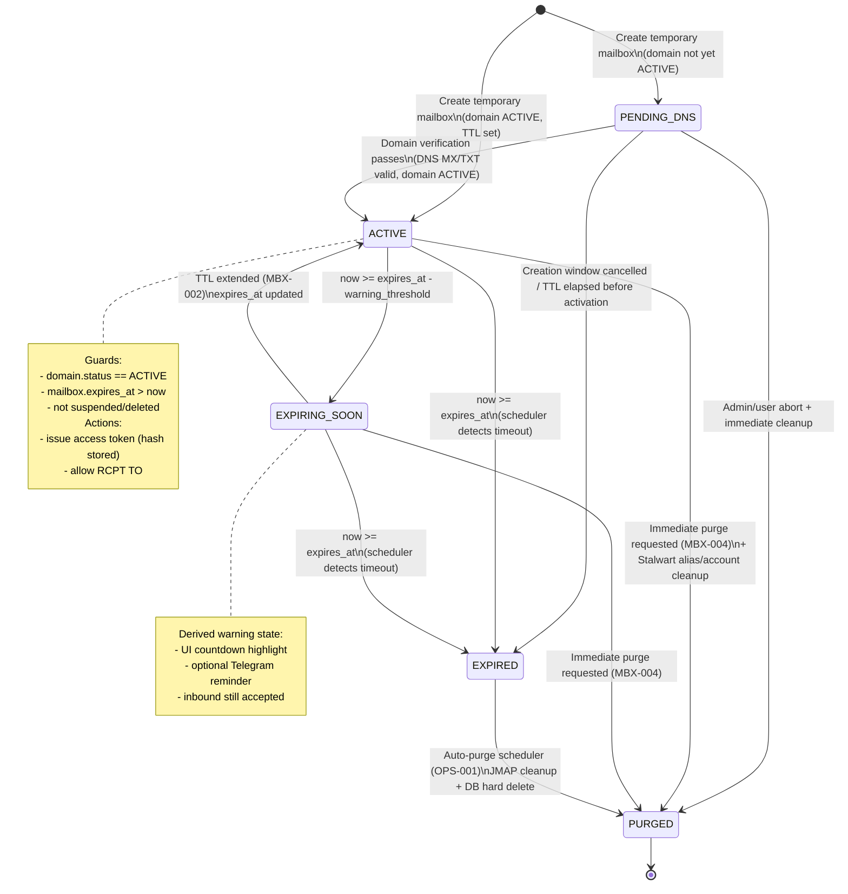
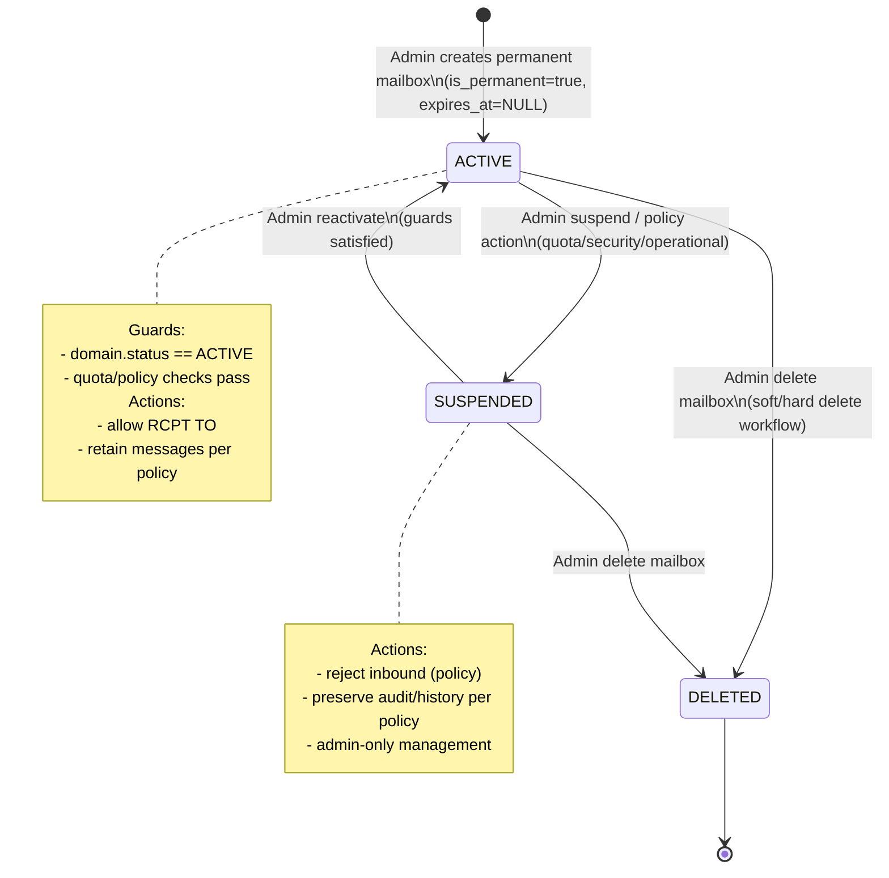

# Mailbox Lifecycle State Machine

**Status:** `PROPOSED`  
**Version:** `0.1`  
**Date:** `2026-11-15`  
**Owner:** `Architecture`  
**Dokumen Terkait:** `./expiration-deletion-flow.md`, `./email-flow-sequence.md`, `../adr/ADR-003.md`, `../adr/ADR-004.md`, `../adr/ADR-005.md`, `../adr/ADR-011.md`, `../../02-requirements/srs.md` (`MBX-001..MBX-004`, `INB-001`, `OPS-001`), `../../02-requirements/brd.md` (`BR-001`, `BR-004`), `../../02-requirements/nfr-spec.md` (`NFR-002`, `NFR-003`), `../../02-requirements/security-privacy-requirements.md` (`SEC-002`, `SEC-003`, `SEC-008`)

## 1. Tujuan
Mendefinisikan state machine siklus hidup mailbox DomiBox untuk dua kelas mailbox: **sementara (temporary/disposable)** dan **permanen (persistent/alias-managed)**, termasuk transisi valid, pemicu (trigger), guard condition, aksi sistem, TTL extension, dan alur konversi/operasi administratif.

## 2. Definisi Status (Canonical)

### 2.1 Mailbox Sementara
| Status | Deskripsi | Dapat Menerima Email Inbound? | Dapat Dibaca via Token? | Catatan |
| --- | --- | :---: | :---: | --- |
| `PENDING_DNS` | Domain/mailbox dibuat tetapi domain penerima belum terverifikasi/aktif penuh untuk menerima mail | Tidak (secara operasional aman: reject) | Terbatas (metadata mailbox) | Umumnya transisi cepat setelah domain aktif; state eksplisit untuk audit/onboarding |
| `ACTIVE` | Mailbox aktif dan berada dalam masa berlaku TTL (`now < expires_at`) | Ya | Ya (token valid) | Status operasional utama |
| `EXPIRING_SOON` | Mailbox masih aktif tetapi mendekati kedaluwarsa (threshold peringatan, mis. <= 5 menit) | Ya | Ya | State turunan/notifikasi; tidak mengubah hak terima mail |
| `EXPIRED` | TTL habis (`now >= expires_at`) dan mailbox tidak lagi valid untuk inbound baru | Tidak | Opsional read-only grace (kebijakan implementasi; default: tidak untuk token publik) | Menunggu purge oleh scheduler |
| `PURGED` | Data mailbox dan pesan terkait telah dihapus (hard delete) sesuai kebijakan retensi | Tidak | Tidak | Terminal state |

### 2.2 Mailbox Permanen
| Status | Deskripsi | Dapat Menerima Email Inbound? | Dapat Dikelola Admin? | Catatan |
| --- | --- | :---: | :---: | --- |
| `ACTIVE` | Mailbox permanen aktif, tanpa `expires_at` | Ya | Ya | State normal |
| `SUSPENDED` | Mailbox dinonaktifkan sementara oleh admin/kebijakan | Tidak (reject inbound) | Ya | Pesan historis dapat dipertahankan sesuai kebijakan |
| `DELETED` | Mailbox dihapus dari operasi aktif (soft/hard delete sesuai implementasi & audit policy) | Tidak | Terbatas/audit only | Terminal operasional; audit trail tetap dipertahankan |

## 3. State Diagram — Mailbox Sementara (Temporary)

## 4. State Diagram — Mailbox Permanen (Permanent)

## 5. Alur Konversi & Perpanjangan (Flows)

### 5.1 TTL Extension Flow (Temporary Mailbox)
| Step | Trigger | Guard / Validasi | Aksi Sistem | Hasil |
| --- | --- | --- | --- | --- |
| 1 | User meminta extend TTL (`MBX-002`) | Token akses valid, mailbox `ACTIVE` atau `EXPIRING_SOON`, belum `EXPIRED/PURGED` | Validasi kepemilikan token dan policy batas maksimum akumulasi | Request diterima/ditolak |
| 2 | Policy extension diterapkan | `new_expires_at <= now + max_ttl_cap` (mis. total <= 72 jam) | Update `expires_at` di DB; tulis audit event | `expires_at` bertambah |
| 3 | State refresh | Jika sebelumnya `EXPIRING_SOON` dan threshold tidak lagi terpenuhi | Recompute derived state menjadi `ACTIVE` | Countdown diperbarui di Web/Bot |
| 4 | Expired request | Mailbox sudah `EXPIRED` | Tolak dengan error semantik (HTTP 410/ekuivalen domain error) | Tidak ada perubahan state |

### 5.2 Conversion Flow (Temporary -> Permanent)
Konversi opsional (fitur terkontrol admin; dapat diaktifkan bertahap sesuai roadmap) mengubah mailbox sementara menjadi permanen untuk mempertahankan alamat dan histori pesan.

| Step | Trigger | Guard / Validasi | Aksi Sistem | Hasil |
| --- | --- | --- | --- | --- |
| 1 | Admin memilih "Convert to Permanent" | Mailbox sumber `ACTIVE`/`EXPIRING_SOON` (dan opsional grace `EXPIRED` sebelum purge), domain `ACTIVE` | Validasi hak admin, konflik alamat, kuota permanen | Permintaan konversi tervalidasi |
| 2 | Apply conversion | Tidak ada job purge in-flight untuk mailbox | Set `is_permanent=true`, `expires_at=NULL`, status `ACTIVE`; buat/ubah alias/account mapping di Stalwart via JMAP bila diperlukan | Mailbox menjadi permanen |
| 3 | Policy alignment | Kuota/retensi permanen diterapkan | Update metadata kuota/retensi, catat audit `MAILBOX_CONVERTED` | State permanen stabil |
| 4 | Failure handling | Error JMAP/DB | Rollback transaksi/kompensasi idempotent | State sumber konsisten, error dilaporkan |

### 5.3 Immediate Purge Flow (Temporary Mailbox)
| Step | Trigger | Guard / Validasi | Aksi Sistem | Hasil |
| --- | --- | --- | --- | --- |
| 1 | User/admin request delete (`MBX-004`) | Token/admin auth valid, mailbox belum `PURGED` | Tandai purge in-progress (lock/idempotency key) | Mencegah operasi ganda |
| 2 | External cleanup | Koneksi JMAP internal tersedia | Hapus alias/account/mail objects terkait di Stalwart sesuai model penyimpanan | State mail engine sinkron |
| 3 | DB cleanup | Transaksi DB aktif | Hapus/purge message + mailbox record (hard delete sesuai kebijakan MVP), tulis audit | `PURGED` terminal |
| 4 | Notify/UI update | Channel tersedia | Emit event ke Web/Bot (mailbox removed/expired) | UI sinkron |

## 6. Transisi, Guard, dan Aksi (Matriks Ringkas)

| Dari | Ke | Trigger | Guard Utama | Aksi Utama |
| --- | --- | --- | --- | --- |
| `PENDING_DNS` | `ACTIVE` | Domain verified/activated | Domain `ACTIVE`, TTL valid | Enable receive path, issue/keep token |
| `PENDING_DNS` | `EXPIRED` | TTL elapsed pre-activation | `now >= expires_at` | Mark expired, block inbound |
| `ACTIVE` | `EXPIRING_SOON` | Warning threshold reached | Derived state only | UI/Bot reminder, no inbound change |
| `EXPIRING_SOON` | `ACTIVE` | TTL extension | Token valid, cap not exceeded | Update `expires_at`, audit |
| `ACTIVE`/`EXPIRING_SOON` | `EXPIRED` | TTL timeout | `now >= expires_at` | Stop inbound acceptance, queue for purge |
| `ACTIVE`/`EXPIRING_SOON`/`EXPIRED` | `PURGED` | Immediate purge or scheduler | Not already purged; idempotency lock | Stalwart cleanup + DB hard delete + audit |
| `ACTIVE` (permanent) | `SUSPENDED` | Admin/policy suspend | Admin authorized | Reject inbound, retain history |
| `SUSPENDED` (permanent) | `ACTIVE` | Admin reactivate | Domain/policy/quota OK | Resume inbound |
| `ACTIVE`/`SUSPENDED` (permanent) | `DELETED` | Admin delete | Admin authorized, dependency checks | Remove/deactivate + audit |

## 7. Aturan Konsistensi & Keamanan
- **Single source of truth operasional:** Status otorisasi penerimaan inbound ditentukan oleh state mailbox/domain di DomiBox + sinkronisasi alias/account di Stalwart; mismatch harus memicu rekonsiliasi.
- **Idempotensi transisi terminal:** Operasi `EXPIRED -> PURGED` dan delete manual harus idempotent untuk retry scheduler/worker.
- **Auditability:** Setiap transisi status material (`create`, `extend`, `expire`, `convert`, `suspend`, `delete/purge`) mencatat audit event terstruktur (`OPS-002`, `SEC-008`).
- **Access control:** Token mailbox hanya berlaku untuk mailbox target dan tidak melewati batas state/ownership (`SEC-002`).
- **Fail-safe inbound:** Jika state ambigu saat validasi `RCPT TO`, sistem memilih penolakan aman (reject) daripada menerima ke mailbox yang tidak valid.

## 8. Traceability
| Kebutuhan | Cakupan |
| --- | --- |
| `BR-001` | Siklus hidup mailbox sementara/permanen, TTL, konversi operasional |
| `BR-004` | Penghapusan/purge terkontrol dan audit perubahan status |
| `FR-002` / `MBX-001` | Pembuatan temporary mailbox dengan TTL dan token akses |
| `FR-002.1` / `MBX-002` | TTL extension dan guard batas waktu |
| `FR-003` / `MBX-003` | State mailbox permanen aktif dan manajemen administratif |
| `FR-003.1` / `MBX-004` | Immediate purge sebelum TTL habis |
| `FR-004` / `INB-001` | Dampak state terhadap penerimaan SMTP (`RCPT TO` accept/reject) |
| `FR-008` / `OPS-001` | Transisi otomatis ke expired/purged oleh scheduler |
| `NFR-002`, `NFR-003` | Responsivitas operasi lifecycle dan integritas data mailbox/pesan |
| `SEC-002`, `SEC-003`, `SEC-008` | Isolasi akses token, kontrol administratif, audit trail lifecycle |
| `ADR-003`, `ADR-004`, `ADR-005`, `ADR-011` | Model mailbox alias/JMAP, persistensi PostgreSQL, scheduler TTL/purge |

## 9. Referensi Teknis & Standar
- RFC 5321 — Simple Mail Transfer Protocol (SMTP response semantics for recipient validation): https://www.rfc-editor.org/rfc/rfc5321
- RFC 8620 — JMAP Core (object lifecycle operations via API patterns): https://www.rfc-editor.org/rfc/rfc8620
- RFC 8621 — JMAP for Mail (mailbox/message object operations): https://www.rfc-editor.org/rfc/rfc8621
- PostgreSQL 16 Transactions and Concurrency: https://www.postgresql.org/docs/16/mvcc.html
- Stalwart Mail Server Documentation (accounts/aliases/JMAP management): https://stalw.art/docs/
- Stalwart JMAP Overview: https://stalw.art/docs/jmap/overview
- Martin Fowler — State Machine patterns (conceptual reference): https://martinfowler.com/dslCatalog/stateMachine.html
- NIST SP 800-92 — Guide to Computer Security Log Management (auditability of state transitions): https://csrc.nist.gov/pubs/sp/800/92/final
