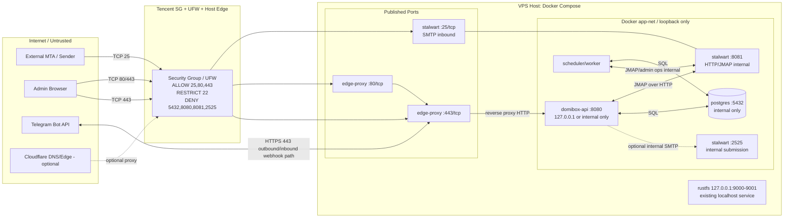

# Network Port Matrix

**Status:** `PROPOSED`  
**Version:** `0.1`  
**Date:** `2026-11-15`  
**Owner:** `Architecture`  
**Dokumen Terkait:** `../architecture-overview.md`, `../adr/ADR-001.md`, `../adr/ADR-002.md`, `../adr/ADR-004.md`, `../adr/010.md`, `../../02-requirements/srs.md` (`FR-001`, `FR-004`, `FR-006`, `FR-007`, `INB-001`), `../../02-requirements/nfr-spec.md` (`NFR-001`, `NFR-006`), `../../02-requirements/security-privacy-requirements.md` (`SEC-001`, `SEC-002`, `SEC-004`, `SEC-007`, `SEC-008`), `../../09-research/mail-infrastructure-suitability.md`

## 1. Tujuan & Ruang Lingkup
Dokumen ini mendefinisikan matriks port jaringan, binding address, arah trafik, protokol, pemilik layanan (container/host), dan aturan firewall untuk arsitektur DomiBox pada deployment pilot single-node (Tencent VPS, Ubuntu 24.04, Docker Compose, modular monolith). Matriks ini menjadi acuan implementasi konfigurasi Docker Compose, UFW, Tencent Security Group/Lighthouse Firewall, reverse proxy, dan verifikasi operasional.

## 2. Asumsi & Batasan Operasional
- Deployment pilot bersifat single-owner/single-node; tidak ada HA multi-node pada MVP (`A-OPS`, selaras `docs/01-product/mvp-scope.md`).
- Inbound SMTP (Port 25) **dapat** diterima di VPS hanya jika diizinkan pada Tencent Security Group/Lighthouse Firewall **dan** UFW (`VERIFIED` konteks kebijakan inbound dari riset infrastruktur; konfigurasi aktual VPS adalah gate implementasi).
- Outbound SMTP Port 25 dari Tencent CVM diblokir secara default dan memerlukan proses unblock terpisah; MVP DomiBox **tidak bergantung** pada outbound SMTP eksternal karena outbound mail submission berada di luar cakupan MVP (`VERIFIED` dari riset; selaras `Q-003` resolusi usulan).
- Layanan data internal (PostgreSQL, Stalwart HTTP/JMAP internal, submission internal) tidak diekspos ke internet publik.
- Cloudflare dapat digunakan untuk DNS/proxy HTTP(S) sesuai konfigurasi domain; penerimaan MX untuk domain yang dilayani Stalwart tidak boleh bentrok dengan Cloudflare Email Routing pada hostname/domain penerima yang sama (lihat `docs/03-architecture/diagrams/domain-onboarding-flow.md`).

## 3. Matriks Port Layanan (Application & Infrastructure)

| ID | Port | Proto | Arah | Sumber | Tujuan / Listener | Binding | Pemilik / Container | Exposure | Tujuan Fungsional | Aturan Firewall (UFW / Tencent SG) | Terkait |
| --- | ---: | --- | --- | --- | --- | --- | --- | --- | --- | --- | --- |
| NP-001 | 25 | TCP | Inbound | Internet (External MTA/MX sender) | Stalwart SMTP listener | `0.0.0.0:25` (container) dipublikasikan ke host | `stalwart` | **Public** (wajib untuk inbound mail) | Penerimaan email inbound SMTP (`RCPT TO` validation, early reject) | **ALLOW** inbound TCP/25 dari `0.0.0.0/0` pada Tencent SG/Lighthouse Firewall dan UFW; log rate/anomaly di host | `BR-002`, `FR-004`, `INB-001`, `SEC-004`, `NFR-004`, `RISK-OPS-PORT25` |
| NP-002 | 80 | TCP | Inbound | Internet / Cloudflare edge / ACME CA | Reverse proxy (Caddy/Nginx/Traefik) | `0.0.0.0:80` | `edge-proxy` (host/container) | **Public** | HTTP entrypoint, ACME HTTP-01 challenge, redirect ke HTTPS | **ALLOW** inbound TCP/80 dari `0.0.0.0/0` (atau Cloudflare IP ranges jika proxy-only); UFW allow 80/tcp | `BR-001`, `FR-007`, `NFR-001`, `SEC-007` |
| NP-003 | 443 | TCP | Inbound | Internet / Cloudflare edge / User browser / Telegram webhook (jika webhook mode) | Reverse proxy (Caddy/Nginx/Traefik) TLS termination | `0.0.0.0:443` | `edge-proxy` | **Public** | HTTPS untuk Web Dashboard/API, TLS termination, reverse proxy ke backend | **ALLOW** inbound TCP/443 dari `0.0.0.0/0` (atau Cloudflare IP ranges jika proxy-only); UFW allow 443/tcp | `BR-003`, `FR-006`, `FR-007`, `WEB-001`, `SEC-001`, `SEC-007`, `NFR-001`, `NFR-006` |
| NP-004 | 8080 | TCP | Internal (east-west) / loopback-proxied | Reverse proxy container, internal services | DomiBox Backend API (Fastify/Node.js) | `127.0.0.1:8080` (host bind) atau Docker network-only `backend:8080` tanpa host publish | `domibox-api` | **Internal only** (tidak publik) | REST API, webhook receiver internal, SSE endpoint backend, orchestration logic | **DENY** inbound publik TCP/8080 pada Tencent SG & UFW; hanya akses via reverse proxy/Docker network | `FR-001..FR-008`, `SEC-001`, `SEC-002`, `SEC-007`, `ADR-001`, `ADR-006` |
| NP-005 | 5432 | TCP | Internal only | DomiBox Backend API, scheduler/worker, migrator | PostgreSQL 16 | Docker network bind `postgres:5432`; opsional host bind `127.0.0.1:5432` untuk admin lokal saja | `postgres` | **Internal only** | Penyimpanan relasional utama (domain, mailbox, message metadata/body refs, audit, pairing, jobs) | **DENY** inbound publik TCP/5432 pada Tencent SG & UFW; tidak ada host publish publik; akses admin via SSH tunnel/localhost | `BR-001..BR-004`, `FR-001..FR-008`, `SEC-002`, `SEC-003`, `SEC-008`, `NFR-003`, `ADR-005` |
| NP-006 | 8081 | TCP | Internal only | DomiBox Backend API / integration worker | Stalwart HTTP Admin/JMAP endpoint | Docker network bind `stalwart:8081`; opsional host bind `127.0.0.1:8081` | `stalwart` | **Internal only** | Integrasi JMAP over HTTP (account/alias/mailbox/message ops), health/admin API internal | **DENY** inbound publik TCP/8081 pada Tencent SG & UFW; kredensial service-to-service only | `FR-002`, `FR-004`, `INB-001`, `MBX-*`, `ADR-002`, `ADR-003`, `ADR-004` |
| NP-007 | 2525 | TCP | Internal only | DomiBox Backend API / internal tools (jika diperlukan) | Stalwart submission/internal SMTP listener (opsional) | Docker network bind `stalwart:2525`; opsional `127.0.0.1:2525` | `stalwart` | **Internal only** | Jalur submission/internal SMTP untuk kebutuhan operasional masa depan atau pengujian terkontrol (MVP: tidak dipakai untuk outbound publik) | **DENY** inbound publik TCP/2525 pada Tencent SG & UFW; tidak diekspos publik | `ADR-002`, `ADR-004`, `Q-003` (outbound out-of-scope MVP) |
| NP-008 | 9000-9001 | TCP | Loopback/internal (existing service) | Local host processes/container yang berwenang | RustFS (existing container) | `127.0.0.1:9000-9001` (observed existing) | `rustfs` (existing, non-DomiBox) | **Localhost only** | Penyimpanan objek/layanan existing di VPS; **bukan** komponen DomiBox | Pastikan tidak diubah menjadi publik; hindari konflik bind dengan reverse proxy/Stalwart; exclude dari aturan allow publik DomiBox | `NFR-008` (operasional), `RISK-TECH-STACK` (konflik port) |
| NP-009 | 22 | TCP | Inbound (admin) | Administrator IPs / bastion (recommended restricted) | OpenSSH server (host) | `0.0.0.0:22` (host) | Host OS | **Restricted public/admin** | Administrasi VPS, deployment, troubleshooting, emergency access | **ALLOW** TCP/22 hanya dari IP tepercaya (recommended) pada Tencent SG & UFW; rate-limit/bruteforce protection; MFA/passkey policy di level operasional | `SEC-001`, `SEC-008`, `NFR-006` |

## 4. Matriks Port yang Tidak Digunakan / Dilarang pada MVP

| Port | Proto | Status MVP | Alasan | Kontrol |
| ---: | --- | --- | --- | --- |
| 465 | TCP | **Closed / Not exposed** | SMTPS submission tidak diperlukan untuk inbound-only MVP; mengurangi permukaan serangan | Tidak dipublish di Docker/host; deny di SG/UFW |
| 587 | TCP | **Closed / Not exposed (public)** | Submission client (outbound/authenticated) di luar cakupan MVP (`Q-003`) | Hanya boleh aktif internal/loopback jika benar-benar diperlukan untuk tooling; default closed |
| 993 | TCP | **Closed / Not exposed** | IMAPS tidak dipakai; integrasi internal menggunakan JMAP over HTTP (`ADR-004`) | Default closed |
| 143 | TCP | **Closed / Not exposed** | IMAP plaintext tidak dipakai dan tidak aman | Default closed |
| 110/995 | TCP | **Closed / Not exposed** | POP3/POP3S tidak termasuk arsitektur DomiBox | Default closed |
| 3306 | TCP | **Closed / Not exposed** | MySQL/MariaDB tidak digunakan (PostgreSQL dipilih pada `ADR-005`) | Default closed |

## 5. Aturan Firewall & Segmentasi Jaringan

### 5.1 Tencent Cloud Security Group / Lighthouse Firewall (Network Edge)
| Rule ID | Direction | Protocol/Port | Source/Destination | Action | Keterangan |
| --- | --- | --- | --- | --- | --- |
| SG-IN-001 | Inbound | TCP/25 | `0.0.0.0/0` → VPS | ALLOW | SMTP inbound dari internet (MX pengirim eksternal) |
| SG-IN-002 | Inbound | TCP/80 | `0.0.0.0/0` → VPS (atau Cloudflare CIDR saja jika full proxy) | ALLOW | HTTP redirect/ACME |
| SG-IN-003 | Inbound | TCP/443 | `0.0.0.0/0` → VPS (atau Cloudflare CIDR saja jika full proxy) | ALLOW | HTTPS Web/API/Webhook endpoint |
| SG-IN-004 | Inbound | TCP/22 | Admin CIDR/IP tepercaya → VPS | ALLOW (restricted) | SSH administrasi; hindari `0.0.0.0/0` pada produksi |
| SG-IN-DENY | Inbound | TCP/5432,8080,8081,2525,465,587,993 | Any → VPS | DENY | Blokir layanan internal dan protokol non-MVP |
| SG-OUT-001 | Outbound | TCP/443, TCP/80, TCP/53, UDP/53 | VPS → Internet | ALLOW | DNS, HTTPS API (Telegram, package/update repos, ACME, verifikasi eksternal) |
| SG-OUT-002 | Outbound | TCP/25 | VPS → Internet | **DENY/DEFAULT BLOCKED** (MVP) | Outbound SMTP eksternal tidak diperlukan; selaras kebijakan Tencent & scope MVP |

### 5.2 UFW (Host OS Firewall)
| Rule ID | Direction | Rule | Action | Keterangan |
| --- | --- | --- | --- | --- |
| UFW-001 | Inbound | `allow 22/tcp` (prefer restricted source) | ALLOW | SSH admin |
| UFW-002 | Inbound | `allow 25/tcp` | ALLOW | SMTP inbound ke Stalwart |
| UFW-003 | Inbound | `allow 80/tcp` | ALLOW | HTTP/ACME/reverse proxy |
| UFW-004 | Inbound | `allow 443/tcp` | ALLOW | HTTPS reverse proxy |
| UFW-005 | Inbound | default deny incoming | DENY | Menutup semua port lain termasuk 5432, 8080, 8081, 2525, 465, 587, 993 |
| UFW-006 | Outbound | default allow outgoing (dengan pembatasan opsional egress) | ALLOW (baseline) | Dapat diperketat kemudian; minimal butuh 53/80/443 |

### 5.3 Docker Network Segmentation (Compose)
| Network | Anggota | Tujuan | Eksposur Host |
| --- | --- | --- | --- |
| `edge-net` | `edge-proxy`, `domibox-api` | Proxy HTTPS ke API/SSE | 80/443 dipublish via proxy saja |
| `app-net` | `domibox-api`, `stalwart`, `postgres`, `worker/scheduler` | Komunikasi aplikasi internal (JMAP, DB, event handling) | Tanpa publish publik; opsional `127.0.0.1` bind untuk debug terbatas |
| `mail-net` (opsional, dapat digabung dengan `app-net` secara terkendali) | `stalwart`, `domibox-api` | Isolasi trafik integrasi mail engine | 25 dipublish khusus untuk Stalwart SMTP |

## 6. Diagram Topologi Port & Trust Boundary

## 7. Validasi & Checklist Implementasi
- [ ] Verifikasi `docker compose ps`/port mapping: hanya 25, 80, 443 (dan 22 host) yang terekspos publik.
- [ ] Verifikasi UFW (`ufw status verbose`) menolak 5432/8080/8081/2525 dari interface publik.
- [ ] Verifikasi Tencent SG/Lighthouse Firewall selaras dengan tabel SG-IN/SG-OUT.
- [ ] Uji inbound SMTP eksternal ke port 25 (RCPT TO valid/invalid) dan pastikan early rejection berjalan.
- [ ] Uji akses HTTPS publik ke Web/API; pastikan API `:8080` tidak dapat diakses langsung dari internet.
- [ ] Uji koneksi PostgreSQL hanya dari container jaringan internal/localhost tunnel.
- [ ] Uji integrasi JMAP backend → `stalwart:8081` melalui Docker network/service name.
- [ ] Konfirmasi tidak ada konflik bind dengan `rustfs` (`127.0.0.1:9000-9001`).

## 8. Traceability
| Kebutuhan / Kontrol | Relevansi Port Matrix |
| --- | --- |
| `BR-001`, `DOM-001` | Port 80/443 untuk verifikasi/domain management UI/API; proteksi endpoint internal |
| `BR-002`, `FR-004`, `INB-001` | Port 25 inbound SMTP ke Stalwart; validasi penerima dan observabilitas |
| `BR-003`, `FR-006`, `FR-007` | Port 443 untuk dashboard dan integrasi Telegram webhook/API path |
| `BR-004`, `OPS-001`, `OPS-002` | Isolasi DB/JMAP internal untuk operasi purge/audit yang aman |
| `NFR-001`, `NFR-004`, `NFR-006` | Ketersediaan endpoint publik, latensi inbound, pembatasan permukaan serangan |
| `SEC-001`, `SEC-002`, `SEC-004`, `SEC-007`, `SEC-008` | Segmentasi trust boundary, akses admin terbatas, proteksi layanan internal, auditabilitas |
| `ADR-001`, `ADR-002`, `ADR-004`, `ADR-005`, `ADR-010` | Topologi Compose, Stalwart engine, JMAP internal, PostgreSQL internal, strategi DNS/port 25 |

## 9. Referensi Teknis & Standar
- RFC 5321 — Simple Mail Transfer Protocol (SMTP): https://www.rfc-editor.org/rfc/rfc5321
- RFC 6186 — Use of SRV Records for Locating Email Submission/Access Services (konteks port submission/IMAP; referensi batasan MVP): https://www.rfc-editor.org/rfc/rfc6186
- RFC 8621 — JSON Meta Application Protocol (JMAP): https://www.rfc-editor.org/rfc/rfc8621
- Stalwart Mail Server Documentation (listeners, ports, JMAP/HTTP): https://stalw.art/docs/
- Stalwart JMAP/management references: https://stalw.art/docs/jmap/overview
- PostgreSQL 16 Documentation (connections, listen_addresses, security): https://www.postgresql.org/docs/16/
- Docker Compose Networking: https://docs.docker.com/compose/how-tos/networking/
- Docker Compose Ports: https://docs.docker.com/reference/compose-file/services/#ports
- Ubuntu UFW Documentation: https://help.ubuntu.com/community/UFW
- Tencent Cloud Security Group Overview: https://www.tencentcloud.com/document/product/213/12452
- Tencent Cloud Lighthouse Firewall Rules (CreateFirewallRules): https://www.tencentcloud.com/document/product/1103/42513
- Tencent Cloud Unblocking Port 25 (outbound policy context): https://intl.cloud.tencent.com/document/product/213/34833
- Cloudflare Email Routing (MX behavior/context): https://developers.cloudflare.com/email-routing/
- Riset internal: `../../09-research/mail-infrastructure-suitability.md`
