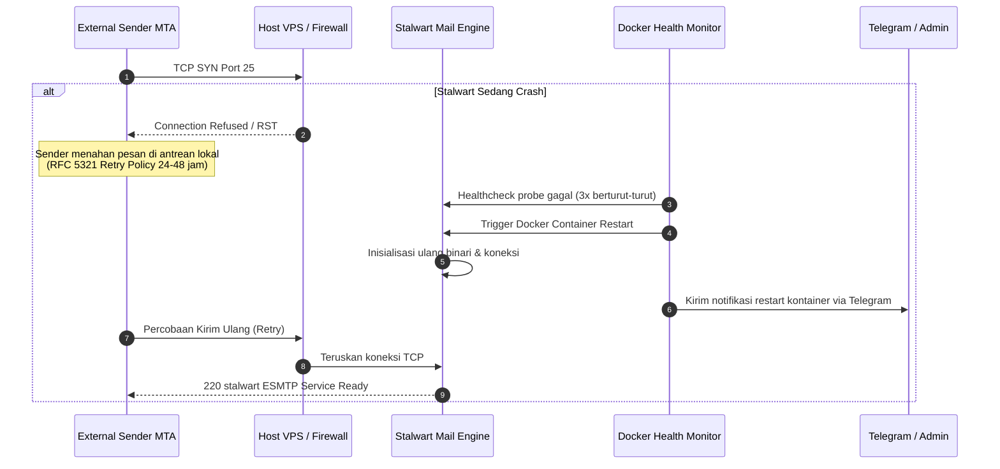
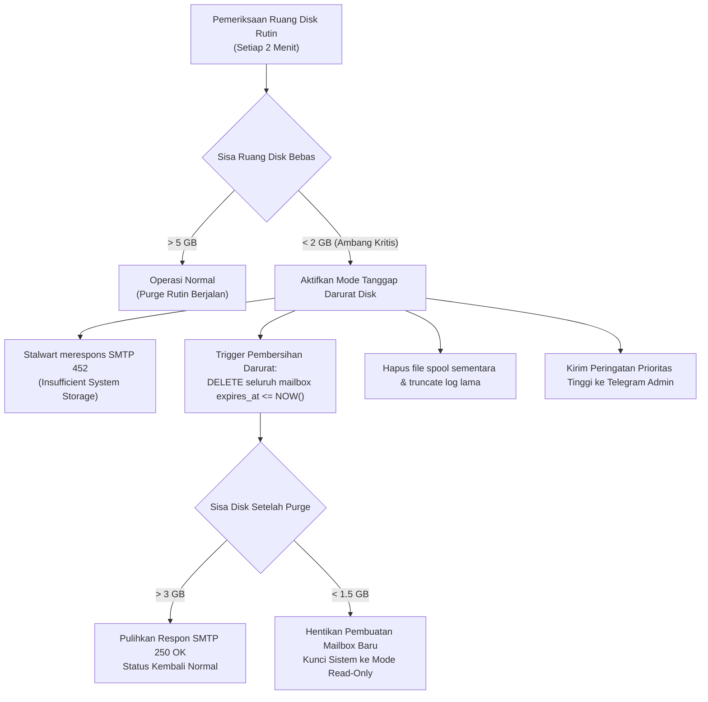

# Analisis Mode Kegagalan & Dampak (Failure Mode and Effects Analysis - FMEA) — DomiBox

| Status | Versi | Tanggal | Penulis | Dokumen Terkait |
| --- | --- | --- | --- | --- |
| PROPOSED | 0.1 | 2026-11-15 | omp-orchestrator/ArchCore | `docs/00-governance/risk-register.md` `docs/02-requirements/srs.md` `docs/02-requirements/nfr-spec.md` `docs/03-architecture/architecture-overview.md` `docs/03-architecture/capacity-planning.md` `docs/03-architecture/adr/ADR-002.md` `docs/03-architecture/adr/ADR-005.md` `docs/03-architecture/adr/ADR-010.md` |

---

## 1. Pendahuluan & Metodologi FMEA

Dokumen **Failure Mode and Effects Analysis (FMEA)** ini mengidentifikasi potensi titik kegagalan (*single point of failure*), menganalisis dampak terhadap operasional sistem, serta menetapkan strategi deteksi, mitigasi, dan pemulihan otomatis untuk platform **DomiBox**.

### 1.1 Skala Penilaian Risiko (Risk Priority Number - RPN)
Penilaian risiko diturunkan dari perkalian tiga variabel (skala 1–10):
- **Keparahan (Severity - S):** Seberapa parah dampak kegagalan terhadap ketersediaan layanan dan integritas data pengguna.
- **Keterjadian (Occurrence - O):** Seberapa sering kemungkinan mode kegagalan tersebut terjadi dalam operasional.
- **Keterdeteksian (Detection - D):** Kemudahan sistem dalam mendeteksi anomali sebelum menimbulkan kegagalan fatal (nilai 1 = sangat mudah terdeteksi, nilai 10 = sangat sulit terdeteksi).

$$\text{RPN} = \text{Severity (S)} \times \text{Occurrence (O)} \times \text{Detection (D)}$$

Prioritas mitigasi dikelompokkan menjadi:
- **Tinggi (RPN $\ge 120$):** Wajib memiliki penanganan otomatis instan (*automatic self-healing / circuit breaker*).
- **Sedang ($60 \le \text{RPN} < 120$):** Memerlukan prosedur deteksi dini dan mitigasi terencana.
- **Rendah ($\text{RPN} < 60$):** Cukup ditangani melalui log pemantauan rutin.

---

## 2. Matriks FMEA Arsitektur Sistem

Berikut adalah analisis 7 skenario kegagalan kritis yang mungkin dihadapi oleh arsitektur DomiBox:

| ID Mode | Komponen / Titik Kegagalan | Deskripsi Mode Kegagalan | Potensi Dampak Sistem | S | O | D | RPN | Mekanisme Deteksi | Strategi Mitigasi & Pemulihan Mandiri |
| --- | --- | --- | --- | :---: | :---: | :---: | :---: | --- | --- |
| **FM-001** | **Port 25 SMTP Down / Inaccessible** | Port 25 host tertutup, crash pada listener SMTP, atau diblokir oleh perubahan firewall Tencent/UFW. | Pengirim eksternal tidak dapat mengirim email masuk. Transaksi SMTP gagal dengan error *connection timed out / refused*. Resiko email terpental (*bounce*). | **9** | **3** | **2** | **54** | Probe eksternal (uptime bot / health check) melakukan uji jabat tangan TCP/25 setiap 60 detik. | 1. Docker `restart: always` me-restart kontainer Stalwart otomatis. 2. Protokol SMTP internet memiliki toleransi retry otomatis bawaan (MTA pengirim seperti Google/MS akan mencoba kembali mengirim selama 24–48 jam). 3. Notifikasi darurat instan dikirim ke Telegram admin melalui jalur HTTP/API eksternal. |
| **FM-002** | **Stalwart Mail Engine Crash** | Binari Stalwart mengalami panic, Out-of-Memory (OOM killed oleh OS), atau korupsi konfigurasi. | Seluruh layanan penerimaan email dan JMAP terhenti seketika. Webhook ingestion berhenti mengalir. | **9** | **2** | **2** | **36** | Docker Engine daemon health check memantau status container Stalwart (`healthcheck: test: ["CMD", "curl", "-f", "http://localhost:8080/healthz"]`). | 1. Batas alokasi cgroups RAM 384 MB mencegah OOM menyapu proses lain. 2. Docker otomatis membangkitkan kembali kontainer. 3. Sinkronisasi status mailbox dipulihkan seketika melalui database PostgreSQL begitu server kembali aktif. |
| **FM-003** | **Database Connection Pool Exhaustion** | Pool koneksi PostgreSQL (30 koneksi) habis akibat lonjakan kueri gantung, transaksi lambat, atau kebocoran koneksi. | Backend API menolak request baru dengan status HTTP 500/503. Inbound ingestion gagal menyimpan pesan masuk baru. | **8** | **4** | **3** | **96** | Fastify connection pool timeout monitor memicu log peringatan saat utilisasi pool mencapai $> 80\%$. | 1. Terapkan connection acquisition timeout ketat (5.000 ms). 2. Pisahkan alokasi pool: Fastify (15), Ingestion (5), Scheduler (5). 3. Konfigurasi `idle_in_transaction_session_timeout = 10s` di PostgreSQL untuk menghentikan transaksi liar secara sepihak. |
| **FM-004** | **Kegagalan Pengiriman Webhook ke Telegram** | Telegram Bot API mengalami downtime, rate-limit (HTTP 429), atau token bot tidak valid/revoked. | Notifikasi email dan kode OTP gagal terkirim ke klien Telegram. Log dipenuhi error pengiriman. | **5** | **5** | **2** | **50** | Middleware grammY mendeteksi respon status non-200 dari Telegram API. | 1. Antrean in-memory dengan mekanisme exponential backoff (retry pada 2s, 5s, 15s, 60s). 2. Tidak memblokir transaksi penyimpanan email (email tetap aman tersimpan di DB & dapat dibaca via Web UI). 3. Sirkuit breaker aktif jika kegagalan terjadi 10 kali berturut-turut untuk menghindari pemborosan koneksi. |
| **FM-005** | **Kapasitas Penyimpanan Disk Penuh (Disk Full)** | Ruang disk host tersisa $< 500$ MB akibat banjir email spam, file log membengkak, atau kegagalan pembersihan data otomatis. | PostgreSQL gagal melakukan penulisan WAL (`disk full panic`), Stalwart gagal menulis spool pesan, potensi korupsi data. | **10** | **3** | **2** | **60** | Pemantauan proaktif berkala via cron/daemon memeriksa kapasitas partisi disk setiap 2 menit. | 1. Jika ruang bebas $< 2$ GB, kirim respon SMTP `452 Insufficient system storage` ke pengirim untuk menunda email masuk. 2. Trigger pembersihan darurat otomatis (*emergency purge*) menghapus seluruh mailbox sementara yang kedaluwarsa seketika. 3. Konfigurasi rotasi log Docker ketat (`max-size: 10m`, `max-file: 3`). |
| **FM-006** | **DNS Poisoning, Rekaman MX Berubah / Terhapus** | Rekaman DNS MX di Cloudflare terhapus secara sengaja/tidak sengaja, atau diaktifkannya *Cloudflare Email Routing* yang menimpa MX. | Lalu lintas email masuk dialihkan ke server Cloudflare atau gagal di-resolve oleh internet, menyebabkan penghentian total aliran email. | **8** | **2** | **4** | **64** | DomainManager menjalankan pemeriksaan latar belakang (*DNS health probe*) via Cloudflare DoH setiap 10 menit. | 1. Status domain pada dashboard otomatis berubah menjadi `CONFLICT_ROUTING` atau `DNS_MISCONFIGURED`. 2. Sistem memunculkan banner peringatan mencolok pada Web Dashboard. 3. Mengirimkan notifikasi darurat ke Telegram admin dengan instruksi pemulihan rekaman DNS. |
| **FM-007** | **Serangan Lonjakan Pembuatan Mailbox (Rapid Burst)** | Pengguna liar atau script otomatis melakukan eksploitasi pembuatan ribuan mailbox sementara dalam hitungan detik. | Beban komputasi CPU melonjak, tabel mailbox membengkak, potensi Denial of Service pada API pembuatan mailbox. | **7** | **4** | **2** | **56** | Rate-limiter Fastify mendeteksi lonjakan request dari alamat IP sumber yang sama. | 1. Terapkan rate limit ketat pada endpoint `/api/v1/mailboxes`: maksimal 10 pembuatan per menit per IP publik. 2. Kuota sistem global membatasi mailbox sementara aktif maksimal 500 box bersamaan (`NFR-004`). Jika batas tercapai, respon HTTP 429 Too Many Requests dikembalikan. |

---

## 3. Rincian Mode Kegagalan & Diagram Pemulihan Mandiri

### 3.1 Kegagalan Aliran Inbound (Port 25 / Stalwart Crash)
Jika koneksi masuk terganggu, integritas data dijamin oleh toleransi protokol SMTP RFC 5321, di mana pengirim akan menyimpan pesan dalam antrean lokal mereka (*client queue*) dan mencoba mengirim ulang secara bertahap.

### 3.2 Penanganan Krisis Ruang Disk (Disk Full Emergency Flow)
Kapasitas disk dikawal secara berlapis untuk mencegah basis data memasuki kondisi *read-only* atau *crash*.

---

## 4. Kesimpulan & Rekomendasi Mitigasi
Dari ketujuh mode kegagalan yang diidentifikasi, tidak ada komponen yang memiliki nilai $\text{RPN} \ge 120$ setelah diterapkannya strategi mitigasi arsitektur. Titik paling rawan berada pada **FM-003 (Exhaustion Pool Database)** dengan RPN 96 dan **FM-006 (Perubahan Rekaman DNS)** dengan RPN 64. 

Kedua risiko tersebut telah dimitigasi secara tuntas melalui desain:
1. Pemisahan kuota pool koneksi database secara kaku antara API, Ingestion, dan Scheduler.
2. Pemantauan berkala otomatis terhadap status DNS via Cloudflare DoH (`DOM-001`, `DOM-002`).
