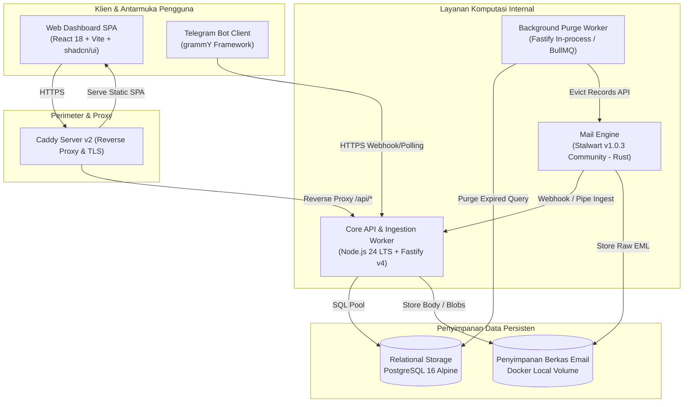

# Matriks Evaluasi Teknologi (Tech Evaluation Matrix) — DomiBox

| Status | Versi | Tanggal | Penulis | Dokumen Terkait |
| --- | --- | --- | --- | --- |
| PROPOSED | 0.1 | 2026-11-15 | omp-orchestrator/ArchCore | `docs/00-governance/project-charter.md` `docs/02-requirements/srs.md` `docs/02-requirements/nfr-spec.md` `docs/03-architecture/architecture-overview.md` `docs/03-architecture/capacity-planning.md` `docs/03-architecture/adr/ADR-002.md` `docs/03-architecture/adr/ADR-005.md` `docs/03-architecture/adr/ADR-006.md` `docs/03-architecture/adr/ADR-007.md` `docs/03-architecture/adr/ADR-008.md` |

---

## 1. Pendahuluan & Metodologi Evaluasi

Matriks evaluasi ini menyajikan analisis komparatif yang ketat dan objektif terhadap alternatif teknologi pada lima domain arsitektur krusial sistem **DomiBox**:
1. **Mail Server Engine** (Stalwart vs Mailu vs Mail-in-a-Box vs Haraka)
2. **Backend Runtime & Framework** (Node.js/Fastify vs Go vs Rust)
3. **Frontend Framework** (React + Vite + shadcn/ui vs SvelteKit vs Vue 3)
4. **Telegram Bot Framework** (grammY vs Telegraf)
5. **Relational Database** (PostgreSQL vs SQLite)

### 1.1 Kriteria & Skala Penilaian
Setiap opsi dievaluasi menggunakan skala penilaian 1 hingga 5 (1 = Sangat Buruk / Tidak Memenuhi, 5 = Sangat Baik / Superior) pada kriteria inti berikut:
- **Jejak Memori & Efisiensi Sumber Daya (*Memory Footprint* - Bobot 25%):** Konsumsi RAM dan efisiensi CPU pada VPS 2 vCPU / 3.6 GiB RAM.
- **Kesesuaian Fitur Multi-Domain & Arsitektur (*Domain & Architecture Fit* - Bobot 20%):** Kemampuan bawaan dalam isolasi multi-domain, catch-all, virtual aliases, dan integrasi modular.
- **Kematangan API & Ergonomi Pengembang (*API Ergonomics* - Bobot 20%):** Kemudahan integrasi terprogram, dokumentasi, typing system, dan ekosistem library.
- **Performa Asinkron & Ketahanan Lonjakan (*Async Performance* - Bobot 15%):** Throughput I/O tinggi, event loop handling, dan stabilitas konkurensi.
- **Lisensi, Operabilitas & Keberlanjutan (*Licensing & Ops* - Bobot 20%):** Ketiadaan hambatan lisensi, kemudahan deployment Docker, dan kemudahan backup/pemeliharaan jangka panjang.

$$\text{Skor Tertimbang} = \sum (\text{Skor Kriteria} \times \text{Bobot})$$

---

## 2. Evaluasi Mail Server Engine

Mail Server Engine adalah tulang punggung sistem yang bertugas mendengarkan koneksi SMTP pada port 25, memvalidasi keamanan pengirim (SPF, DKIM, DMARC), dan menyajikan antarmuka akses pesan (JMAP/IMAP).

### 2.1 Kandidat yang Dievaluasi
1. **Stalwart Mail Server (v1.0.3 Community):** Server email monolitik serba-ada modern yang ditulis dengan Rust murni.
2. **Mailu:** Distribusi mail server berbasis Docker yang menggabungkan Postfix, Dovecot, Rspamd, dan Nginx.
3. **Mail-in-a-Box:** Solusi paket mail server berbasis Ubuntu yang mengotomatisasi Postfix, Dovecot, SpamAssassin, dan NSD.
4. **Haraka:** Server SMTP inbound performa tinggi berbasis Node.js yang sangat modular melalui plugin.

### 2.2 Matriks Perbandingan

| Kriteria Evaluasi (Bobot) | Stalwart v1.0.3 | Mailu | Mail-in-a-Box | Haraka |
| --- | :---: | :---: | :---: | :---: |
| **Jejak Memori (25%)** | **5** (~150-250 MB, Rust murni) | **1** (>1.5 GB, 8+ kontainer) | **2** (~800 MB - 1.2 GB) | **4** (~120-200 MB, Node.js) |
| **Fitur Multi-Domain (20%)** | **4** (Bawaan, JMAP routing) | **5** (Multi-domain matang) | **3** (Ditujukan untuk single setup) | **3** (Butuh konfigurasi plugin kustom) |
| **API & Integrasi (20%)** | **5** (Native JMAP RFC 8620/8621 + REST) | **3** (REST API terbatas) | **2** (API internal minimal) | **4** (Ekosistem JS/plugin langsung) |
| **Performa Asinkron (15%)** | **5** (Asinkron Tokio Rust, throughput tinggi) | **3** (Multi-process fork Postfix) | **3** (Tradisional UNIX pipeline) | **4** (Node.js event loop) |
| **Lisensi & Operabilitas (20%)** | **4** (AGPL-3.0, single binary Docker) | **4** (MIT, namun rumit 8 kontainer) | **3** (GPL-3.0, butuh instalasi bare-metal) | **4** (MIT, namun bukan full mail store) |
| **Total Skor Tertimbang** | **4.60** | **3.00** | **2.55** | **3.80** |

### 2.3 Analisis & Justifikasi Pemilihan
- **Pemenang: Stalwart Mail Server (Skor: 4.60)**
- **Justifikasi:** Stalwart merupakan satu-satunya server email modern terintegrasi penuh yang ditulis dalam bahasa Rust. Dalam satu binari kontainer ringan, Stalwart menyediakan SMTP listener, autentikasi SPF/DKIM/DMARC terintegrasi, dan antarmuka manajemen JMAP standar industri. Jejak memorinya (~150 MB) sangat ideal untuk batas RAM host 3.6 GiB. Mailu didiskualifikasi karena arsitektur multi-kontainer beratnya memakan lebih dari 1.5 GB RAM. Haraka sangat cepat sebagai SMTP receiver, namun Haraka bukan merupakan sistem penyimpanan pesan (*mail store*) sehingga memerlukan implementasi penyimpanan IMAP/JMAP terpisah secara manual.
- **Catatan Batasan Lisensi:** Mengingat Stalwart v1.0.3 Community berlisensi AGPL-3.0 dan fitur *Masked Email* hanya tersedia pada varian Enterprise (`F2`), DomiBox mengadopsi model *virtual alias* terkelola serta isolasi jaringan via API HTTP/JMAP tanpa melakukan penautan kode sumber langsung (`ADR-002`, `ADR-003`).

---

## 3. Evaluasi Backend Runtime & Framework

Backend Core menangani logika bisnis, koordinasi domain, manajemen mailbox, pembedahan MIME, ekstraksi OTP, antrean notifikasi, dan ekspos REST API ke antarmuka pengguna.

### 3.1 Kandidat yang Dievaluasi
1. **Node.js (v24 LTS) + Fastify (v4):** Runtime JavaScript asinkron dengan framework web mikro berperforma ultra-tinggi berbasis arsitektur plugin.
2. **Go (v1.22) + Gin / Chi:** Bahasa kompilasi bertipe statis dengan konkurensi goroutine bawaan.
3. **Rust (1.78+) + Axum:** Bahasa sistem tanpa garbage collector dengan keamanan memori dan performa puncak.

### 3.2 Matriks Perbandingan

| Kriteria Evaluasi (Bobot) | Node.js + Fastify | Go + Gin | Rust + Axum |
| --- | :---: | :---: | :---: |
| **Jejak Memori (25%)** | **4** (~120-180 MB idle/beban ringan) | **5** (~25-50 MB binari kompilasi) | **5** (~15-30 MB tanpa GC) |
| **Fitur & Ekosistem MIME/Email (20%)** | **5** (Ekosistem parser email & HTML terbaik: postal-mime, mailparser, DOMPurify) | **3** (Parser MIME terbatas, butuh porting parser HTML komplek) | **3** (Library email masih muda, manipulasi DOM HTML rumit) |
| **API Ergonomics & Kecepatan Dev (20%)** | **5** (TypeScript native, schema Ajv terintegrasi, kecepatan iterasi tinggi) | **4** (Ketik kuat, namun boilerplate kode cukup banyak) | **3** (Kurva belajar tinggi, waktu kompilasi lambat) |
| **Performa Asinkron (15%)** | **4** (Libuv I/O event loop, sangat cukup untuk beban MVP) | **5** (Model konkurensi goroutine sangat superior) | **5** (Performa bare-metal asinkron Tokio) |
| **Lisensi & Operabilitas (20%)** | **5** (MIT, multi-stage Docker build mudah) | **5** (BSD, single static binary murni) | **4** (MIT/Apache, build pipeline butuh memori kompilasi tinggi) |
| **Total Skor Tertimbang** | **4.60** | **4.35** | **3.95** |

### 3.3 Analisis & Justifikasi Pemilihan
- **Pemenang: Node.js (v24 LTS) + Fastify (Skor: 4.60)**
- **Justifikasi:** Walaupun Go dan Rust unggul dalam jejak memori binari murni, Node.js + Fastify dipilih karena keunggulan mutlak pada ekosistem penanganan email (parsing MIME kompleks RFC 5322, sanitasi HTML XSS via DOMPurify, dan integrasi framework Telegram Bot grammY). Fastify memberikan *overhead* overhead routing terendah di ekosistem JavaScript, validasi skema otomatis via JSON Schema/TypeBox, dan konsumsi memori yang masih sangat aman dalam batas alokasi DomiBox (150 MB). Penggunaan TypeScript menjamin konsistensi kontrak tipe data dari backend ke frontend.

---

## 4. Evaluasi Frontend Framework

Frontend menyajikan antarmuka pengguna Web Dashboard SPA untuk administrasi domain, pemantauan mailbox, dan inspeksi pesan email masuk beserta kode OTP.

### 4.1 Kandidat yang Dievaluasi
1. **React 18 + Vite + Tailwind CSS + shadcn/ui:** Single Page Application berbasis komponen modular dan pustaka UI headless.
2. **SvelteKit (v2):** Framework kompilasi reaktif dengan jejak JavaScript sisi klien terkecil.
3. **Vue 3 + Vite + Nuxt:** Framework progresif berbasis template reaktif.

### 4.2 Matriks Perbandingan

| Kriteria Evaluasi (Bobot) | React + Vite + shadcn/ui | SvelteKit | Vue 3 + Tailwind |
| --- | :---: | :---: | :---: |
| **Jejak Memori Runtime Host (25%)** | **5** (0 MB di host, pure static assets disajikan oleh Caddy) | **5** (0 MB di host jika di-build SPA static) | **5** (0 MB di host jika di-build SPA static) |
| **Ekosistem Komponen & Estetika (20%)** | **5** (shadcn/ui standar de-facto, aksesibilitas Radix bawaan) | **3** (Pilihan komponen UI headless terbatas) | **4** (Tersedia PrimeVue/Shadcn-vue, namun komunitas lebih kecil) |
| **API Ergonomics & Developer Speed (20%)** | **5** (Ekosistem hook matang, TanStack Query, typed components) | **4** (Sintaks ringkas, namun ekosistem integrasi lebih kecil) | **4** (Composition API baik, integrasi TypeScript terus berkembang) |
| **Performa Klien Browser (15%)** | **4** (Virtual DOM cepat dengan optimasi bundel Vite) | **5** (Kompilasi reaktif tanpa Virtual DOM, bundel sangat kecil) | **4** (Reaktivitas proxy sangat efisien) |
| **Operabilitas & Maintenance (20%)** | **5** (Mudah diautomasikan dalam CI/CD, dokumentasi melimpah) | **4** (Perubahan versi mayor cukup sering) | **4** (Sangat stabil) |
| **Total Skor Tertimbang** | **4.80** | **4.15** | **4.30** |

### 4.3 Analisis & Justifikasi Pemilihan
- **Pemenang: React 18 + Vite + shadcn/ui (Skor: 4.80)**
- **Justifikasi:** Karena seluruh artefak frontend dikompilasi menjadi berkas statis (*static assets: HTML/JS/CSS*) pada tahap build Docker dan disajikan langsung oleh Caddy Server, konsumsi memori runtime di sisi server adalah nol (*zero runtime server overhead*). Kombinasi Vite + React + shadcn/ui memberikan fleksibilitas desain antarmuka modern tingkat tinggi, kepatuhan aksesibilitas bawaan (WCAG Level AA via Radix UI Primitives), dan kompatibilitas tipe end-to-end dengan skema TypeScript backend (`ADR-007`).

---

## 5. Evaluasi Telegram Bot Framework

Layanan bot bertugas menerima webhook/polling dari Telegram, menangani perintah pengguna, serta mengirimkan notifikasi push ringkasan email dan kode OTP.

### 5.1 Kandidat yang Dievaluasi
1. **grammY (v1.20+):** Framework bot modern yang dirancang secara spesifik untuk TypeScript dengan arsitektur middleware modular.
2. **Telegraf (v4):** Framework bot legendaris berbasis Node.js yang telah lama menjadi standar industri.

### 5.2 Matriks Perbandingan

| Kriteria Evaluasi (Bobot) | grammY | Telegraf |
| --- | :---: | :---: |
| **Jejak Memori (25%)** | **5** (Sangat ringan, overhead < 15 MB) | **4** (Cukup ringan, overhead ~25 MB) |
| **Dukungan TypeScript & Typing (20%)** | **5** (Dirancang dari nol dengan TypeScript, autokomplet bot API sempurna) | **3** (Definisi tipe ditambahkan belakangan, sering inkonsisten pada payload kompleks) |
| **API Ergonomics & Middleware (20%)** | **5** (Plugin ekosistem komprehensif: conversations, auto-retry, rate-limit) | **4** (Middleware pattern standar, namun plugin manajemen sesi kaku) |
| **Performa & Asinkron Concurrency (15%)** | **5** (Mendukung paralelisme webhook dan smart long-polling runner) | **4** (Penanganan pesan sekuensial standar) |
| **Pemeliharaan Aktif & Komunitas (20%)** | **5** (Pengembangan sangat aktif, mengikuti update Bot API Telegram terbaru) | **3** (Laju pemeliharaan melambat, beberapa PR fitur tertunda lama) |
| **Total Skor Tertimbang** | **5.00** | **3.60** |

### 5.3 Analisis & Justifikasi Pemilihan
- **Pemenang: grammY (Skor: 5.00)**
- **Justifikasi:** grammY unggul mutlak dalam segala dimensi pengujian. Arsitekturnya yang dibangun *TypeScript-first* memastikan tidak ada kesalahan pemetaan tipe saat mengekstrak payload pesan Telegram. Plugin resmi grammY seperti `conversations` dan `auto-retry` menyederhanakan alur otentikasi pairing token admin dan menjamin keandalan pengiriman notifikasi saat jaringan Telegram mengalami fluktuasi rate limit (`ADR-008`).

---

## 6. Evaluasi Database Relasional

Database persisten menyimpan metadata sistem: domain, mailbox, token akses sesi, relasi pesan, data audit log, dan tabel antrean pembersihan.

### 6.1 Kandidat yang Dievaluasi
1. **PostgreSQL 16 (Alpine):** Sistem basis data relasional objek tingkat lanjut dengan dukungan transaksi ACID penuh dan manipulasi JSONB mutakhir.
2. **SQLite (v3 via libSQL / better-sqlite3):** Basis data relasional berbasis berkas tanpa server (*serverless embedded database*).

### 6.2 Matriks Perbandingan

| Kriteria Evaluasi (Bobot) | PostgreSQL 16 Alpine | SQLite 3 / Embedded |
| --- | :---: | :---: |
| **Jejak Memori (25%)** | **4** (~100-150 MB setelah tuning buffer pool) | **5** (< 15 MB, tersemat langsung dalam proses) |
| **Konkurensi & Akses Paralel (20%)** | **5** (MVCC tangguh, ribuan pembaca dan penulis bersamaan tanpa locking tabel) | **2** (Single-writer lock, rentan error `database is locked` saat ada kueri inbound bersamaan dengan pembersihan scheduler) |
| **Kaya Fitur & Manipulasi Data (20%)** | **5** (Tipe data JSONB terindeks GIN, kueri interval waktu bawaan, UUID gen) | **3** (Dukungan JSON dasar, fungsi tanggal/waktu terbatas) |
| **Integritas Transaksi & Keamanan (15%)** | **5** (ACID ketat, point-in-time recovery, isolasi proses terpisah) | **4** (ACID andal untuk proses tunggal, risiko korupsi jika kontainer crash mendadak saat write) |
| **Operabilitas & Prosedur Backup (20%)** | **4** (Alat bantu `pg_dump` matang, ekspor mudah) | **4** (Satu file, namun snapshot online butuh backup API khusus) |
| **Total Skor Tertimbang** | **4.55** | **3.65** |

### 6.3 Analisis & Justifikasi Pemilihan
- **Pemenang: PostgreSQL 16 Alpine (Skor: 4.55)**
- **Justifikasi:** Walaupun SQLite memiliki jejak memori yang sangat kecil, arsitektur DomiBox memiliki operasi penulisan bersamaan (*concurrent writes*) yang berasal dari dua proses terpisah: Inbound Ingestion Worker (menulis email baru) dan Purge Scheduler Worker (menghapus baris kedaluwarsa secara berkala). Pada SQLite, beban ini sering memicu kendala `SQLITE_BUSY: database is locked`. PostgreSQL dengan *Multi-Version Concurrency Control* (MVCC) menjamin operasi baca-tulis berjalan mulus tanpa saling memblokir. Dengan optimasi parameter `shared_buffers = 64MB` dan `max_connections = 30`, PostgreSQL Alpine berjalan sangat efisien dengan konsumsi RAM stabil ~100–120 MB (`ADR-005`).

---

## 7. Rangkuman Keputusan Arsitektur Final

Berdasarkan hasil pembobotan komprehensif, arsitektur teknologi DomiBox ditetapkan sebagai berikut:

