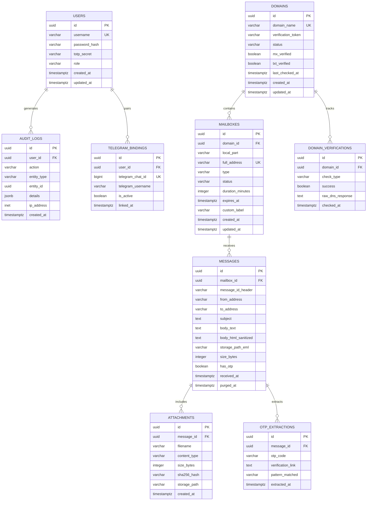

# Database Schema & Entity Relationship (PostgreSQL 16)

| Status | Versi | Tanggal | Penulis | Dokumen Terkait |
| --- | --- | --- | --- | --- |
| PROPOSED | 0.1 | 2026-11-15 | omp-orchestrator/TechSpec | `docs/03-architecture/adr/ADR-005.md`<br>`docs/04-technical/api/openapi.yaml`<br>`docs/02-requirements/srs.md` |

---

## 1. Ikhtisar Skema Basis Data
Basis data DomiBox menggunakan **PostgreSQL 16** dengan skema relasional yang dioptimalkan untuk integritas data, performa kueri berkecepatan tinggi, dan otomatisasi retensi/pembersihan (*auto-purge*).

Semua waktu dicatat dalam format `TIMESTAMPTZ` (UTC). Kunci utama (*primary key*) menggunakan `UUID v7` atau `UUID v4` untuk menghindari tabrakan konkurensi.

---

## 2. Diagram Entitas Relasi (ERD - Mermaid)



---

## 3. Definisi Tabel DDL (Data Definition Language)

```sql
-- Ekstensi UUID
CREATE EXTENSION IF NOT EXISTS "uuid-ossp";

-- 1. Tabel Users (Single-Owner Admin)
CREATE TABLE users (
    id UUID PRIMARY KEY DEFAULT gen_random_uuid(),
    username VARCHAR(64) NOT NULL UNIQUE,
    password_hash VARCHAR(255) NOT NULL,
    totp_secret VARCHAR(128) NULL,
    role VARCHAR(32) NOT NULL DEFAULT 'OWNER',
    created_at TIMESTAMPTZ NOT NULL DEFAULT CURRENT_TIMESTAMP,
    updated_at TIMESTAMPTZ NOT NULL DEFAULT CURRENT_TIMESTAMP
);

-- 2. Tabel Domains
CREATE TABLE domains (
    id UUID PRIMARY KEY DEFAULT gen_random_uuid(),
    domain_name VARCHAR(255) NOT NULL UNIQUE,
    verification_token VARCHAR(128) NOT NULL,
    status VARCHAR(32) NOT NULL DEFAULT 'PENDING_VERIFICATION',
    mx_verified BOOLEAN NOT NULL DEFAULT FALSE,
    txt_verified BOOLEAN NOT NULL DEFAULT FALSE,
    last_checked_at TIMESTAMPTZ NULL,
    created_at TIMESTAMPTZ NOT NULL DEFAULT CURRENT_TIMESTAMP,
    updated_at TIMESTAMPTZ NOT NULL DEFAULT CURRENT_TIMESTAMP
);

CREATE INDEX idx_domains_status ON domains(status);

-- 3. Tabel Mailboxes
CREATE TABLE mailboxes (
    id UUID PRIMARY KEY DEFAULT gen_random_uuid(),
    domain_id UUID NOT NULL REFERENCES domains(id) ON DELETE CASCADE,
    local_part VARCHAR(128) NOT NULL,
    full_address VARCHAR(384) NOT NULL UNIQUE,
    type VARCHAR(32) NOT NULL DEFAULT 'temporary', -- 'temporary' atau 'permanent'
    status VARCHAR(32) NOT NULL DEFAULT 'active',   -- 'active', 'expired', 'suspended'
    duration_minutes INTEGER NOT NULL DEFAULT 60,
    expires_at TIMESTAMPTZ NULL,
    custom_label VARCHAR(255) NULL,
    created_at TIMESTAMPTZ NOT NULL DEFAULT CURRENT_TIMESTAMP,
    updated_at TIMESTAMPTZ NOT NULL DEFAULT CURRENT_TIMESTAMP
);

CREATE INDEX idx_mailboxes_expires_at ON mailboxes(expires_at) WHERE status = 'active';
CREATE INDEX idx_mailboxes_domain_id ON mailboxes(domain_id);
CREATE INDEX idx_mailboxes_full_address ON mailboxes(full_address);

-- 4. Tabel Messages
CREATE TABLE messages (
    id UUID PRIMARY KEY DEFAULT gen_random_uuid(),
    mailbox_id UUID NOT NULL REFERENCES mailboxes(id) ON DELETE CASCADE,
    message_id_header VARCHAR(512) NULL,
    from_address VARCHAR(384) NOT NULL,
    to_address VARCHAR(384) NOT NULL,
    subject TEXT NULL,
    body_text TEXT NULL,
    body_html_sanitized TEXT NULL,
    storage_path_eml VARCHAR(512) NULL,
    size_bytes INTEGER NOT NULL DEFAULT 0,
    has_otp BOOLEAN NOT NULL DEFAULT FALSE,
    received_at TIMESTAMPTZ NOT NULL DEFAULT CURRENT_TIMESTAMP,
    purged_at TIMESTAMPTZ NULL
);

CREATE INDEX idx_messages_mailbox_id ON messages(mailbox_id);
CREATE INDEX idx_messages_received_at ON messages(received_at DESC);
CREATE INDEX idx_messages_has_otp ON messages(has_otp) WHERE has_otp = TRUE;

-- 5. Tabel OTP Extractions
CREATE TABLE otp_extractions (
    id UUID PRIMARY KEY DEFAULT gen_random_uuid(),
    message_id UUID NOT NULL REFERENCES messages(id) ON DELETE CASCADE,
    otp_code VARCHAR(32) NULL,
    verification_link TEXT NULL,
    pattern_matched VARCHAR(64) NULL,
    extracted_at TIMESTAMPTZ NOT NULL DEFAULT CURRENT_TIMESTAMP
);

CREATE INDEX idx_otp_message_id ON otp_extractions(message_id);

-- 6. Tabel Telegram Bindings
CREATE TABLE telegram_bindings (
    id UUID PRIMARY KEY DEFAULT gen_random_uuid(),
    user_id UUID NOT NULL REFERENCES users(id) ON DELETE CASCADE,
    telegram_chat_id BIGINT NOT NULL UNIQUE,
    telegram_username VARCHAR(128) NULL,
    pairing_code VARCHAR(32) NULL,
    is_active BOOLEAN NOT NULL DEFAULT TRUE,
    linked_at TIMESTAMPTZ NOT NULL DEFAULT CURRENT_TIMESTAMP
);

-- 7. Tabel Audit Logs
CREATE TABLE audit_logs (
    id UUID PRIMARY KEY DEFAULT gen_random_uuid(),
    user_id UUID NULL REFERENCES users(id) ON DELETE SET NULL,
    action VARCHAR(64) NOT NULL,
    entity_type VARCHAR(64) NOT NULL,
    entity_id UUID NULL,
    details JSONB NULL,
    ip_address INET NULL,
    created_at TIMESTAMPTZ NOT NULL DEFAULT CURRENT_TIMESTAMP
);

CREATE INDEX idx_audit_logs_created_at ON audit_logs(created_at DESC);
CREATE INDEX idx_audit_logs_action ON audit_logs(action);
```
