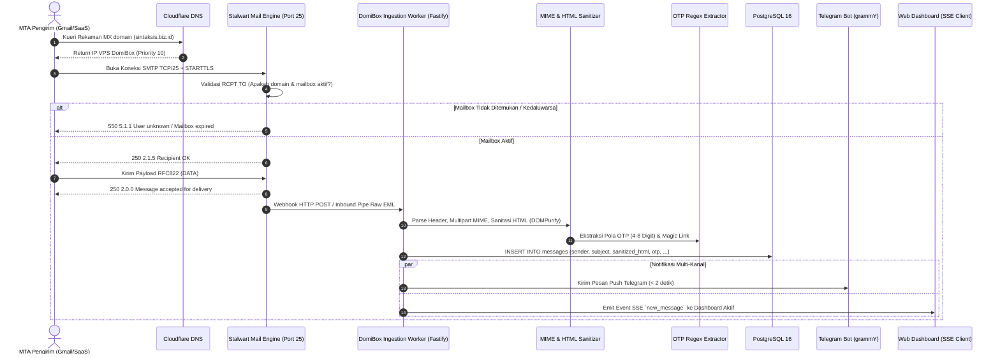

# Mail Flow & Ingestion Pipeline Specification — DomiBox Platform

| Status | Versi | Tanggal | Penulis | Dokumen Terkait |
| --- | --- | --- | --- | --- |
| PROPOSED | 0.1 | 2026-11-15 | omp-orchestrator/TechSpec | `docs/02-requirements/functional-specs/03-inbox-management.md` `docs/03-architecture/diagrams/email-flow-sequence.md` `docs/03-architecture/adr/ADR-002.md` `docs/03-architecture/adr/ADR-010.md` |

---

## 1. Arsitektur Alur Surat Masuk (Inbound Mail Architecture)
Platform DomiBox beroperasi dalam mode **Inbound-Only** pada fase MVP (`A-001`, `Q-003`). Email masuk diarahkan ke server melalui rekaman DNS MX domain kustom yang menunjuk langsung ke alamat IP publik VPS Tencent Cloud (`vps-tencent3b`, Port 25 inbound).

---

## 2. Diagram Pipeline Pemrosesan Email (Mermaid)

---

## 3. Langkah-Langkah Validasi & Keamanan Inbound
1. **Validasi RCPT TO di Edge MTA:** Stalwart memvalidasi alamat penerima terhadap daftar alias aktif via kueri internal/webhook. Email untuk alamat yang telah kedaluwarsa atau tidak terdaftar langsung ditolak dengan kode SMTP 550 (`F4`, `MBX-005`).
2. **Evaluasi Otentikasi Email (`SEC-004`):**
   - SPF (*Sender Policy Framework*) dievaluasi terhadap IP pengirim.
   - DKIM (*DomainKeys Identified Mail*) diverifikasi menggunakan public key pengirim.
   - DMARC dievaluasi dan status dicatat pada kolom `spf_status`, `dkim_status`, `dmarc_status`.
3. **Penyimpanan Raw EML Terbatas:** Berkas mentah disimpan sementara pada volume lokal Docker `mail_spool` dan akan dihapus saat mailbox kedaluwarsa (`MBX-005`).
